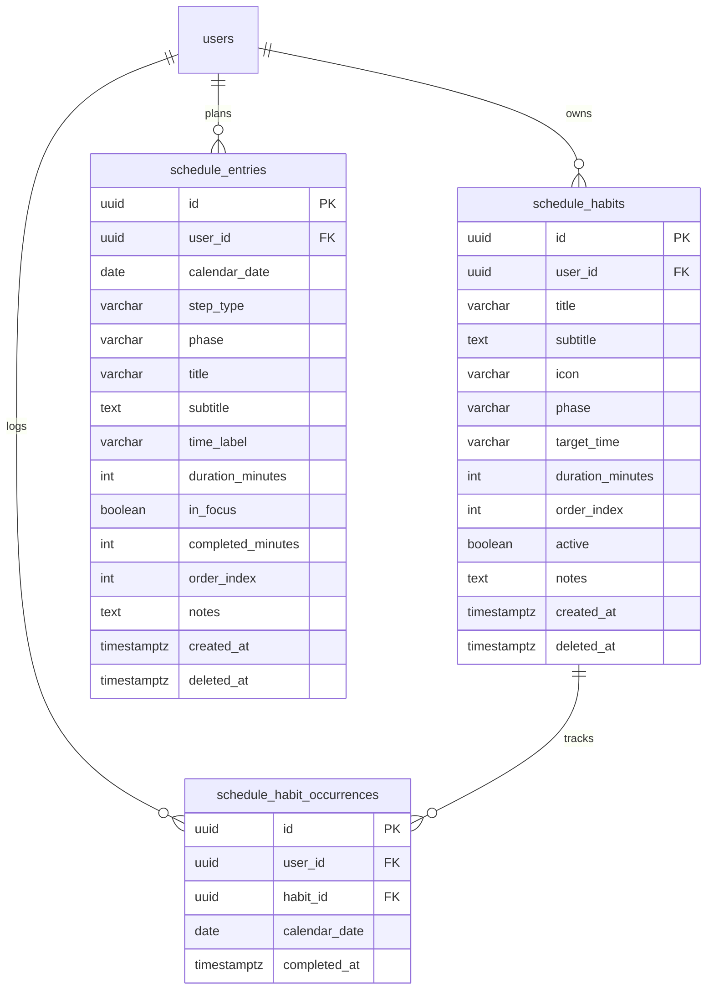

# Plan 010: Backend Vertical Slice — Daily Schedule Link-Map & Habit Tracker

## Status

Approved (Implemented and Verified via Multi-Agent Swarm)

## Specification

### Primary Behavioral Source of Truth

- [daily-schedule-linkmap.md](file:///Users/metamartin/Documents/RoutMartin/productivity-os/docs/specs/planning/daily-schedule-linkmap.md) (Approved)

### Supporting Decisions & Architectural Guidelines

- **ADR-002: Technology Stack** (Spring Boot 3, Kotlin 1.9+, PostgreSQL, REST API)
- **ADR-003: Database Persistence** (Flyway migrations, `timestamptz` instants, user-scoped foreign keys, soft-deletes)
- **ADR-004: Authentication and User Isolation** (Stateless JWT, `CurrentUser.id()` security context, zero cross-user visibility)
- **ADR-005: API Architecture** (REST `/api/v1`, resource-oriented URIs, thin controllers, structured error model)
- **ADR-006: Time and Timezone Handling** (`LocalDate` for calendar days, user-profile IANA timezone via `UserTimezoneService`, injectable `Clock`)
- **ADR-007: Package and Module Layout** (`com.productivityos.schedule` with `controller/`, `service/`, `domain/`, `persistence/`, `dto/`, `exception/`)

### Frontend Context & Alignment

- Web Client: [scheduleStore.ts](file:///Users/metamartin/Documents/RoutMartin/productivity-os/apps/web/src/features/planning/scheduleStore.ts) & [types.ts](file:///Users/metamartin/Documents/RoutMartin/productivity-os/apps/web/src/features/planning/types.ts)
- iOS Client: [Schedule.swift](file:///Users/metamartin/Documents/RoutMartin/productivity-os/apps/ios/ProductivityOS/Models/Schedule.swift) & [ScheduleService.swift](file:///Users/metamartin/Documents/RoutMartin/productivity-os/apps/ios/ProductivityOS/Core/Services/ScheduleService.swift)
- Prior Plans: [008-daily-schedule-linkmap.md](file:///Users/metamartin/Documents/RoutMartin/productivity-os/docs/plans/008-daily-schedule-linkmap.md) (Web) and [009-ios-daily-schedule-linkmap.md](file:///Users/metamartin/Documents/RoutMartin/productivity-os/docs/plans/009-ios-daily-schedule-linkmap.md) (iOS)

---

## Acceptance Criteria (Backend Vertical Slice)

### AC-B01: Unified Schedule Graph Retrieval (`GET /api/v1/schedule/{date}`)
- **Given** an authenticated user and a valid calendar date `YYYY-MM-DD`,
- **When** the client sends `GET /api/v1/schedule/{date}`,
- **Then** the server responds with `200 OK` and a `ScheduleGraphResponse` body,
- **And** the payload contains circadian anchors (Wake `06:30`, Bedtime `22:30`), four standard phases (`morning`, `deep-focus`, `afternoon`, `bedtime`), habit nodes, activity nodes, recharge nodes, and topological connecting edges,
- **And** all returned data is strictly scoped to the authenticated user's ID.

### AC-B02: Baseline Blueprint Auto-Seeding (Spec AC-009)
- **Given** an authenticated user who has no existing habits or schedule records,
- **When** the user accesses `GET /api/v1/schedule/{date}` for the first time,
- **Then** the service seeds a standard 5-habit baseline routine (`Hydration & Mineral Salts`, `Zone 2 Cardio & Mobility`, `Cold Rinse & Grooming`, `Daily Top 3 Planning`, `Evening Wind-Down`) in `schedule_habits`,
- **And** returns a populated 16-node circadian graph with zero initial completions.

### AC-B03: Habit Completion Toggle & Streak Increment (Spec AC-002, AC-005)
- **Given** an incomplete habit node on calendar date `D` belonging to the authenticated user,
- **When** the client sends `POST /api/v1/schedule/habits/{id}/toggle` with `{ "date": "D" }`,
- **Then** a completion record is inserted into `schedule_habit_occurrences` with the current UTC instant,
- **And** the habit's consecutive daily streak count increments by 1,
- **And** the 14-day history array reflects `completed = true` for date `D`,
- **And** outgoing edges from this habit node are marked `active = true`,
- **And** the projected bedtime overflow minutes are recalculated and returned.

### AC-B04: Habit Uncheck / Reversal & Streak Rollback
- **Given** a habit node that is currently marked completed on calendar date `D`,
- **When** the client sends `POST /api/v1/schedule/habits/{id}/toggle` with `{ "date": "D" }` again,
- **Then** the occurrence record for `(user_id, habit_id, date)` is deleted,
- **And** the habit's streak count decrements by 1 (restoring the previous streak),
- **And** the 14-day history entry for date `D` reflects `completed = false`,
- **And** outgoing edges from this habit node are marked `active = false`,
- **And** historical completion records for prior dates remain unaffected.

### AC-B05: Dynamic Bedtime & Overflow Recalculation (Spec AC-004)
- **Given** a daily schedule graph on date `D` with pending habits and incomplete activity blocks,
- **When** the graph is retrieved or a habit is toggled,
- **Then** the overflow minutes are calculated as:
  $$\text{overflowMinutes} = \min(45, (\text{pendingHabits} + \text{incompleteActivities}) \times 15)$$
- **And** `projectedBedtime` is formatted as target bedtime plus overflow (e.g., `22:30` + 45m = `23:15`),
- **And** the Bedtime Anchor node reports matching `projectedTime` and `overflowMinutes`.

### AC-B06: In-Line Step Creation (Spec AC-007)
- **Given** an authenticated user and a target phase on calendar date `D`,
- **When** the client sends `POST /api/v1/schedule/steps` with `{ "date": "D", "phase": "deep-focus", "type": "task", "title": "API Implementation", "durationMinutes": 60 }`,
- **Then** a new record is saved in `schedule_entries` with an auto-assigned order index,
- **And** the server responds with `201 Created` and a `ScheduleNodeDTO` payload with `Location: /api/v1/schedule/steps/{id}`,
- **And** subsequent schedule graph fetches include the new node seamlessly rewired into the edge topology.

### AC-B07: Node Deletion from Schedule (Spec AC-008)
- **Given** an existing custom step or activity in `schedule_entries` with ID `{id}`,
- **When** the client sends `DELETE /api/v1/schedule/steps/{id}`,
- **Then** the record is soft-deleted (`deleted_at = now()`),
- **And** adjacent incoming and outgoing edges in the graph bridge cleanly without orphaned links,
- **And** the server responds with `204 No Content`.

### AC-B08: Anchor Node Deletion Invariant Guard
- **Given** an anchor node ID (e.g. `anchor-wake` or `anchor-bedtime`),
- **When** the client attempts `DELETE /api/v1/schedule/steps/{id}`,
- **Then** the server rejects the request with `400 Bad Request` (`code = "ANCHOR_DELETION_NOT_ALLOWED"`),
- **And** circadian anchor milestones remain permanently intact.

### AC-B09: Strict User Isolation (ADR-004)
- **Given** User A and User B,
- **When** User A attempts to toggle or delete a habit or step owned by User B,
- **Then** the server responds with `404 Not Found` without disclosing the resource's existence,
- **And** User B's occurrences and schedule records remain completely unmodified.

### AC-B10: 14-Day Consistency History Array Generation (Spec AC-006)
- **Given** a habit with occurrences logged across various dates,
- **When** `GET /api/v1/schedule/{date}` or `toggle` is executed,
- **Then** every habit node includes a `history` list of exactly 14 consecutive `HabitStreakDayDTO` entries ending on `{date}`,
- **And** each entry accurately reflects `completed = true` or `false` based on persisted occurrences for that calendar date in the user's timezone.

---

## Architecture

### 1. Autonomous Domain Model

Per the approved specification and ADR-007, the Schedule module is fully autonomous and decoupled from Task Management, Daily Top 3, and Focus Sessions:

```
┌────────────────────────────────────────────────────────────────────────┐
│                   com.productivityos.schedule                          │
│                                                                        │
│   controller/                                                          │
│   └── ScheduleController.kt (REST /api/v1/schedule)                    │
│                                                                        │
│   service/                                                             │
│   ├── ScheduleService.kt (Orchestration, Blueprint seeding, CRUD)      │
│   ├── BedtimeProjectionEngine.kt (Overflow minutes & ETA calculation)  │
│   └── HabitStreakCalculator.kt (Consecutive streaks & 14-day history)  │
│                                                                        │
│   domain/                                                              │
│   ├── ScheduleGraph.kt, ScheduleNode.kt, ScheduleEdge.kt               │
│   ├── SchedulePhase.kt, HabitStreakDay.kt                              │
│   └── ScheduleNodeType.kt, ScheduleEdgeType.kt, SchedulePhaseId.kt     │
│                                                                        │
│   persistence/                                                         │
│   ├── ScheduleHabitEntity.kt & ScheduleHabitRepository.kt             │
│   ├── ScheduleHabitOccurrenceEntity.kt & OccurrenceRepository.kt       │
│   └── ScheduleEntryEntity.kt & ScheduleEntryRepository.kt             │
│                                                                        │
│   dto/                                                                 │
│   ├── ScheduleGraphResponse.kt, ScheduleNodeDTO.kt, ScheduleEdgeDTO.kt │
│   ├── ToggleHabitRequest.kt, ToggleHabitResponse.kt                    │
│   └── AddScheduleStepRequest.kt                                        │
│                                                                        │
│   exception/                                                           │
│   ├── ScheduleNodeNotFoundException.kt                                 │
│   └── AnchorDeletionNotAllowedException.kt                             │
└───────────────────────────────────┬────────────────────────────────────┘
                                    │ consumes UserTimezoneService
                                    ▼
┌────────────────────────────────────────────────────────────────────────┐
│                      com.productivityos.user                           │
│   service/UserTimezoneService.kt (Resolves user ZoneId and LocalDate)  │
└────────────────────────────────────────────────────────────────────────┘
```

### 2. Database Schema (PostgreSQL via Flyway V15)



### 3. Graph Assembly & Topology Engine

When assembling the graph for calendar date `D`:
1. **Circadian Anchors:** Injected automatically (Wake Anchor `06:30`, Bedtime Target `22:30`).
2. **Four Standard Phases:**
   - `morning`: Morning Activation (`06:30 – 09:00`, tone: `warning`)
   - `deep-focus`: Deep Focus Work (`09:00 – 12:30`, tone: `accent`)
   - `afternoon`: Afternoon Momentum (`12:30 – 18:00`, tone: `blue`)
   - `bedtime`: Bedtime Sanctuary (`21:00 – 22:30`, tone: `success`)
3. **Nodes Assembly:**
   - Active `schedule_habits` for user, joined with `schedule_habit_occurrences` for date `D`.
   - Active `schedule_entries` for `(user_id, calendar_date)` where `deleted_at IS NULL`.
   - Node attributes include computed streaks, 14-day history array, active execution flags, and category metadata.
4. **Edge Wiring:**
   - Nodes are ordered chronologically by `phase` and `order_index`.
   - Consecutive nodes within a phase link with `type = sequential`.
   - Consecutive habits in the morning or bedtime stacks link with `type = prerequisite`.
   - Phase boundary connectors link with `type = phase`.
   - Outgoing edges from completed habits are marked `active = true` (Spec AC-005).
5. **Bedtime Projection Engine:**
   - Counts pending habits and incomplete activity blocks.
   - Computes overflow minutes: `min(45, (pendingHabits + incompleteActivities) * 15)`.
   - Formats `projectedBedtime` and attaches overflow delta to Bedtime terminus node.

---

## Step 1 — Database Migration (`V15__habits_and_schedule.sql`)

- **File:** `apps/api/src/main/resources/db/migration/V15__habits_and_schedule.sql`
- **Spec/AC:** AC-B01, AC-B03, AC-B06, AC-B07, AC-B09.
- **Scope:**
  - Create `schedule_habits` table storing recurring habits with user isolation.
  - Create `schedule_habit_occurrences` table recording completion per user, habit, and calendar date.
  - Create `schedule_entries` table recording day-specific custom steps/activities.
  - Apply foreign keys with `ON DELETE CASCADE` referencing `users(id)`.
  - Add partial unique indexes for user isolation and fast date lookups:
    - `idx_sho_user_habit_date_unique`: `UNIQUE (user_id, habit_id, calendar_date)`
    - `idx_schedule_habits_user_active`: `(user_id, phase) WHERE deleted_at IS NULL`
    - `idx_schedule_entries_user_date`: `(user_id, calendar_date) WHERE deleted_at IS NULL`

### Migration DDL Definition

```sql
-- V15: Daily Schedule Link-Map and Habit Tracker
-- Spec: docs/specs/planning/daily-schedule-linkmap.md
-- ADRs: ADR-003 (Persistence), ADR-004 (User Isolation), ADR-006 (Timezones)

CREATE TABLE schedule_habits (
    id UUID PRIMARY KEY DEFAULT gen_random_uuid(),
    user_id UUID NOT NULL REFERENCES users(id) ON DELETE CASCADE,
    title VARCHAR(255) NOT NULL,
    subtitle TEXT,
    icon VARCHAR(64) NOT NULL DEFAULT 'sun.max',
    phase VARCHAR(32) NOT NULL,
    target_time VARCHAR(8),
    duration_minutes INT NOT NULL DEFAULT 15 CHECK (duration_minutes > 0),
    order_index INT NOT NULL DEFAULT 0,
    active BOOLEAN NOT NULL DEFAULT TRUE,
    notes TEXT,
    created_at TIMESTAMPTZ NOT NULL DEFAULT now(),
    deleted_at TIMESTAMPTZ
);

CREATE INDEX idx_schedule_habits_user_id ON schedule_habits (user_id);
CREATE INDEX idx_schedule_habits_user_active ON schedule_habits (user_id, phase) WHERE deleted_at IS NULL;

CREATE TABLE schedule_habit_occurrences (
    id UUID PRIMARY KEY DEFAULT gen_random_uuid(),
    user_id UUID NOT NULL REFERENCES users(id) ON DELETE CASCADE,
    habit_id UUID NOT NULL REFERENCES schedule_habits(id) ON DELETE CASCADE,
    calendar_date DATE NOT NULL,
    completed_at TIMESTAMPTZ NOT NULL DEFAULT now(),
    CONSTRAINT uq_habit_occurrence_user_habit_date UNIQUE (user_id, habit_id, calendar_date)
);

CREATE INDEX idx_sho_user_date ON schedule_habit_occurrences (user_id, calendar_date);
CREATE INDEX idx_sho_habit_date ON schedule_habit_occurrences (habit_id, calendar_date);

CREATE TABLE schedule_entries (
    id UUID PRIMARY KEY DEFAULT gen_random_uuid(),
    user_id UUID NOT NULL REFERENCES users(id) ON DELETE CASCADE,
    calendar_date DATE NOT NULL,
    step_type VARCHAR(32) NOT NULL,
    phase VARCHAR(32) NOT NULL,
    title VARCHAR(255) NOT NULL,
    subtitle TEXT,
    time_label VARCHAR(32),
    duration_minutes INT NOT NULL DEFAULT 30 CHECK (duration_minutes >= 0),
    in_focus BOOLEAN NOT NULL DEFAULT FALSE,
    completed_minutes INT NOT NULL DEFAULT 0 CHECK (completed_minutes >= 0),
    order_index INT NOT NULL DEFAULT 0,
    notes TEXT,
    created_at TIMESTAMPTZ NOT NULL DEFAULT now(),
    deleted_at TIMESTAMPTZ
);

CREATE INDEX idx_schedule_entries_user_date ON schedule_entries (user_id, calendar_date) WHERE deleted_at IS NULL;
```

---

## Step 2 — Persistence Layer (Entities & Repositories)

- **Files:**
  - `apps/api/src/main/kotlin/com/productivityos/schedule/persistence/ScheduleHabitEntity.kt`
  - `apps/api/src/main/kotlin/com/productivityos/schedule/persistence/ScheduleHabitRepository.kt`
  - `apps/api/src/main/kotlin/com/productivityos/schedule/persistence/ScheduleHabitOccurrenceEntity.kt`
  - `apps/api/src/main/kotlin/com/productivityos/schedule/persistence/ScheduleHabitOccurrenceRepository.kt`
  - `apps/api/src/main/kotlin/com/productivityos/schedule/persistence/ScheduleEntryEntity.kt`
  - `apps/api/src/main/kotlin/com/productivityos/schedule/persistence/ScheduleEntryRepository.kt`
- **Spec/AC:** AC-B01, AC-B03, AC-B04, AC-B06, AC-B07, AC-B09.
- **Scope:**
  - Implement JPA entities adhering to ADR-007 (`*Entity` suffix, `toDomain()` or entity mapping).
  - Implement Spring Data JPA repositories with strict user-scoping:
    - `ScheduleHabitRepository`:
      - `findByUserIdAndDeletedAtIsNullOrderByOrderIndexAsc(userId: UUID): List<ScheduleHabitEntity>`
      - `findByIdAndUserIdAndDeletedAtIsNull(id: UUID, userId: UUID): Optional<ScheduleHabitEntity>`
      - `countByUserIdAndDeletedAtIsNull(userId: UUID): Long`
    - `ScheduleHabitOccurrenceRepository`:
      - `findByUserIdAndCalendarDate(userId: UUID, date: LocalDate): List<ScheduleHabitOccurrenceEntity>`
      - `findByUserIdAndHabitIdAndCalendarDate(userId: UUID, habitId: UUID, date: LocalDate): Optional<ScheduleHabitOccurrenceEntity>`
      - `findByUserIdAndHabitIdAndCalendarDateBetween(userId: UUID, habitId: UUID, fromDate: LocalDate, toDate: LocalDate): List<ScheduleHabitOccurrenceEntity>`
      - `deleteByUserIdAndHabitIdAndCalendarDate(userId: UUID, habitId: UUID, date: LocalDate): Int`
    - `ScheduleEntryRepository`:
      - `findByUserIdAndCalendarDateAndDeletedAtIsNullOrderByOrderIndexAsc(userId: UUID, date: LocalDate): List<ScheduleEntryEntity>`
      - `findByIdAndUserIdAndDeletedAtIsNull(id: UUID, userId: UUID): Optional<ScheduleEntryEntity>`

---

## Step 3 — Domain Engine & Pure Calculation Components

- **Files:**
  - `apps/api/src/main/kotlin/com/productivityos/schedule/domain/ScheduleGraph.kt`
  - `apps/api/src/main/kotlin/com/productivityos/schedule/domain/ScheduleNode.kt`
  - `apps/api/src/main/kotlin/com/productivityos/schedule/domain/ScheduleEdge.kt`
  - `apps/api/src/main/kotlin/com/productivityos/schedule/domain/SchedulePhase.kt`
  - `apps/api/src/main/kotlin/com/productivityos/schedule/domain/HabitStreakDay.kt`
  - `apps/api/src/main/kotlin/com/productivityos/schedule/domain/ScheduleEnums.kt` (`ScheduleNodeType`, `ScheduleEdgeType`, `SchedulePhaseId`)
  - `apps/api/src/main/kotlin/com/productivityos/schedule/service/BedtimeProjectionEngine.kt`
  - `apps/api/src/main/kotlin/com/productivityos/schedule/service/HabitStreakCalculator.kt`
- **Spec/AC:** AC-B03, AC-B04, AC-B05, AC-B10.
- **Scope:**
  - Pure domain data classes adhering to ADR-007 (pure Kotlin, no framework dependencies in `domain`).
  - `BedtimeProjectionEngine`:
    - Pure math calculation: `calculateOverflow(pendingHabits: Int, incompleteActivities: Int): Int`
    - Formats projected bedtime: `calculateProjectedTime(targetBedtime: String, overflowMinutes: Int): String`
  - `HabitStreakCalculator`:
    - Calculates consecutive streak count backwards from current date.
    - Generates 14-day consistency matrix ending on `currentDate`:
      `generate14DayHistory(occurrences: Set<LocalDate>, anchorDate: LocalDate): List<HabitStreakDay>`

---

## Step 4 — DTO Contracts & Validation Models

- **Files:**
  - `apps/api/src/main/kotlin/com/productivityos/schedule/dto/ScheduleGraphResponse.kt`
  - `apps/api/src/main/kotlin/com/productivityos/schedule/dto/ScheduleNodeDTO.kt`
  - `apps/api/src/main/kotlin/com/productivityos/schedule/dto/ScheduleEdgeDTO.kt`
  - `apps/api/src/main/kotlin/com/productivityos/schedule/dto/SchedulePhaseDTO.kt`
  - `apps/api/src/main/kotlin/com/productivityos/schedule/dto/HabitStreakDayDTO.kt`
  - `apps/api/src/main/kotlin/com/productivityos/schedule/dto/ToggleHabitRequest.kt`
  - `apps/api/src/main/kotlin/com/productivityos/schedule/dto/ToggleHabitResponse.kt`
  - `apps/api/src/main/kotlin/com/productivityos/schedule/dto/AddScheduleStepRequest.kt`
- **Spec/AC:** AC-B01, AC-B03, AC-B06.
- **Scope:**
  - Full parity with frontend contracts defined in `apps/web/src/features/planning/types.ts` and `apps/ios/ProductivityOS/Models/Schedule.swift`.
  - Jakarta validation constraints (`@field:NotBlank`, `@field:Min`, `@field:Pattern`) for boundary validation per ADR-005.

### DTO Signatures

```kotlin
data class ScheduleGraphResponse(
    val date: String,
    val wakeTime: String,
    val targetBedtime: String,
    val projectedBedtime: String,
    val overflowMinutes: Int,
    val phases: List<SchedulePhaseDTO>,
    val nodes: List<ScheduleNodeDTO>,
    val edges: List<ScheduleEdgeDTO>
)

data class ToggleHabitRequest(
    val date: LocalDate? = null
)

data class ToggleHabitResponse(
    val habitId: UUID,
    val completed: Boolean,
    val streak: Int,
    val history: List<HabitStreakDayDTO>,
    val updatedEdges: List<ScheduleEdgeDTO>,
    val projectedBedtime: String,
    val overflowMinutes: Int
)

data class AddScheduleStepRequest(
    val date: LocalDate? = null,
    @field:NotBlank val phase: String,
    @field:NotBlank val type: String,
    @field:NotBlank val title: String,
    val subtitle: String? = null,
    val timeSlot: String? = null,
    val durationMinutes: Int? = null,
    val iconName: String? = null
)
```

---

## Step 5 — Application Service (`ScheduleService`)

- **File:** `apps/api/src/main/kotlin/com/productivityos/schedule/service/ScheduleService.kt`
- **Spec/AC:** AC-B01 through AC-B10.
- **Scope:**
  - `@Service @Transactional` orchestrator:
    - `getSchedule(userId: UUID, date: LocalDate): ScheduleGraphResponse`:
      - Checks if user has any habits; if none, calls `seedDefaultBlueprint(userId)`.
      - Fetches active habits, habit occurrences for `date` and historical window `[date - 30 days, date]`.
      - Fetches custom schedule entries for `(userId, date)`.
      - Computes streaks and 14-day history for each habit.
      - Assembles nodes and re-wires directional edges (`sequential`, `prerequisite`, `phase`).
      - Evaluates pending items and computes bedtime overflow and projected ETA.
    - `toggleHabit(userId: UUID, habitId: UUID, date: LocalDate): ToggleHabitResponse`:
      - Validates habit exists and belongs to `userId` (throws `ScheduleNodeNotFoundException` if not found).
      - Checks existing occurrence:
        - If present: deletes occurrence (reversal).
        - If absent: saves new `ScheduleHabitOccurrenceEntity(completedAt = clock.instant())`.
      - Recomputes streak and 14-day history.
      - Determines outgoing edges active status.
      - Recalculates projected bedtime and returns `ToggleHabitResponse`.
    - `addStep(userId: UUID, request: AddScheduleStepRequest): ScheduleNodeDTO`:
      - Resolves target calendar date (defaults to `today(userId)` if null).
      - Validates phase is one of `morning`, `deep-focus`, `afternoon`, `bedtime`.
      - If type is `habit`: creates new `ScheduleHabitEntity`.
      - If type is `task` or `recharge`: creates new `ScheduleEntryEntity`.
      - Assigns next `order_index` within phase.
      - Returns mapped `ScheduleNodeDTO`.
    - `deleteStep(userId: UUID, stepId: String): Unit`:
      - Rejects if `stepId` is an anchor (throws `AnchorDeletionNotAllowedException`).
      - Parses UUID and queries `schedule_entries`:
        - If found: sets `deletedAt = clock.instant()`, saves.
      - If not found in entries, queries `schedule_habits`:
        - If found: sets `deletedAt = clock.instant()`, saves.
      - If neither: throws `ScheduleNodeNotFoundException`.
    - `seedDefaultBlueprint(userId: UUID)`:
      - Inserts the 5 baseline circadian habits with default duration and order indices.

---

## Step 6 — REST Controller & Exception Handling (`ScheduleController`)

- **Files:**
  - `apps/api/src/main/kotlin/com/productivityos/schedule/controller/ScheduleController.kt`
  - `apps/api/src/main/kotlin/com/productivityos/schedule/exception/ScheduleExceptions.kt`
  - `apps/api/src/main/kotlin/com/productivityos/api/GlobalExceptionHandler.kt` (update)
- **Spec/AC:** AC-B01, AC-B03, AC-B06, AC-B07, AC-B08, AC-B09.
- **Scope:**
  - Thin controller annotated with `@RestController`, `@RequestMapping("/api/v1/schedule")`, `@Tag(name = "Daily Schedule")`.
  - Injects `CurrentUser` and `UserTimezoneService`.
  - Endpoints:
    - `GET /api/v1/schedule/{date}`: returns `ScheduleGraphResponse`
    - `POST /api/v1/schedule/habits/{id}/toggle`: accepts `@RequestBody(required = false) ToggleHabitRequest?`, returns `ToggleHabitResponse`
    - `POST /api/v1/schedule/steps`: accepts `@Valid @RequestBody AddScheduleStepRequest`, returns `201 Created` with `Location` header
    - `DELETE /api/v1/schedule/steps/{id}`: returns `204 No Content`
  - Exceptions:
    - `ScheduleNodeNotFoundException`: mapped to `404 Not Found`
    - `AnchorDeletionNotAllowedException`: mapped to `400 Bad Request`

---

## Step 7 — Architecture Boundary Rules (`ArchitectureTest.kt`)

- **File:** `apps/api/src/test/kotlin/com/productivityos/ArchitectureTest.kt`
- **Spec/AC:** ADR-007 compliance.
- **Scope:**
  - Add ArchUnit test verifying module isolation:
    ```kotlin
    @ArchTest
    fun schedule_module_depends_only_on_user_and_shared_packages(classes: JavaClasses) {
        noClasses().that().resideInAPackage("com.productivityos.schedule..")
            .should().dependOnClassesThat().resideInAnyPackage(
                "com.productivityos.task..",
                "com.productivityos.project..",
                "com.productivityos.goal..",
                "com.productivityos.focus..",
                "com.productivityos.dailyplan..",
                "com.productivityos.topthree..",
                "com.productivityos.auth.."
            ).check(classes)
    }
    ```

---

## Tests

### Traceability Matrix

| AC | Step | Test Class | Verification Target |
|---|---|---|---|
| **AC-B01** | Step 5, 6 | `ScheduleControllerTest`, `ScheduleServiceTest` | Unified graph with anchors, 4 phases, nodes, and edges returned |
| **AC-B02** | Step 5 | `ScheduleServiceTest` | Fresh user automatically seeded with 5 baseline blueprint habits |
| **AC-B03** | Step 5, 6 | `ScheduleServiceTest` | Habit completion inserts occurrence, increments streak, illuminates edges |
| **AC-B04** | Step 5, 6 | `ScheduleServiceTest` | Untoggle deletes occurrence, decrements streak, dims outgoing edges |
| **AC-B05** | Step 3, 5 | `BedtimeProjectionEngineTest`, `ScheduleServiceTest` | Overflow formula: `min(45, (pendingHabits + incompleteActivities) * 15)` |
| **AC-B06** | Step 5, 6 | `ScheduleControllerTest`, `ScheduleServiceTest` | In-line step created in `schedule_entries` with 201 Created & Location header |
| **AC-B07** | Step 5, 6 | `ScheduleControllerTest`, `ScheduleServiceTest` | Step soft-deleted (`deleted_at != null`), edges bridged, returns 204 No Content |
| **AC-B08** | Step 5, 6 | `ScheduleControllerTest` | Deleting anchor returns 400 Bad Request (`ANCHOR_DELETION_NOT_ALLOWED`) |
| **AC-B09** | Step 5, 6 | `ScheduleServiceTest` | Cross-user toggle/delete returns 404 without data modification |
| **AC-B10** | Step 3, 5 | `HabitStreakCalculatorTest`, `ScheduleServiceTest` | 14-day history array has exactly 14 items ending on queried date |
| **ADR-007** | Step 7 | `ArchitectureTest` | ArchUnit test confirms Schedule module has zero illegal dependencies |

---

## Verification

### 1. Build and Static Analysis
```bash
./gradlew :apps:api:compileKotlin :apps:api:compileTestKotlin
```

### 2. Architecture & Module Boundary Verification
```bash
./gradlew :apps:api:test --tests "com.productivityos.ArchitectureTest"
```

### 3. Unit and Service Tests
```bash
./gradlew :apps:api:test --tests "com.productivityos.schedule.*"
```

### 4. Full API Test Suite Execution
```bash
./gradlew :apps:api:test
```
