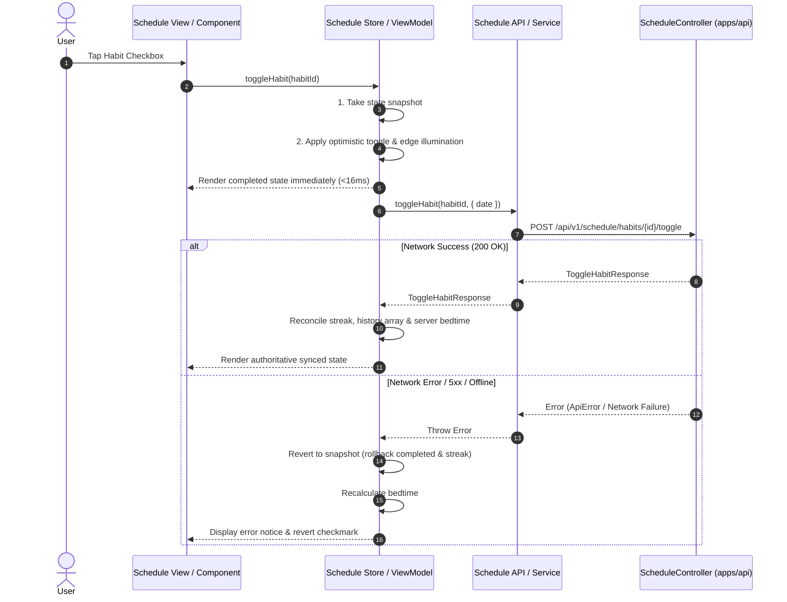

# Plan 011: Client API Integration — Daily Schedule Link-Map & Habit Tracker

## Status

Approved

## Specification

### Primary Behavioral Source of Truth

- [daily-schedule-linkmap.md](file:///Users/metamartin/Documents/RoutMartin/productivity-os/docs/specs/planning/daily-schedule-linkmap.md) (Approved)
- [010-backend-schedule-slice.md](file:///Users/metamartin/Documents/RoutMartin/productivity-os/docs/plans/010-backend-schedule-slice.md) (Approved & Implemented Backend Slice)

### Supporting Decisions & Architectural Guidelines

- **ADR-002: Technology Stack** (Vue 3, Pinia, TypeScript, Vite for `apps/web`; Swift 5.9+, SwiftUI, `@Observable` for `apps/ios`)
- **ADR-004: Authentication and User Isolation** (Stateless Bearer JWT, silent refresh via `/api/v1/auth/refresh`, zero cross-user exposure)
- **ADR-005: API Architecture** (REST `/api/v1`, resource-oriented URIs, structured error model `ApiError`)
- **ADR-006: Time and Timezone Handling** (Dates evaluated in user's configured IANA timezone `YYYY-MM-DD`, no UTC date truncation)
- **ADR-007: Package and Module Layout** (Autonomous Schedule feature domains on both Web and iOS)

---

## Acceptance Criteria (Client Integration Slice)

### AC-C01: Web Schedule Graph Live Fetch & Rendering

- **Given** an authenticated user opens `/schedule` on the web app,
- **When** the schedule store initializes for calendar date `D` in the user's timezone,
- **Then** `scheduleStore.ts` issues `GET /api/v1/schedule/{date}` using `apiClient`,
- **And** the returned `ScheduleGraphResponse` populates `phases`, `nodes`, `edges`, anchors, and bedtime projection,
- **And** the reactive store status transitions from `loading` to `ready`.

### AC-C02: Web Optimistic Habit Toggle with Server Sync

- **Given** an incomplete habit node on the web schedule link-map,
- **When** the user clicks the habit toggle checkbox or button,
- **Then** the UI immediately illuminates the habit, increments streak, illuminates outgoing edges, and updates bedtime projection,
- **And** `scheduleStore.ts` dispatches `POST /api/v1/schedule/habits/{id}/toggle` with `{ "date": "D" }`,
- **And** on a successful `200 OK` response, the store reconciles the habit's streak, 14-day history array, updated edges, and server-calculated bedtime projection.

### AC-C03: Web Habit Toggle Network Failure & Rollback

- **Given** a habit node toggled optimistically on the web schedule graph,
- **When** the network request to `POST /api/v1/schedule/habits/{id}/toggle` fails (e.g. offline, timeout, or 500 error),
- **Then** the store rolls back the habit completion status, streak counter, 14-day history entry, and outgoing edge states to their pre-toggle values,
- **And** the bedtime projection recalculates back to the pre-toggle ETA,
- **And** an error toast or message is recorded without crashing the UI.

### AC-C04: Web In-Line Step Addition & Persistence

- **Given** an authenticated user fills out and submits the `ScheduleAddStepDialog`,
- **When** the form is submitted,
- **Then** `scheduleStore.ts` calls `POST /api/v1/schedule/steps` with `{ phase, type, title, subtitle, durationMinutes, timeSlot, iconName }`,
- **And** on `201 Created`, the newly returned node (with server-generated UUID) is inserted into `graph.nodes`,
- **And** connecting edges in the phase are dynamically rewired and the bedtime projection recalculates immediately.

### AC-C05: Web Node Deletion & Edge Bridging Persistence

- **Given** an existing custom step or habit selected in `ScheduleContextPanel`,
- **When** the user clicks "Delete from Today",
- **Then** `scheduleStore.ts` checks that the node is not an anchor (`anchorKind == null`),
- **And** calls `DELETE /api/v1/schedule/steps/{id}`,
- **And** removes the node from `graph.nodes`, bridges incoming and outgoing edges cleanly, and clears the selection,
- **And** if the server rejects the request, the node and its original edges are restored.

### AC-C06: iOS Schedule Graph Retrieval with Blueprint Fallback

- **Given** the iOS app displays `ScheduleView`,
- **When** `ScheduleViewModel.loadData(date:)` executes,
- **Then** `ScheduleService` sends `GET /api/v1/schedule/{date}` via `APIClient.shared`,
- **And** if the network request succeeds, the `@Observable` graph is populated with the remote payload,
- **And** if the network request fails (offline, connection error), `ScheduleService` falls back gracefully to `createDefaultBlueprint(for: dateString)` so the user can interact with their routine uninterrupted.

### AC-C07: iOS Optimistic Habit Toggle & Server Reconciliation

- **Given** an incomplete habit node displayed on any iOS layout (Spine, Journey, Matrix),
- **When** the user taps the habit completion checkbox,
- **Then** `ScheduleViewModel` optimistically marks the habit completed, increments the streak, lights up outgoing edges, and adjusts bedtime projection,
- **And** invokes `POST /api/v1/schedule/habits/{id}/toggle` asynchronously through `ScheduleService`,
- **And** on success, reconciles the local node with `ToggleHabitResponse` (exact streak, 14-day history matrix, and updated edge states),
- **And** on failure, rolls back the local mutation to its prior state and sets `errorMessage`.

### AC-C08: iOS Step Creation, Deletion & Anchor Protection

- **Given** an authenticated user on the iOS `ScheduleView`,
- **When** the user adds a step via `ScheduleAddStepSheet`,
- **Then** `ScheduleService` dispatches `POST /api/v1/schedule/steps` and the server-returned `ScheduleNode` is inserted into the graph and topological edges rewire,
- **And** when the user deletes a non-anchor step from `ScheduleNodeDetailSheet`, `ScheduleService` dispatches `DELETE /api/v1/schedule/steps/{id}`,
- **And** attempting to delete circadian anchors (`anchor-wake` or `anchor-bedtime`) is blocked by both client validation and backend invariant guard.

---

## Architecture

### 1. Autonomous Client Architecture & Data Flow

Per the approved specification ([daily-schedule-linkmap.md](file:///Users/metamartin/Documents/RoutMartin/productivity-os/docs/specs/planning/daily-schedule-linkmap.md)), Schedule is an **autonomous, self-contained domain**:

- No coupling to external Task backlogs, Daily Top 3, or Focus timer sessions.
- Graph mutations, edge rewiring, and bedtime projections execute natively within the Schedule domain.
- Both Web (`apps/web`) and iOS (`apps/ios`) communicate with the locked Spring Boot REST API (`apps/api/src/main/kotlin/com/productivityos/schedule/controller/ScheduleController.kt`).

```
┌────────────────────────────────────────────────────────────────────────┐
│                        WEB CLIENT (apps/web)                           │
│                                                                        │
│   SchedulePage.vue                                                     │
│   ├── Layouts: ScheduleSpineLayout / JourneyLayout / MatrixLayout      │
│   ├── Nodes: ScheduleHabitNode, ScheduleTaskNode, ScheduleAnchorNode   │
│   └── Dialogs: ScheduleAddStepDialog, ScheduleContextPanel             │
│                                                                        │
│   useScheduleStore (Pinia)                                             │
│   • State: graph, activeLayout, status, selectedNodeId                 │
│   • Actions: load(), toggleHabit(), addStep(), deleteNode()           │
│   • Optimistic state & rollback snapshot management                    │
│                                                                        │
│   scheduleApi (apps/web/src/features/planning/scheduleApi.ts)          │
│   └── apiClient (Bearer JWT, silent refresh, structured ApiError)      │
└───────────────────────────────────┬────────────────────────────────────┘
                                    │ HTTP / REST (/api/v1/schedule)
                                    ▼
┌────────────────────────────────────────────────────────────────────────┐
│                     BACKEND API (apps/api)                             │
│   ScheduleController.kt (/api/v1/schedule)                             │
│   • GET    /api/v1/schedule/{date}                                     │
│   • POST   /api/v1/schedule/habits/{id}/toggle                         │
│   • POST   /api/v1/schedule/steps                                      │
│   • DELETE /api/v1/schedule/steps/{id}                                 │
└───────────────────────────────────▲────────────────────────────────────┘
                                    │ HTTP / REST (/api/v1/schedule)
┌───────────────────────────────────┴────────────────────────────────────┐
│                        iOS CLIENT (apps/ios)                           │
│                                                                        │
│   ScheduleView.swift                                                   │
│   ├── Layouts: ScheduleSpineLayoutView / JourneyLayoutView / Matrix    │
│   └── Sheets: ScheduleAddStepSheet, ScheduleNodeDetailSheet            │
│                                                                        │
│   ScheduleViewModel (@Observable, @MainActor)                          │
│   • State: graph, activeLayout, loadState, selectedNodeId              │
│   • Methods: loadData(), toggleHabit(), addStep(), deleteNode()        │
│   • Optimistic rollback & bedtime projection recalculation             │
│                                                                        │
│   ScheduleService (ScheduleServicing)                                  │
│   • APIClient.shared (URLSession, Bearer token, silent refresh)        │
│   • Graceful fallback to createDefaultBlueprint(for:) on network error │
└────────────────────────────────────────────────────────────────────────┘
```

### 2. Backend API Endpoint Contracts (Locked & Verified)

Verified directly against `apps/api/src/main/kotlin/com/productivityos/schedule/controller/ScheduleController.kt` and `apps/api/src/main/kotlin/com/productivityos/schedule/dto/`:

| Endpoint                              | Method   | Request Payload                                                                                | Response Code                     | Response Body           |
| ------------------------------------- | -------- | ---------------------------------------------------------------------------------------------- | --------------------------------- | ----------------------- |
| `/api/v1/schedule/{date}`             | `GET`    | _None_ (path: `YYYY-MM-DD`)                                                                    | `200 OK`                          | `ScheduleGraphResponse` |
| `/api/v1/schedule/habits/{id}/toggle` | `POST`   | `ToggleHabitRequest` (`date?: LocalDate`)                                                      | `200 OK`                          | `ToggleHabitResponse`   |
| `/api/v1/schedule/steps`              | `POST`   | `AddScheduleStepRequest` (`phase`, `type`, `title`, `durationMinutes`, `timeSlot`, `iconName`) | `201 Created` (`Location` header) | `ScheduleNodeDTO`       |
| `/api/v1/schedule/steps/{id}`         | `DELETE` | _None_                                                                                         | `204 No Content`                  | _Empty_                 |

#### Wire DTO Schemas

```typescript
// Web / REST Schemas
export interface ScheduleGraphResponse {
  date: string;
  wakeTime: string;
  targetBedtime: string;
  projectedBedtime: string;
  overflowMinutes: number;
  phases: SchedulePhaseDTO[];
  nodes: ScheduleNodeDTO[];
  edges: ScheduleEdgeDTO[];
}

export interface ToggleHabitRequest {
  date?: string; // YYYY-MM-DD
}

export interface ToggleHabitResponse {
  habitId: string;
  completed: boolean;
  streak: number;
  history: HabitStreakDayDTO[];
  updatedEdges: ScheduleEdgeDTO[];
  projectedBedtime: string;
  overflowMinutes: number;
}

export interface AddScheduleStepRequest {
  date?: string; // YYYY-MM-DD
  phase: string; // "morning" | "deep-focus" | "afternoon" | "bedtime"
  type: string; // "habit" | "task" | "recharge"
  title: string;
  subtitle?: string;
  timeSlot?: string;
  durationMinutes?: number;
  iconName?: string;
}
```

### 3. Optimistic Updates & Rollback Lifecycle

For habit toggles and step deletions, user latency must be near zero:

1. **Snapshot:** Deep-copy or record affected node/edges state before applying mutation.
2. **Optimistic Application:** Immediate mutation of local reactive state (`completed`, `streak`, `edges.active`, `overflowMinutes`, `projectedBedtime`).
3. **Async Dispatch:** Asynchronous HTTP request sent to backend API.
4. **On Success (`200 OK` / `204 No Content`):** Apply authoritative server values (e.g. 14-day history array, backend-confirmed streak, server bedtime calculation).
5. **On Error (Network / 5xx):** Revert reactive store to the pre-mutation snapshot, recalculate bedtime, and set user error notification.



---

## Step 1 — Web Schedule API Client Module (`apps/web`)

**Status:** pending

- **Files/modules:**
  - `apps/web/src/features/planning/scheduleApi.ts` (new)
- **Spec/AC:** AC-C01, AC-C02, AC-C04, AC-C05
- **Behavior:**
  - Implement typed wrapper functions over `apiClient` (`apps/web/src/lib/api/client.ts`):
    - `getSchedule(date: string): Promise<ScheduleGraphResponse>`
    - `toggleHabit(habitId: string, request?: ToggleHabitRequest): Promise<ToggleHabitResponse>`
    - `addStep(request: AddScheduleStepRequest): Promise<ScheduleNode>`
    - `deleteStep(stepId: string): Promise<void>`
  - Use `todayISODate()` to resolve user's local date when `date` parameter is omitted.
  - Automatically map field aliases (`phaseId` -> `phase`, `totalMinutes` -> `durationMinutes`) to guarantee backend parity.
- **Dependencies:** `apps/web/src/lib/api/client.ts`, `apps/web/src/features/planning/types.ts`.
- **Tests:**
  - Type-checking via `vue-tsc`.
  - Integration verify against mock API client responses.
- **Risks/ambiguities:** Backend expects UUID for `habitId`. The API client must validate or pass the UUID string without modification.

---

## Step 2 — Web Schedule Store Live Wiring & Optimistic Rollback (`apps/web`)

**Status:** pending

- **Files/modules:**
  - `apps/web/src/features/planning/scheduleStore.ts` (edit)
- **Spec/AC:** AC-C01, AC-C02, AC-C03, AC-C04, AC-C05
- **Behavior:**
  - **`load(preview?: PreviewState, date?: string)`**:
    - If `preview` query param exists (`loading`, `error`, `empty`), maintain test harness mock behavior.
    - Otherwise, set `status = 'loading'`, compute `targetDate = date ?? todayISODate()`, and call `scheduleApi.getSchedule(targetDate)`.
    - On success: set `graph.value = response`, calculate bedtime, set `status = 'ready'`.
    - On error: if network error, set `status = 'error'`, record error message, provide fallback gracefully.
  - **`toggleHabit(nodeIdOrHabitId: string)`**:
    - Locate habit node; capture previous values (`completed`, `streak`, `history`, `edges`, `overflow`, `projectedBedtime`).
    - Apply optimistic mutation immediately (flip boolean, adjust streak, illuminate outgoing edges, recalculate bedtime).
    - Asynchronously call `scheduleApi.toggleHabit(habit.habitId ?? habit.id, { date: graph.date })`.
    - If call succeeds: update habit's `streak`, `history`, `updatedEdges`, `overflowMinutes`, and `projectedBedtime` with server response values.
    - If call fails: restore captured previous values and set `errorMessage`.
  - **`addStep(payload: AddStepPayload)`**:
    - Make `addStep` async: call `scheduleApi.addStep(...)`.
    - Upon receiving the `201 Created` server `ScheduleNode`, insert into `graph.value.nodes` at the appropriate phase index.
    - Rewire adjacent edges and recalculate bedtime projection.
    - Return the created `ScheduleNode`.
  - **`deleteNode(nodeId: string)`**:
    - Check invariant: if node is an anchor (`type === 'anchor'`), abort immediately.
    - Capture snapshot of node and connected edges.
    - Optimistically remove node from `nodes`, bridge incoming/outgoing edges, and recalculate bedtime.
    - Call `scheduleApi.deleteStep(nodeId)`.
    - If call fails: restore node and original edges, recalculate bedtime, and set `errorMessage`.
- **Dependencies:** `scheduleApi.ts`.
- **Tests:**
  - Verify optimistic toggle immediately updates state.
  - Verify failed toggle reverts to initial state.
  - Verify `addStep` persists and edge rewiring preserves graph topology.
- **Risks/ambiguities:** None.

---

## Step 3 — Web UI Components Integration & Async Flow (`apps/web`)

**Status:** pending

- **Files/modules:**
  - `apps/web/src/features/planning/components/ScheduleAddStepDialog.vue` (edit)
  - `apps/web/src/features/planning/components/ScheduleContextPanel.vue` (edit)
  - `apps/web/src/pages/SchedulePage.vue` (edit)
- **Spec/AC:** AC-C01, AC-C04, AC-C05
- **Behavior:**
  - In `ScheduleAddStepDialog.vue`:
    - Add `isSubmitting = ref(false)` state.
    - In `handleSubmit()`: await `scheduleStore.addStep(...)` with try/catch, disable submit button and show loading spinner during in-flight request, close dialog on success.
  - In `ScheduleContextPanel.vue`:
    - Add `isDeleting = ref(false)` state.
    - In `handleDelete()`: call `scheduleStore.deleteNode(node.id)`, close the context panel immediately on optimistic delete.
  - In `SchedulePage.vue`:
    - Display error banner or toast notification when `scheduleStore.errorMessage` is populated.
    - Provide a "Retry Connection" action on `isError` state that re-invokes `scheduleStore.load()`.
- **Dependencies:** `scheduleStore.ts`.
- **Tests:**
  - `pnpm run typecheck && pnpm run lint` in `apps/web`.
- **Risks/ambiguities:** None.

---

## Step 4 — iOS Networking Layer: AppEndpoint & DTOs (`apps/ios`)

**Status:** pending

- **Files/modules:**
  - `apps/ios/ProductivityOS/Core/Networking/Endpoint.swift` (edit)
  - `apps/ios/ProductivityOS/Core/Networking/APIDTOs.swift` (edit)
- **Spec/AC:** AC-C06, AC-C07, AC-C08
- **Behavior:**

  - Extend `AppEndpoint`:
    ```swift
    // Daily Schedule (/api/v1/schedule)
    case getSchedule(date: String)
    case toggleHabit(id: UUID, body: Data?)
    case addScheduleStep(body: Data)
    case deleteScheduleStep(id: String)
    ```
  - Map `path`:
    - `.getSchedule(let date)` -> `"/api/v1/schedule/\(date)"`
    - `.toggleHabit(let id, _)` -> `"/api/v1/schedule/habits/\(id.uuidString.lowercased())/toggle"`
    - `.addScheduleStep` -> `"/api/v1/schedule/steps"`
    - `.deleteScheduleStep(let id)` -> `"/api/v1/schedule/steps/\(id)"`
  - Map `method`:
    - `.getSchedule` -> `.get`
    - `.toggleHabit`, `.addScheduleStep` -> `.post`
    - `.deleteScheduleStep` -> `.delete`
  - Map `body`:
    - `.toggleHabit(_, let data)` -> `data`
    - `.addScheduleStep(let data)` -> `data`
  - Add wire DTOs in `APIDTOs.swift`:

    ```swift
    public struct ToggleHabitRequestBody: Codable, Sendable {
        public let date: String?
        public init(date: String? = nil) { self.date = date }
    }

    public struct ToggleHabitResponse: Codable, Sendable {
        public let habitId: UUID
        public let completed: Bool
        public let streak: Int
        public let history: [HabitStreakDay]
        public let updatedEdges: [ScheduleEdge]
        public let projectedBedtime: String
        public let overflowMinutes: Int
    }

    public struct AddScheduleStepRequestBody: Codable, Sendable {
        public let date: String?
        public let phase: String
        public let type: String
        public let title: String
        public let subtitle: String?
        public let timeSlot: String?
        public let durationMinutes: Int?
        public let iconName: String?
    }
    ```

- **Dependencies:** `apps/ios/ProductivityOS/Models/Schedule.swift`.
- **Tests:**
  - Unit test endpoint path formatting and serialization.
- **Risks/ambiguities:** None.

---

## Step 5 — iOS Service Layer: ScheduleService Live Integration (`apps/ios`)

**Status:** pending

- **Files/modules:**
  - `apps/ios/ProductivityOS/Core/Services/ScheduleService.swift` (edit)
- **Spec/AC:** AC-C06, AC-C07, AC-C08
- **Behavior:**
  - Update `ScheduleServicing` protocol:
    ```swift
    public protocol ScheduleServicing: Sendable {
        func loadSchedule(for date: Date) async throws -> ScheduleGraph
        func toggleHabit(habitId: UUID, for date: Date) async throws -> ToggleHabitResponse
        func addStep(_ payload: AddStepPayload, for date: Date) async throws -> ScheduleNode
        func deleteStep(id: String) async throws
        func createDefaultBlueprint(for dateString: String) -> ScheduleGraph
    }
    ```
  - In `ScheduleService`:
    - Inject `apiClient: APIRequesting = APIClient.shared`.
    - In `loadSchedule(for date: Date)`:
      - Format date string `yyyy-MM-dd`.
      - Call `apiClient.request(AppEndpoint.getSchedule(date: dateString))`.
      - If network error occurs, log warning and gracefully return `createDefaultBlueprint(for: dateString)`.
    - In `toggleHabit(habitId: UUID, for date: Date)`:
      - Encode `ToggleHabitRequestBody(date: dateString)`.
      - Call `apiClient.request(AppEndpoint.toggleHabit(id: habitId, body: bodyData))`.
    - In `addStep(_ payload: AddStepPayload, for date: Date)`:
      - Map `AddStepPayload` to `AddScheduleStepRequestBody`.
      - Call `apiClient.request(AppEndpoint.addScheduleStep(body: bodyData))`.
    - In `deleteStep(id: String)`:
      - Call `_ = try await apiClient.send(AppEndpoint.deleteScheduleStep(id: id))`.
- **Dependencies:** `APIClient.swift`, `Endpoint.swift`, `APIDTOs.swift`.
- **Tests:**
  - Unit tests in `ScheduleServiceTests.swift` using `MockAPIClient`.
- **Risks/ambiguities:** Graceful offline fallback must not mask fatal authentication errors (401 triggers `authSession.logout()`).

---

## Step 6 — iOS ViewModel Layer: ScheduleViewModel Asynchronous Wiring (`apps/ios`)

**Status:** pending

- **Files/modules:**
  - `apps/ios/ProductivityOS/Features/Schedule/ScheduleViewModel.swift` (edit)
- **Spec/AC:** AC-C06, AC-C07, AC-C08
- **Behavior:**
  - **`loadData(date: Date = Date())`**:
    - Updates `loadState = .loading`.
    - Fetches graph from `scheduleService.loadSchedule(for: date)`.
    - Sets `graph = loadedGraph`, recalculates bedtime, sets `loadState = .loaded`.
  - **`toggleHabit(_ nodeIdOrHabitId: String)`**:
    - Optimistic local update: flip completed, increment/decrement streak, update history, illuminate edges, recalculate bedtime.
    - Resolve UUID: parse `habitId` from node or fallback to `UUID(uuidString:)`.
    - If valid UUID: dispatch background `Task { do { let res = try await scheduleService.toggleHabit(...); reconcile(res) } catch { rollback() } }`.
  - **`addStep(_ payload: AddStepPayload) async -> ScheduleNode?`**:
    - Call `scheduleService.addStep(payload, for: currentDate)`.
    - Insert the server-returned `ScheduleNode` into `graph.nodes`.
    - Rewire adjacent edges and recalculate bedtime.
  - **`deleteNode(_ nodeId: String)`**:
    - Invariant guard: if `nodeId.hasPrefix("anchor-")` or `type == .anchor`, ignore.
    - Snapshot node and adjacent edges.
    - Optimistically remove node from `graph.nodes` and bridge edges.
    - Dispatch `Task { do { try await scheduleService.deleteStep(id: nodeId) } catch { rollback() } }`.
- **Dependencies:** `ScheduleService.swift`.
- **Tests:**
  - `ScheduleViewModelTests.swift` updated for async service calls and rollback validation.
- **Risks/ambiguities:** Ensure `@MainActor` isolation protects all graph mutations.

---

## Step 7 — iOS Unit & Service Test Suite (`apps/ios`)

**Status:** pending

- **Files/modules:**
  - `apps/ios/ProductivityOSTests/ScheduleServiceTests.swift` (new)
  - `apps/ios/ProductivityOSTests/ScheduleViewModelTests.swift` (edit)
- **Spec/AC:** AC-C06, AC-C07, AC-C08
- **Behavior:**
  - Test `ScheduleService.loadSchedule` returns parsed graph on 200 OK.
  - Test `ScheduleService.loadSchedule` falls back to default blueprint on network error.
  - Test `ScheduleService.toggleHabit` sends correct endpoint and payload.
  - Test `ScheduleService.addStep` correctly serializes step and returns mapped node.
  - Test `ScheduleService.deleteStep` sends DELETE request.
  - Test `ScheduleViewModel` performs optimistic toggle and rolls back on simulated failure.
  - Test `ScheduleViewModel` deletes step and bridges edges.
- **Dependencies:** `MockAPIClient.swift`.
- **Tests:**
  - `swift test --package-path apps/ios`.
- **Risks/ambiguities:** None.

---

## Tests

### Traceability Matrix

| AC         | Target | Component / Module                                 | Verifying Test Suite                                          |
| ---------- | ------ | -------------------------------------------------- | ------------------------------------------------------------- |
| **AC-C01** | Web    | `scheduleStore.ts`, `scheduleApi.ts`               | `ScheduleStoreTest` / Web Typecheck & Mock integration        |
| **AC-C02** | Web    | `scheduleStore.ts`, `scheduleApi.ts`               | `ScheduleStoreTest` (optimistic toggle & server sync)         |
| **AC-C03** | Web    | `scheduleStore.ts`                                 | `ScheduleStoreTest` (reversion on simulated network error)    |
| **AC-C04** | Web    | `scheduleStore.ts`, `ScheduleAddStepDialog.vue`    | `ScheduleStoreTest` (POST step & edge rewiring)               |
| **AC-C05** | Web    | `scheduleStore.ts`, `ScheduleContextPanel.vue`     | `ScheduleStoreTest` (DELETE step & edge bridging)             |
| **AC-C06** | iOS    | `ScheduleService.swift`, `ScheduleViewModel.swift` | `ScheduleServiceTests.testLoadScheduleSuccessAndFallback`     |
| **AC-C07** | iOS    | `ScheduleService.swift`, `ScheduleViewModel.swift` | `ScheduleViewModelTests.testOptimisticHabitToggleAndRollback` |
| **AC-C08** | iOS    | `ScheduleService.swift`, `ScheduleViewModel.swift` | `ScheduleViewModelTests.testAddStepAndAnchorDeleteProtection` |

---

## Verification

Per `AGENTS.md` and repository standards, all verification commands must pass before completion:

### 1. Web Typecheck and Lint

```bash
cd apps/web && pnpm run typecheck && pnpm run lint
```

### 2. iOS Test Suite Execution

```bash
swift test --package-path apps/ios
```

### 3. Backend Regression Check

```bash
./gradlew :apps:api:test --tests "com.productivityos.schedule.*"
```

---

## Pre-Implementation Decisions (must be resolved first)

- **D1: Web Mock Mode & Preview Fallback Strategy:**

  - _Context:_ The web app currently supports `route.query.preview` (`loading`, `error`, `empty`) and offline mock graphs in `scheduleStore.ts`.
  - _Decision:_ Retain preview query parameter switches for visual design reviews and tests, while directing normal traffic to real API calls via `scheduleApi.ts`.
  - _Status:_ **Resolved / Confirmed**.

- **D2: Habit ID Mapping (UUID vs String IDs):**

  - _Context:_ Initial UI mock data used string identifiers (`habit-hydration`, `habit-workout`), whereas the backend PostgreSQL schema uses UUID primary keys.
  - _Decision:_ When seeding the baseline blueprint, the backend generates real UUIDs. The client code uses `node.habitId ?? node.id` to transmit the UUID to `POST /api/v1/schedule/habits/{id}/toggle`. For any legacy non-UUID nodes in mock mode, the client gracefully falls back to local simulation.
  - _Status:_ **Resolved / Confirmed**.

- **D3: Step Creation Synchronization Strategy:**
  - _Context:_ For `addStep`, the client can either optimistically create a temporary ID or await the server's `201 Created` response containing the permanent PostgreSQL UUID.
  - _Decision:_ Await the backend `POST /api/v1/schedule/steps` call so the newly inserted node immediately holds its canonical UUID, preventing ID collisions or 404s when subsequently editing or deleting that step. The dialog UI shows a subtle inline loading state on the "Add Step" button.
  - _Status:_ **Resolved / Confirmed**.

---

## Out of Scope for This Plan

- Two-way external calendar sync (Google Calendar, Apple Calendar, Outlook).
- Global Focus session integration (Schedule activities track duration natively per Spec Rule 1).
- Offline background queue synchronization using IndexedDB / BackgroundTasks framework (deferred to a dedicated offline-first sync plan).
- Push notification circadian reminders.

---

## Change History

- **2026-11-12:** Initial plan proposed for Client API Integration across `apps/web` and `apps/ios` targeting the approved Schedule Link-Map specification and verified backend slice (`010-backend-schedule-slice.md`).
