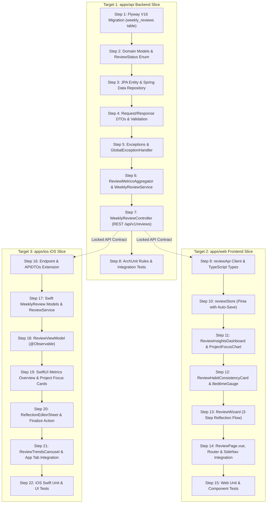

# Plan 012: Weekly Review & Progress Analytics (Behavior & Productivity Learning)

## Status

Proposed / Awaiting Human Approval

---

## Specification

### Primary Behavioral Source of Truth

- [weekly-review-and-analytics.md](file:///Users/metamartin/Documents/RoutMartin/productivity-os/docs/specs/progress/weekly-review-and-analytics.md) (Proposed)

### Supporting Architecture & Decisions

- **Domain Architecture:** [docs/architecture/domain.md](file:///Users/metamartin/Documents/RoutMartin/productivity-os/docs/architecture/domain.md) (Sections "Weekly Review" & "Progress")
- **System Architecture:** [docs/architecture/system.md](file:///Users/metamartin/Documents/RoutMartin/productivity-os/docs/architecture/system.md)
- **ADR-002: Technology Stack** (Spring Boot 3, Kotlin, Vue 3, TypeScript, Swift, PostgreSQL)
- **ADR-003: Database Persistence** (Flyway migrations, `timestamptz` instants, user-scoped foreign keys, single transaction per use case)
- **ADR-004: Authentication and User Isolation** (Stateless JWT, `CurrentUser.id()` context, 404 for foreign resources)
- **ADR-005: API Architecture** (REST `/api/v1`, resource-oriented URIs, structured error model)
- **ADR-006: Time and Timezone Handling** (`LocalDate` for calendar days, user-configured IANA timezone via `UserTimezoneService`, injectable `Clock`)
- **ADR-007: Package and Module Layout** (`com.productivityos.review` with `controller/`, `service/`, `domain/`, `persistence/`, `dto/`, `exception/`)

---

## Architectural Decisions & Product Choices

### D1: Week Boundary Convention
- **Option A (Recommended):** ISO-8601 standard week starting **Monday at 00:00:00** and ending **Sunday at 23:59:59.999999** in the user's configured IANA timezone (`ZoneId`). A week is indexed by its Monday `LocalDate` (`periodStartDate`) and formatted as ISO week (e.g. `2026-W46`).
- **Option B:** User-configurable week start day (e.g., Sunday-to-Saturday).
- **Decision:** **Option A**. Conforms directly to ISO-8601, eliminates arbitrary boundary overlaps, standardizes multi-week trend comparisons, and aligns with ADR-006 centralized timezone arithmetic.

### D2: Aggregation Query vs Precomputed Rollup
- **Option A (Recommended):** On-demand aggregation during `DRAFT` status; freeze into persistent static snapshot upon transition to `COMPLETED`.
- **Option B:** Continuous precomputed rollup maintained via event listeners or database triggers.
- **Option C:** Pure on-demand recalculation even for historical completed reviews.
- **Decision:** **Option A**. While a review is in `DRAFT` (or for the current active week), metrics are computed on-demand from operational tables (`daily_plans`, `tasks`, `focus_sessions`, `schedule_habit_occurrences`). When the user completes the review (`POST /complete`), the calculated metrics are frozen permanently into the `weekly_reviews` row. This provides real-time responsiveness during reflection while guaranteeing historical immutability without complex trigger/event pipeline overhead.

### D3: Immutability After COMPLETED
- **Option A (Recommended):** Strict Immutability. Once `status = 'COMPLETED'`, the review record (both metrics and reflection text: wins, blockers, adjustments, satisfaction score) becomes strictly read-only. Calling `PUT /api/v1/reviews/{id}` or `POST /complete` on a completed review returns `409 Conflict` (`code = "REVIEW_ALREADY_COMPLETED"`).
- **Option B:** Metrics frozen, but reflection text remains editable.
- **Option C:** Explicit "Reopen" endpoint (`POST /reviews/{id}/reopen`) transitioning back to `DRAFT`.
- **Decision:** **Option A**. Preserves the integrity of completed historical milestones and prevents accidental retroactive tampering. If a user needs to edit notes, they do so while in `DRAFT`. An amendment workflow can be introduced in a future spec if needed.

---

## Vertical Slices & Implementation Steps



---

### Target 1: apps/api Backend Vertical Slice

#### Step 1: Database Migration (`V16__weekly_reviews.sql`)
- **File:** `apps/api/src/main/resources/db/migration/V16__weekly_reviews.sql`
- **Schema:**
  ```sql
  CREATE TABLE weekly_reviews (
      id UUID PRIMARY KEY DEFAULT gen_random_uuid(),
      user_id UUID NOT NULL REFERENCES users(id) ON DELETE CASCADE,
      period_start_date DATE NOT NULL,
      period_end_date DATE NOT NULL,
      status VARCHAR(20) NOT NULL DEFAULT 'DRAFT'
          CHECK (status IN ('DRAFT', 'COMPLETED')),
      wins TEXT,
      blockers TEXT,
      adjustments TEXT,
      satisfaction_score INT CHECK (satisfaction_score IS NULL OR (satisfaction_score >= 1 AND satisfaction_score <= 10)),
      completed_tasks_count INT NOT NULL DEFAULT 0,
      planned_tasks_count INT NOT NULL DEFAULT 0,
      planned_completed_tasks_count INT NOT NULL DEFAULT 0,
      total_focus_minutes INT NOT NULL DEFAULT 0,
      habit_consistency_rate NUMERIC(5,2) NOT NULL DEFAULT 0.00,
      average_bedtime_overflow_minutes INT NOT NULL DEFAULT 0,
      metrics_snapshot TEXT,
      completed_at TIMESTAMPTZ,
      created_at TIMESTAMPTZ NOT NULL DEFAULT now(),
      updated_at TIMESTAMPTZ NOT NULL DEFAULT now(),
      version BIGINT NOT NULL DEFAULT 0,
      CONSTRAINT uq_weekly_reviews_user_period UNIQUE (user_id, period_start_date)
  );

  CREATE INDEX idx_weekly_reviews_user_id ON weekly_reviews (user_id);
  CREATE INDEX idx_weekly_reviews_user_period ON weekly_reviews (user_id, period_start_date DESC);
  CREATE INDEX idx_weekly_reviews_user_status ON weekly_reviews (user_id, status);
  ```
- **AC Mapping:** AC-WR01, AC-WR06, AC-WR08.

#### Step 2: Pure Domain Models
- **Path:** `apps/api/src/main/kotlin/com/productivityos/review/domain/`
- **Files:**
  - `ReviewStatus.kt`: Enum `DRAFT`, `COMPLETED`.
  - `WeeklyReview.kt`: Core aggregate representing period, reflections, status, and frozen or live metrics.
  - `ReviewMetrics.kt`: Value object aggregating planned tasks, completed tasks, focus time, habit consistency, and bedtime alignment.
  - `ProjectFocusBreakdown.kt`: Value object with `projectId`, `projectTitle`, `focusMinutes`, `percentage`.
  - `HabitReviewSummary.kt`: Value object with `habitId`, `title`, `icon`, `phase`, `completionsInWeek`, `targetDays`, `streak`.
  - `ReviewTrend.kt`: Value object containing 4-week progression items and relative deltas.
- **AC Mapping:** AC-WR01, AC-WR02, AC-WR03, AC-WR04, AC-WR06, AC-WR07.

#### Step 3: Persistence Layer
- **Path:** `apps/api/src/main/kotlin/com/productivityos/review/persistence/`
- **Files:**
  - `WeeklyReviewEntity.kt`: JPA mapping for `weekly_reviews` with optimistic `@Version`, conversion `toDomain()`, and factory `from()`.
  - `WeeklyReviewRepository.kt`:
    - `findByUserIdAndPeriodStartDate(userId: UUID, startDate: LocalDate): WeeklyReviewEntity?`
    - `findAllByUserIdOrderByPeriodStartDateDesc(userId: UUID, pageable: Pageable): Page<WeeklyReviewEntity>`
    - `findTop4ByUserIdAndStatusOrderByPeriodStartDateDesc(userId: UUID, status: ReviewStatus): List<WeeklyReviewEntity>`
    - `existsByUserIdAndPeriodStartDate(userId: UUID, startDate: LocalDate): Boolean`
- **AC Mapping:** AC-WR01, AC-WR05, AC-WR06, AC-WR07.

#### Step 4: Request & Response DTOs
- **Path:** `apps/api/src/main/kotlin/com/productivityos/review/dto/`
- **Files:**
  - `WeeklyReviewResponse.kt`: DTO returning complete review payload including nested `ReviewMetricsDTO`.
  - `ReviewMetricsDTO.kt`: Detailed telemetry breakdown.
  - `ProjectFocusBreakdownDTO.kt` & `HabitReviewDTO.kt`.
  - `UpdateReviewRequest.kt`: `@field:Size(max=5000)` on reflections, `@field:Min(1) @field:Max(10)` on satisfaction score.
  - `CreateReviewRequest.kt`: Optional `date: LocalDate?` (defaults to current date in user timezone).
  - `ReviewTrendsResponse.kt` & `WeeklyReviewTrendItemDTO.kt`.
- **AC Mapping:** AC-WR05, AC-WR07, AC-WR08.

#### Step 5: Exceptions & Global Error Handling
- **Path:** `apps/api/src/main/kotlin/com/productivityos/review/exception/`
- **Files:**
  - `WeeklyReviewNotFoundException.kt`: Thrown when review is not found or owned by another user.
  - `ReviewAlreadyCompletedException.kt`: Thrown when modifying a completed review.
  - Edit `apps/api/src/main/kotlin/com/productivityos/api/GlobalExceptionHandler.kt` to map:
    - `WeeklyReviewNotFoundException` $\rightarrow$ `404 NOT_FOUND`
    - `ReviewAlreadyCompletedException` $\rightarrow$ `409 CONFLICT` with code `"REVIEW_ALREADY_COMPLETED"`
- **AC Mapping:** AC-WR06, AC-WR08.

#### Step 6: ReviewMetricsAggregator & WeeklyReviewService
- **Path:** `apps/api/src/main/kotlin/com/productivityos/review/service/`
- **Files:**
  - `ReviewMetricsAggregator.kt`:
    - Reads tasks from `DailyPlanRepository` and `TaskRepository`.
    - Reads focus sessions from `FocusSessionRepository` and projects from `ProjectRepository`.
    - Reads habit occurrences from `ScheduleHabitRepository` and `ScheduleHabitOccurrenceRepository`.
    - Calculates bedtime overflow from `ScheduleEntryRepository` and anchors.
    - Zero-safe arithmetic: returns 0% rather than `NaN` or dividing by zero.
  - `WeeklyReviewService.kt`:
    - Handles week boundary resolution via `UserTimezoneService.timezone(userId)`.
    - `getCurrentReview(userId: UUID)`: Fetches or creates `DRAFT` review for the current week.
    - `getReviewById(userId: UUID, id: UUID)`: User-isolated retrieval.
    - `createOrGetReview(userId: UUID, targetDate: LocalDate?)`: Resolves Monday of date's week and returns existing or new `DRAFT`.
    - `updateReviewDraft(userId: UUID, id: UUID, req: UpdateReviewRequest)`: Enforces `DRAFT` status and saves reflections.
    - `completeReview(userId: UUID, id: UUID)`: Aggregates final metrics, serializes `metrics_snapshot`, sets `COMPLETED` and `completed_at`.
    - `getReviewTrends(userId: UUID, weeks: Int)`: Retrieves chronological trend items and calculates deltas.
- **AC Mapping:** AC-WR01, AC-WR02, AC-WR03, AC-WR04, AC-WR05, AC-WR06, AC-WR07.

#### Step 7: WeeklyReviewController (REST API)
- **Path:** `apps/api/src/main/kotlin/com/productivityos/review/controller/`
- **File:** `WeeklyReviewController.kt`
- **Endpoints:**
  - `GET /api/v1/reviews/current` $\rightarrow$ `200 OK`
  - `GET /api/v1/reviews/{id}` $\rightarrow$ `200 OK` (or `404`)
  - `GET /api/v1/reviews?page=0&size=10` $\rightarrow$ `200 OK`
  - `POST /api/v1/reviews` $\rightarrow$ `201 Created` / `200 OK`
  - `PUT /api/v1/reviews/{id}` $\rightarrow$ `200 OK` (or `409` if completed)
  - `POST /api/v1/reviews/{id}/complete` $\rightarrow$ `200 OK` (or `409` if already completed)
  - `GET /api/v1/reviews/trends?weeks=4` $\rightarrow$ `200 OK`
- **AC Mapping:** AC-WR08.

#### Step 8: Backend Verification & ArchUnit Tests
- **Files:**
  - `apps/api/src/test/kotlin/com/productivityos/ArchitectureTest.kt`: Add rule verifying that `com.productivityos.review..` only depends on approved modules and no existing module depends on `review`.
  - `apps/api/src/test/kotlin/com/productivityos/review/WeeklyReviewServiceTest.kt`: Unit tests for boundary resolution, metrics rollups, draft updates, and completion freeze.
  - `apps/api/src/test/kotlin/com/productivityos/review/WeeklyReviewControllerTest.kt`: MockMvc tests for all 7 endpoints, status codes, and input validation.
- **Verification Command:** `./gradlew :apps:api:test --tests "com.productivityos.review.*"` & `./gradlew :apps:api:test --tests "com.productivityos.ArchitectureTest"`

---

### Target 2: apps/web Frontend Vertical Slice

#### Step 9: API Client & Types
- **Path:** `apps/web/src/features/review/`
- **Files:**
  - `types.ts`: TypeScript interfaces for `WeeklyReview`, `ReviewMetrics`, `ProjectFocusBreakdown`, `HabitReview`, `ReviewTrendsResponse`, `WeeklyReviewTrendItem`, `UpdateReviewPayload`.
  - `api/reviewApi.ts`: Axios/fetch client using existing `@/lib/api/client` with Bearer auth and refresh token handling.
- **AC Mapping:** AC-WR08, AC-WR09.

#### Step 10: Pinia Review Store
- **File:** `apps/web/src/features/review/reviewStore.ts`
- **State:**
  - `currentReview: WeeklyReview | null`
  - `historicalReviews: WeeklyReview[]`
  - `trends: ReviewTrendsResponse | null`
  - `activeStep: number` (1: Insights, 2: Reflection Wizard, 3: Finalize)
  - `isSavingDraft: boolean`, `isCompleting: boolean`, `loading: boolean`, `error: string | null`
- **Actions:**
  - `loadCurrentReview()`, `loadReviewById(id)`, `saveDraftDebounced(payload)`, `completeCurrentReview()`, `loadTrends()`
- **AC Mapping:** AC-WR05, AC-WR06, AC-WR09.

#### Step 11: Insights Dashboard & Project Focus Chart
- **Path:** `apps/web/src/features/review/components/`
- **Files:**
  - `ReviewInsightsDashboard.vue`: Hero analytics summary displaying Task Planned-vs-Actual completion ring, Focus Hours, Habit Consistency score, and Bedtime Alignment delta.
  - `ReviewProjectFocusChart.vue`: Stacked horizontal visual bar chart breaking down focus hours by project with color-coded legend.
- **AC Mapping:** AC-WR02, AC-WR03, AC-WR09.

#### Step 12: Habit Consistency Card & Bedtime Gauge
- **Path:** `apps/web/src/features/review/components/`
- **Files:**
  - `ReviewHabitConsistencyCard.vue`: Grid of active habits displaying weekly checkmark indicators, completion ratios, and current streak badges.
  - `ReviewBedtimeGauge.vue`: Visual gauge displaying average bedtime overflow minutes with color indicators (green $\le 0$m, amber $\le 30$m, red $> 30$m).
- **AC Mapping:** AC-WR04, AC-WR09.

#### Step 13: Qualitative Reflection Wizard
- **Path:** `apps/web/src/features/review/components/`
- **Files:**
  - `ReviewWizard.vue`: Guided 3-step ritual:
    - Step 1: Look Back & Telemetry Overview
    - Step 2: Wins & Blockers Prompts (with rich text inputs and auto-saving)
    - Step 3: Next Week Adjustments & Satisfaction Score Slider (1–10)
  - `ReviewCompleteModal.vue`: Polished confirmation dialog summarizing the week before final commitment.
- **AC Mapping:** AC-WR05, AC-WR06, AC-WR09.

#### Step 14: ReviewPage, Router & SideNav Integration
- **Files:**
  - `apps/web/src/pages/ReviewPage.vue`: Page orchestrating the dashboard, reflection wizard, historical drawer, and trends view.
  - `apps/web/src/app/router/index.ts`: Register `/review` route:
    ```ts
    {
      path: "review",
      name: "review",
      component: ReviewPage,
      meta: { title: "Weekly Review", icon: CalendarCheck2, implemented: true },
    }
    ```
  - `apps/web/src/app/layouts/SideNav.vue`: Add `Weekly Review` navigation link with contextual badge indicator when the current day is Sunday or Monday and the review is in `DRAFT`.
- **AC Mapping:** AC-WR09.

#### Step 15: Frontend Verification & Tests
- **Files:**
  - `apps/web/src/features/review/__tests__/reviewStore.spec.ts`: Unit tests for store actions, debounced autosave, and completion state.
  - `apps/web/src/features/review/__tests__/ReviewWizard.spec.ts`: Component tests for wizard progression, validation, and satisfaction slider.
- **Verification Command:** `pnpm --filter web typecheck && pnpm --filter web test:unit`

---

### Target 3: apps/ios iOS Vertical Slice

#### Step 16: iOS Endpoint & APIDTOs Extension
- **Files:**
  - `apps/ios/ProductivityOS/Core/Networking/Endpoint.swift`:
    Add cases:
    - `.getCurrentReview` $\rightarrow$ `GET /api/v1/reviews/current`
    - `.getReview(id: UUID)` $\rightarrow$ `GET /api/v1/reviews/{id}`
    - `.listReviews(page: Int, size: Int)` $\rightarrow$ `GET /api/v1/reviews`
    - `.createReview(body: Data)` $\rightarrow$ `POST /api/v1/reviews`
    - `.updateReview(id: UUID, body: Data)` $\rightarrow$ `PUT /api/v1/reviews/{id}`
    - `.completeReview(id: UUID)` $\rightarrow$ `POST /api/v1/reviews/{id}/complete`
    - `.getReviewTrends(weeks: Int)` $\rightarrow$ `GET /api/v1/reviews/trends`
  - `apps/ios/ProductivityOS/Core/Networking/APIDTOs.swift`:
    Add Codable DTOs matching backend JSON contracts.
- **AC Mapping:** AC-WR08, AC-WR10.

#### Step 17: Swift Models & ReviewService
- **Path:** `apps/ios/ProductivityOS/`
- **Files:**
  - `Models/WeeklyReview.swift`: Swift domain structs conforming to `Identifiable`, `Codable`, `Sendable`.
  - `Core/Services/ReviewService.swift`: Network service integrating `APIClient.shared` with `APICache` for offline caching.
- **AC Mapping:** AC-WR10.

#### Step 18: ReviewViewModel (@Observable)
- **Path:** `apps/ios/ProductivityOS/Features/Review/`
- **File:** `ReviewViewModel.swift`
- **Features:**
  - `@Observable final class ReviewViewModel`
  - Manages `currentReview`, `historicalReviews`, `trends`, `isDraftDirty`, `isSaving`, `isCompleting`, `errorMessage`.
  - Debounced auto-save on reflection input.
  - Haptic feedback triggers on review completion.
- **AC Mapping:** AC-WR05, AC-WR06, AC-WR10.

#### Step 19: SwiftUI Metrics Overview & Project Focus Cards
- **Path:** `apps/ios/ProductivityOS/Features/Review/Components/`
- **Files:**
  - `ReviewMetricsOverviewCard.swift`: Task completion circular ring and focus hours summary.
  - `ProjectFocusBarChart.swift`: SwiftUI horizontal segmented bar chart visualizing project effort.
  - `HabitConsistencyCard.swift`: Habit week grid showing 7-day completion dots and active streak flame.
- **AC Mapping:** AC-WR02, AC-WR03, AC-WR04, AC-WR10.

#### Step 20: Reflection Editor Sheet & Finalize Action
- **Path:** `apps/ios/ProductivityOS/Features/Review/Components/`
- **Files:**
  - `ReflectionEditorSheet.swift`: Native form sections for Wins, Blockers, Adjustments, and a 1–10 satisfaction score stepper.
  - Finalize button triggering animated celebration modal and switching state to frozen view.
- **AC Mapping:** AC-WR05, AC-WR06, AC-WR10.

#### Step 21: ReviewTrendsCarousel & App Integration
- **Path:** `apps/ios/ProductivityOS/Features/Review/`
- **Files:**
  - `Components/ReviewTrendsCarousel.swift`: Horizontal scrollable cards visualizing 4-week progression metrics.
  - `ReviewView.swift`: Main screen coordinating overview cards, reflection sheet, trends carousel, and historical picker.
  - Integration into iOS navigation shell.
- **AC Mapping:** AC-WR07, AC-WR10.

#### Step 22: iOS Verification & Tests
- **Files:**
  - `apps/ios/ProductivityOSTests/ReviewServiceTests.swift`: Unit tests for endpoint mapping and mock JSON decoding.
  - `apps/ios/ProductivityOSTests/ReviewViewModelTests.swift`: ViewModel state tests verifying draft mutations, error handling, and completion flow.
- **Verification Command:** `swift test --package-path apps/ios`

---

## Traceability Matrix

| Acceptance Criteria | Description | Target 1: Backend Slice | Target 2: Web Slice | Target 3: iOS Slice | Verification Test Suites |
|---|---|---|---|---|---|
| **AC-WR01** | Week Boundary Resolution (ISO-8601 & ADR-006) | `V16__weekly_reviews.sql`, `WeeklyReviewService.resolveWeekBoundaries`, `UserTimezoneService` | `reviewApi.getCurrentReview`, `reviewStore.loadCurrentReview` | `Endpoint.getCurrentReview`, `ReviewService.getCurrentReview` | `WeeklyReviewServiceTest.resolvesIsoWeekBoundariesInUserTimezone` |
| **AC-WR02** | Completed Tasks & Planned-vs-Actual Rate | `ReviewMetricsAggregator.aggregateTasks`, `TaskRepository`, `DailyPlanRepository` | `ReviewInsightsDashboard.vue`, `reviewStore.taskCompletionRate` | `ReviewMetricsOverviewCard.swift` | `WeeklyReviewServiceTest.aggregatesPlannedAndCompletedTasksCorrectly` |
| **AC-WR03** | Focus Effort Rollup & Project Breakdown | `ReviewMetricsAggregator.aggregateFocus`, `FocusSessionRepository`, `ProjectRepository` | `ReviewProjectFocusChart.vue` | `ProjectFocusBarChart.swift` | `WeeklyReviewServiceTest.aggregatesFocusMinutesByProject` |
| **AC-WR04** | Habit Consistency & Bedtime Overflow | `ReviewMetricsAggregator.aggregateHabitsAndCircadian`, `ScheduleHabitRepository` | `ReviewHabitConsistencyCard.vue`, `ReviewBedtimeGauge.vue` | `HabitConsistencyCard.swift` | `WeeklyReviewServiceTest.calculatesHabitConsistencyAndBedtimeOverflow` |
| **AC-WR05** | Draft Reflection Persistence | `WeeklyReviewService.updateReviewDraft`, `WeeklyReviewEntity` | `ReviewWizard.vue`, `reviewStore.saveDraftDebounced` | `ReflectionEditorSheet.swift`, `ReviewViewModel.saveReflectionDraft` | `WeeklyReviewControllerTest.updatesDraftReflectionSuccessfully` |
| **AC-WR06** | Finalize / Complete Review & Freeze | `WeeklyReviewService.completeReview`, `metrics_snapshot`, status transition `DRAFT -> COMPLETED` | `ReviewCompleteModal.vue`, `reviewStore.completeCurrentReview` | `ReviewView.swift` (Finalize Action) | `WeeklyReviewServiceTest.freezesMetricsAndPreventsPostCompletionEdits` |
| **AC-WR07** | Historical Reviews & 4-Week Progress Trends | `WeeklyReviewService.getReviewTrends`, `WeeklyReviewRepository.findTop4...` | `ReviewTrendsChart.vue` | `ReviewTrendsCarousel.swift` | `WeeklyReviewControllerTest.returnsChronologicalTrendsWithDeltas` |
| **AC-WR08** | REST Endpoint Contract & Validation | `WeeklyReviewController`, `GlobalExceptionHandler`, Bean Validation | `reviewApi.ts` error handling | `APIError.swift` mapping | `WeeklyReviewControllerTest.enforcesUserIsolationAndValidation` |
| **AC-WR09** | Web Weekly Review Ritual Dashboard | - | `ReviewPage.vue`, `ReviewWizard.vue`, `SideNav.vue` | - | `reviewStore.spec.ts`, `ReviewWizard.spec.ts` |
| **AC-WR10** | iOS Weekly Review View & Progress Cards | - | - | `ReviewView.swift`, `ReviewViewModel.swift`, `APICache` | `ReviewViewModelTests.swift`, `ReviewServiceTests.swift` |

---

## Verification & Execution Gates

### Phase 1: Planning (Complete)
- Specification authored at `docs/specs/progress/weekly-review-and-analytics.md`
- Implementation plan authored at `docs/plans/012-weekly-review-and-progress-analytics.md`
- Decisions D1, D2, D3 clearly defined.

### Phase 2: Human Approval Gate (MANDATORY STOP)
- Present plan, specification, and decisions D1–D3 to the human user.
- **Halt execution. Do not start coding or modify production code until human approval is given.**

### Phase 3: Concurrent Multi-Target Implementation (Post-Approval)
- **Backend Specialist:** Execute Target 1 (Steps 1–8).
  - Verify via `./gradlew :apps:api:test`
- **Frontend Specialist:** Execute Target 2 (Steps 9–15).
  - Verify via `pnpm --filter web typecheck && pnpm --filter web test:unit`
- **iOS Specialist:** Execute Target 3 (Steps 16–22).
  - Verify via `swift test --package-path apps/ios`

### Phase 4: Independent Verification
- Run `scripts/agent-review.sh` to verify architectural boundaries, ADR compliance, and acceptance criteria coverage.
