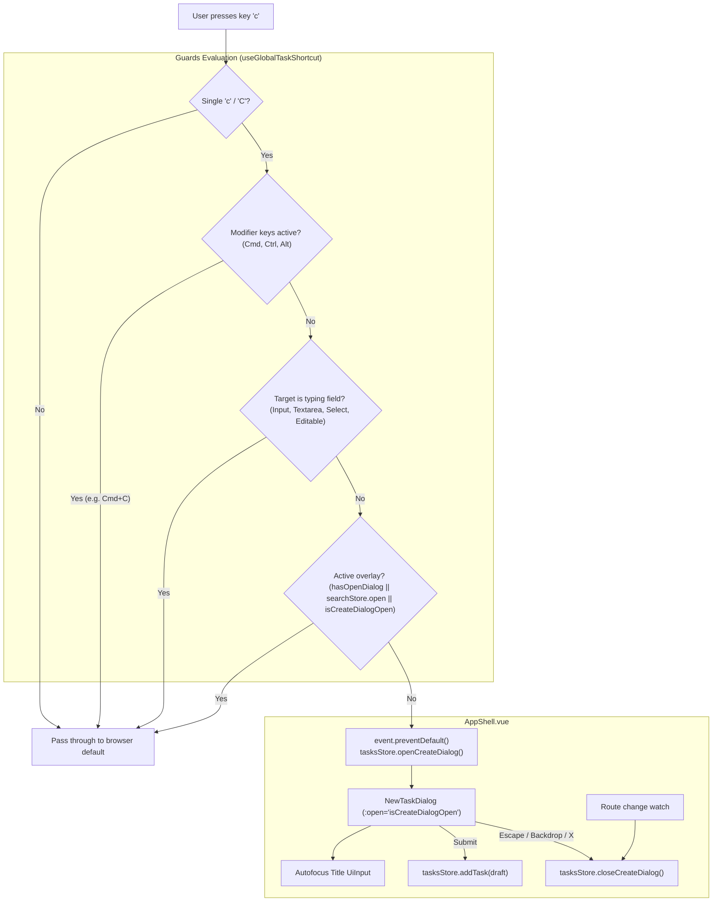

# Plan 013: Global 'c' Keyboard Shortcut to Open New Task Dialog

## Status

Approved (Completed & Verified)

---

## Specification

### Primary Behavioral Source of Truth

- [task-creation-shortcut.md](file:///Users/metamartin/Documents/RoutMartin/productivity-os/docs/specs/ui/task-creation-shortcut.md) (Proposed)

### Acceptance Criteria in Scope

- **AC-001:** Global 'c' Key Opens New Task Dialog
- **AC-002:** Ignored When Focused in Form Inputs and Textareas
- **AC-003:** Modifier Keys Preserve Clipboard Copy (Cmd+C / Ctrl+C)
- **AC-004:** Ignored When Another Modal or Overlay Is Open
- **AC-005:** Ignored When New Task Dialog Is Already Open
- **AC-006:** Dismissible via Escape, Close Button, or Backdrop
- **AC-007:** Successful Task Creation from Any Workspace
- **AC-008:** Dialog Closes on Route Change
- **AC-009:** Visual Shortcut Discoverability Hint
- **AC-010:** Unauthenticated Screens Do Not Listen or Open

### Supporting Architecture & Decisions

- **ADR-001:** Specification-Driven Development (SDD workflow gate)
- **ADR-002:** Technology Stack (Vue 3, Pinia, TypeScript, Vite)
- **ADR-004:** Authentication and User Isolation (`AppShell` mounted only for authenticated sessions)
- **ADR-005:** API Architecture (REST `/api/v1/tasks` lifecycle and DTO contracts)
- **Tasks & Inbox UI Spec:** [tasks-and-inbox-ui.md](file:///Users/metamartin/Documents/RoutMartin/productivity-os/docs/specs/ui/tasks-and-inbox-ui.md) (§12 New Task dialog, §12.1 Creation destination)
- **Global Search Reference:** [global-search.md](file:///Users/metamartin/Documents/RoutMartin/productivity-os/docs/specs/ui/global-search.md) (precedent for global keyboard shortcuts and overlay dismissal)

---

## Architecture

Currently, `NewTaskDialog.vue` is mounted locally inside `TasksPage.vue` (and inside `TaskDetailPanel.vue` for contextual task editing). To make task creation omnipresent:

1. **State Centralization:** `useTasksStore` in `features/tasks/store.ts` gains `isCreateDialogOpen` (boolean ref) and associated actions (`openCreateDialog()`, `closeCreateDialog()`). This decouples the dialog trigger from any specific route or page.
2. **Global Mount in AppShell:** A single global instance of `NewTaskDialog.vue` is mounted inside `AppShell.vue`. This ensures the dialog is available across all views (Today, Inbox, Tasks, Projects, Goals, Schedule, Settings, AI) while automatically excluding unauthenticated routes (`/login`, `/register`).
3. **Dedicated Keyboard Composable & Utilities:**
   - `src/lib/utils/keyboard.ts`: Extracts and standardizes `isTypingTarget(target)` (checking `INPUT`, `TEXTAREA`, `SELECT`, and `contenteditable`) and `isTaskShortcut(event)`.
   - `UiDialog.vue`: Exports `hasOpenDialog(): boolean` to query active modal dialogs in the stacking hierarchy.
   - `useGlobalTaskShortcut()`: Manages the global `keydown` listener, evaluates guards, dispatches dialog opening, and tears down listeners on unmount.
4. **Deduplication in TasksPage:** The redundant local creation dialog inside `TasksPage.vue` is removed. Both the primary "New Task" button and empty-state action button call `tasksStore.openCreateDialog()`.
5. **Discoverability:** A `<kbd class="kbd tnum">c</kbd>` badge is integrated into the "New Task" button on `TasksPage.vue` (and optionally in `TopBar.vue` pending D1).



---

## Step 1 — Shared Keyboard Utility & Dialog Stacking Helper

**Status:** pending

- **Files/modules:**
  - `apps/web/src/lib/utils/keyboard.ts` (new)
  - `apps/web/src/components/ui/UiDialog.vue` (export `hasOpenDialog`)
- **Spec/AC:** AC-002, AC-003, AC-004 foundation
- **Behavior:**
  - In `apps/web/src/lib/utils/keyboard.ts`, implement:
    ```typescript
    export function isTypingTarget(target: EventTarget | null): boolean {
      if (!(target instanceof HTMLElement)) return false
      const tag = target.tagName.toUpperCase()
      return (
        tag === 'INPUT' ||
        tag === 'TEXTAREA' ||
        tag === 'SELECT' ||
        target.isContentEditable ||
        Boolean(target.closest('[contenteditable="true"]'))
      )
    }

    export function isTaskCreationKey(event: KeyboardEvent): boolean {
      if (event.isComposing) return false
      if (event.metaKey || event.ctrlKey || event.altKey) return false
      return event.key.toLowerCase() === 'c'
    }
    ```
  - In `apps/web/src/components/ui/UiDialog.vue`, add an exported function in the module script block:
    ```typescript
    export function hasOpenDialog(): boolean {
      return openDialogs.length > 0
    }
    ```
- **Dependencies:** None.
- **Tests:** Unit tests verifying `isTypingTarget` returns `true` for inputs/textareas/selects/contenteditables and `false` for buttons/divs; `isTaskCreationKey` returns `true` for `'c'`/`'C'` and `false` for `Cmd+C`/`Ctrl+C`/`Alt+C`.
- **Risks/ambiguities:** CapsLock or Shift key behavior (resolved per D2).

---

## Step 2 — Tasks Store Dialog State & Global Actions

**Status:** pending

- **Files/modules:**
  - `apps/web/src/features/tasks/store.ts`
- **Spec/AC:** AC-001, AC-005, AC-006, AC-007
- **Behavior:**
  - Add reactive state:
    ```typescript
    const isCreateDialogOpen = ref(false)

    function openCreateDialog(): void {
      isCreateDialogOpen.value = true
    }

    function closeCreateDialog(): void {
      isCreateDialogOpen.value = false
    }
    ```
  - Export `isCreateDialogOpen`, `openCreateDialog`, and `closeCreateDialog` from `useTasksStore`.
  - Confirm existing `addTask(draft: NewTaskDraft)` persists correctly to backend in real mode and updates local `tasks` reactive list in mock mode.
- **Dependencies:** Pinia store.
- **Tests:** Verify `openCreateDialog()` sets `isCreateDialogOpen` to `true`, and `closeCreateDialog()` sets it to `false`.
- **Risks/ambiguities:** None.

---

## Step 3 — Global Shortcut Composable & AppShell Integration

**Status:** pending

- **Files/modules:**
  - `apps/web/src/features/tasks/composables/useGlobalTaskShortcut.ts` (new)
  - `apps/web/src/app/layouts/AppShell.vue`
- **Spec/AC:** AC-001, AC-002, AC-003, AC-004, AC-005, AC-006, AC-007, AC-008, AC-010
- **Behavior:**
  - Create `useGlobalTaskShortcut.ts`:
    - Listens to `window.addEventListener('keydown', onKeydown)`.
    - Checks `isTaskCreationKey(event)`. If false, returns immediately.
    - Checks `isTypingTarget(event.target)`. If true, returns immediately.
    - Checks `hasOpenDialog() || searchStore.open || tasksStore.isCreateDialogOpen`. If true, returns immediately.
    - Calls `event.preventDefault()` and `tasksStore.openCreateDialog()`.
    - Watches `route.fullPath`: closes dialog on route transition (`tasksStore.closeCreateDialog()`).
    - Removes listener in `onBeforeUnmount`.
  - In `AppShell.vue`:
    - Import and invoke `useGlobalTaskShortcut()`.
    - Import `NewTaskDialog` and `useTasksStore`.
    - Mount `<NewTaskDialog :open="tasksStore.isCreateDialogOpen" @close="tasksStore.closeCreateDialog" @create="handleCreateTask" />`.
    - Implement `handleCreateTask(draft: NewTaskDraft)`: delegates to `tasksStore.addTask(draft)` and displays feedback/preview note if mock mode.
- **Dependencies:** Step 1, Step 2, `useSearchStore`, `useRoute`.
- **Tests:** Verify shortcut listener registers on mount in AppShell; unauthenticated pages (outside AppShell) do not register listener.
- **Risks/ambiguities:** Focus trapping and restoring focus to prior element upon dismissal.

---

## Step 4 — TasksPage Deduplication & Visual Discoverability Hints

**Status:** pending

- **Files/modules:**
  - `apps/web/src/pages/TasksPage.vue`
  - `apps/web/src/app/layouts/TopBar.vue` (refactor typing guard to use shared utility)
- **Spec/AC:** AC-007, AC-009
- **Behavior:**
  - In `apps/web/src/pages/TasksPage.vue`:
    - Remove the local `<NewTaskDialog>` instance at line 563.
    - Remove local `dialogOpen` ref and local `onCreateTask` handler.
    - Update hero action button:
      ```vue
      <UiButton variant="primary" @click="store.openCreateDialog">
        <Plus :size="16" :stroke-width="2" />
        <span>New Task</span>
        <kbd class="kbd tnum">c</kbd>
      </UiButton>
      ```
    - Update empty state button at line 461 to call `store.openCreateDialog`.
  - In `apps/web/src/app/layouts/TopBar.vue`:
    - Replace the local `isTypingTarget` function with the shared `isTypingTarget` from `@/lib/utils/keyboard`.
    - If D1 is approved, add a "New Task" quick action icon button or link with `<kbd>c</kbd>` tooltip.
- **Dependencies:** Step 2, Step 3.
- **Tests:** Visual regression test and manual inspection of `TasksPage.vue` ensuring no duplicate dialogs appear and the `<kbd>c</kbd>` badge renders cleanly.
- **Risks/ambiguities:** Visual styling of `<kbd class="kbd tnum">c</kbd>` on primary button contrast (ensuring readable contrast on primary button surface).

---

## Step 5 — Verification, Typecheck & Manual Walkthrough

**Status:** pending

- **Files/modules:**
  - All touched files in `apps/web`
- **Spec/AC:** AC-001 through AC-010
- **Behavior:**
  - Execute automated static analysis:
    - `pnpm run typecheck` (`vue-tsc --noEmit -p tsconfig.app.json`)
    - `pnpm run lint` (`eslint .`)
    - `pnpm run build` (`vite build`)
  - Execute manual verification checklist across all 8 authenticated workspaces plus login/register.
- **Dependencies:** Steps 1–4.
- **Tests:** Full test suite execution and diff inspection.
- **Risks/ambiguities:** None.

---

## Tests

### Traceability Matrix

| Acceptance Criteria | Implementation Step | Automated / Manual Test Suite |
| :--- | :--- | :--- |
| **AC-001** (Global 'c' opens dialog) | Step 3 (`AppShell.vue`, `useGlobalTaskShortcut`) | Manual verification on all 8 routes (`/today`, `/tasks`, `/inbox`, `/projects`, `/goals`, `/schedule`, `/settings`, `/ai`) |
| **AC-002** (Ignored in inputs/textareas) | Step 1 (`keyboard.ts`), Step 3 | Unit test `keyboard.spec.ts` + Manual verification in search input and textareas |
| **AC-003** (Modifier keys Cmd+C / Ctrl+C) | Step 1 (`keyboard.ts`), Step 3 | Unit test `keyboard.spec.ts` + Manual test copying text with `Cmd+C` / `Ctrl+C` |
| **AC-004** (Ignored when overlay open) | Step 1 (`UiDialog.vue`), Step 3 | Manual verification while `SearchOverlay` (⌘K) or a confirmation dialog is active |
| **AC-005** (Ignored when dialog already open) | Step 2, Step 3 | Manual test: press 'c' while dialog header/buttons have focus |
| **AC-006** (Escape / backdrop / X dismiss) | Step 3 (`AppShell.vue`), `UiDialog.vue` | Manual test: dismiss via `Escape`, click backdrop, click 'X' |
| **AC-007** (Task creation from any workspace) | Step 2 (`store.ts`), Step 3 (`AppShell.vue`) | Manual test: create task from `/projects` and verify Inbox badge & store update |
| **AC-008** (Route change closes dialog) | Step 3 (`useGlobalTaskShortcut.ts`) | Manual test: open dialog, trigger browser back button |
| **AC-009** (Visual `<kbd>c</kbd>` hint) | Step 4 (`TasksPage.vue`) | Visual inspection of primary button in `TasksPage.vue` |
| **AC-010** (Unauthenticated routes excluded) | Step 3 (`AppShell.vue`) | Manual test on `/login` and `/register` pressing 'c' |

---

## Verification

Before reporting completion (per `AGENTS.md`):

1. Run `pnpm --dir apps/web run typecheck` (`vue-tsc --noEmit`).
2. Run `pnpm --dir apps/web run lint` (`eslint .`).
3. Run `pnpm --dir apps/web run build` (`vite build`).
4. Execute manual verification test matrix across:
   - Today screen (`/today`)
   - Tasks screen (`/tasks`)
   - Inbox screen (`/inbox`)
   - Projects screen (`/projects`)
   - Goals screen (`/goals`)
   - Schedule screen (`/schedule`)
   - Settings screen (`/settings`)
   - AI screen (`/ai`)
   - Login screen (`/login`)
5. Inspect `git diff` to verify no unrelated changes, no production code modified outside approved scope.
6. Prepare completion report with AC pass/fail evidence.

---

## Pre-Implementation Decisions (Human Approval Gate)

### D1: TopBar "New Task" Quick Action Trigger
- **Option A (Recommended):** Keep TopBar focused on search and navigation; do not add a New Task button in TopBar. The primary button with `<kbd>c</kbd>` hint lives in `TasksPage.vue`, while the 'c' shortcut is available everywhere.
- **Option B:** Add a compact `+` icon button in `TopBar.vue` (styled identically to the search and theme buttons) with title/tooltip `"New task (c)"` for omnipresent mouse discoverability.
- **Decision:** **Option A** (preserves minimal, calm TopBar aesthetic; can be upgraded to Option B if user feedback desires).

### D2: Shift Key & CapsLock Behavior (`Shift+C`)
- **Option A (Recommended):** Treat `c` and `C` (`Shift+C`) identically: `event.key.toLowerCase() === 'c'` provided `metaKey`, `ctrlKey`, `altKey` are false. Matches Linear and eliminates frustration if CapsLock is accidentally active.
- **Option B:** Strict lowercase `c` only (`event.key === 'c' && !event.shiftKey`).
- **Decision:** **Option A**.

### D3: Post-Creation Navigation Behavior
- **Option A (Recommended):** Non-intrusive. When a user captures a task from `/projects` or `/goals`, the task is created in the background, a toast confirmation appears with an optional link, and the user stays on their current screen.
- **Option B:** Auto-redirect. Immediately navigate the user to `/tasks` or `/inbox` with the newly created task opened in `ContextPanel`.
- **Decision:** **Option A** (prevents disruptive navigation; aligns with fast capture philosophy).

### D4: Form State on Dismissal
- **Option A (Recommended):** Reset draft. Opening the dialog via `c` always starts with a fresh empty draft. Dismissing via `Escape` or backdrop cancels and resets.
- **Option B:** Memory draft cache. Keep typed values in memory so re-pressing `c` restores the previous unfinished draft.
- **Decision:** **Option A** (standard dialog behavior in web apps; prevents stale draft confusion).

---

## Out of Scope for This Plan

- Modifying the contextual task editing flow inside `TaskDetailPanel.vue` (editing remains task-scoped).
- Adding new backend API endpoints or altering existing DTO contracts.
- Global inline quick-capture command bar (natural language date/project parsing in a single-line bar).
- iOS app shortcut implementation (tracked in separate mobile milestone).

---

## Change History

- **2026-11-12:** Initial Plan authored against proposed specification `docs/specs/ui/task-creation-shortcut.md`. Structures 5 vertical implementation steps, shared keyboard utility, `AppShell` global mounting, `TasksPage` deduplication, and pre-implementation decisions D1–D4.
