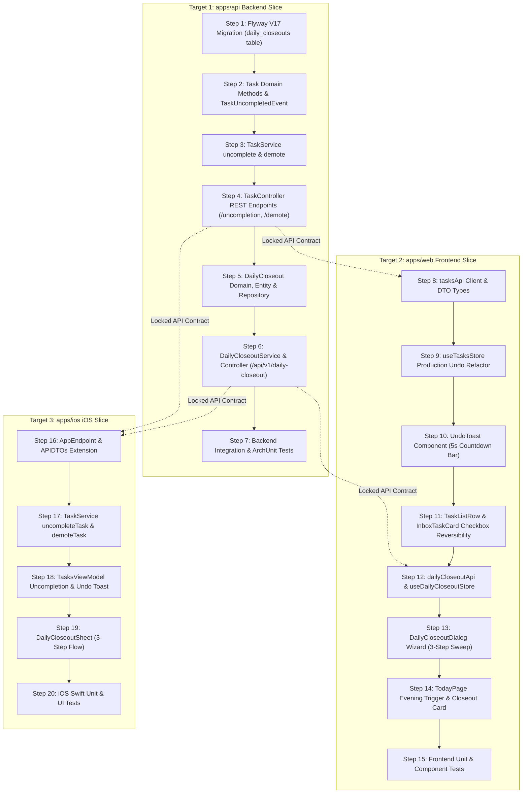

# Plan 014: Two-Tier Rewind Engine & Rituals

## Status

Draft / Awaiting Human Approval

---

## Specification

### Primary Behavioral Source of Truth

- [task-management.md](file:///Users/metamartin/Documents/RoutMartin/productivity-os/docs/specs/tasks/task-management.md) (Amended: task uncompletion & status demotion)
- [tasks-and-inbox-ui.md](file:///Users/metamartin/Documents/RoutMartin/productivity-os/docs/specs/ui/tasks-and-inbox-ui.md) (Amended: production undo toast & uncomplete checkbox)
- [daily-closeout-ritual.md](file:///Users/metamartin/Documents/RoutMartin/productivity-os/docs/specs/progress/daily-closeout-ritual.md) (Draft: evening trigger & 3-step closure flow)
- [weekly-review-and-analytics.md](file:///Users/metamartin/Documents/RoutMartin/productivity-os/docs/specs/progress/weekly-review-and-analytics.md) (Proposed: Spec 012 consumer of daily closeout telemetry)
- [daily-planning.md](file:///Users/metamartin/Documents/RoutMartin/productivity-os/docs/specs/planning/daily-planning.md) (Proposed: daily plan dates, capacity, rollover mechanics)

### Acceptance Criteria in Scope

#### Domain & Backend Task Lifecycle (task-management.md)
- **AC-017 *(amended)*:** Task uncompletion from Completed to In Progress
- **AC-019 *(amended)*:** Status demotion backwards transitions (In Progress → Planned, Planned → Inbox)
- **AC-031:** Task uncompletion to Planned
- **AC-032:** Uncompletion resets completion timestamp to null
- **AC-033:** Uncompletion emits `TaskUncompletedEvent`
- **AC-034:** Invalid uncompletion rejected on non-completed tasks (409 Conflict)
- **AC-035:** Status demotion from Planned to Inbox
- **AC-036:** Status demotion from In Progress to Planned
- **AC-037:** Invalid demotion rejected on Inbox tasks (409 Conflict)

#### Production Undo & Micro-Rewind (tasks-and-inbox-ui.md)
- **AC-UI-001:** Checkbox on completed task rows is interactive and enables uncompletion
- **AC-UI-002:** Uncompleting task triggers `POST /api/v1/tasks/{id}/uncompletion`
- **AC-UI-003:** Reactive Undo Toast displays on task completion, uncompletion, cancellation, and triage
- **AC-UI-004:** Undo Toast displays a 5-second countdown timer and visual progress bar
- **AC-UI-005:** Clicking "Undo" before timer expiration reverts the mutation via corresponding API endpoint

#### Daily Closeout Ritual (daily-closeout-ritual.md)
- **AC-001:** Evening closeout prompt triggers after 18:00 local time on Today page when work remains
- **AC-002:** Manual closeout trigger available anytime on Today workspace
- **AC-003:** Step 1 presents objective daily wins and telemetry (completed tasks, focus hours, Top 3)
- **AC-004:** Step 2 surfaces all unfinished scheduled tasks for today
- **AC-005:** 1-click rollover to tomorrow schedules task in tomorrow's daily plan
- **AC-006:** 1-click move to backlog clears due date without cancelling the task
- **AC-007:** 1-click task cancellation transitions task to Cancelled
- **AC-008:** Bulk rollover shortcut schedules all remaining unfinished tasks to tomorrow
- **AC-010:** Completing closeout persists `DailyCloseout` milestone via `POST /api/v1/daily-closeout/{date}`
- **AC-011:** Daily closeout metrics feed Weekly Review (Spec 012) telemetry

### Supporting Architecture & Decisions

- **Domain Architecture:** [docs/architecture/domain.md](file:///Users/metamartin/Documents/RoutMartin/productivity-os/docs/architecture/domain.md) (Task lifecycle, Daily Planning, Weekly Review)
- **System Architecture:** [docs/architecture/system.md](file:///Users/metamartin/Documents/RoutMartin/productivity-os/docs/architecture/system.md)
- **ADR-001: SDD Workflow** (Gating implementation on approved specification)
- **ADR-002: Technology Stack** (Spring Boot 3, Kotlin, Vue 3, TypeScript, Swift, PostgreSQL)
- **ADR-003: Database Persistence** (Flyway migrations, `timestamptz` instants, user-scoped foreign keys, single transaction per use case)
- **ADR-004: Authentication and User Isolation** (Stateless JWT, `CurrentUser.id()` context, 404 for foreign resources)
- **ADR-005: API Architecture** (REST `/api/v1`, resource-oriented URIs, structured error model)
- **ADR-006: Time and Timezone Handling** (`LocalDate` for calendar days, user-configured IANA timezone via `UserTimezoneService`, injectable `Clock`)
- **ADR-007: Package and Module Layout** (`com.productivityos.task`, `com.productivityos.dailycloseout` or `com.productivityos.dailyplan`)

---

## Architectural Decisions & Product Choices

### D1: Task Uncompletion Endpoint & Contract
- **Option A (Recommended):** `POST /api/v1/tasks/{id}/uncompletion` with optional request body `UncompleteTaskRequest(targetStatus: TaskStatus? = TaskStatus.IN_PROGRESS)`.
  - If request body is omitted or `targetStatus` is null, defaults to `IN_PROGRESS`.
  - Explicitly accepts `IN_PROGRESS` or `PLANNED`. Target states `INBOX` or `CANCELLED` are rejected with `400 Bad Request`.
  - Resets `completedAt = null`, updates `updatedAt = clock.instant()`.
  - Emits `TaskUncompletedEvent(taskId = id, userId = userId)`.
  - Rejects if task is not in `COMPLETED` state (`409 Conflict`).
- **Option B:** Overloaded `POST /api/v1/tasks/{id}/reopening` handling both cancelled and completed tasks.
- **Decision:** **Option A**. Follows ADR-005 explicit action endpoint convention (symmetric to `/completion`), mirrors noun naming in `TaskController`, and preserves domain clarity between reopening cancelled work vs reversing completions.

### D2: Status Demotion Endpoint & Contract
- **Option A (Recommended):** `POST /api/v1/tasks/{id}/demote`.
  - Reversible step backwards:
    - `IN_PROGRESS` → `PLANNED`
    - `PLANNED` → `INBOX`
  - Rejects with `409 Conflict` if task is in `INBOX`, `COMPLETED`, or `CANCELLED`.
  - Updates `updatedAt = clock.instant()`.
- **Option B:** Separate endpoints: `POST /api/v1/tasks/{id}/unplan` and `POST /api/v1/tasks/{id}/pause`.
- **Option C:** Generic state transition endpoint `PUT /api/v1/tasks/{id}/status`.
- **Decision:** **Option A**. Provides a single, clean demotion primitive that mirrors the forward lifecycle steps without proliferating redundant sub-endpoints or violating ADR-005's prohibition against unconstrained status setters.

### D3: Daily Closeout Persistence & Table Layout
- **Option A (Recommended):** Dedicated `daily_closeouts` table (Flyway `V17__daily_closeouts.sql`) and `POST /api/v1/daily-closeout/{date}`.
  - Stores: `id UUID`, `user_id UUID`, `calendar_date DATE`, `completed_at TIMESTAMPTZ`, `focus_minutes INT`, `completed_tasks_count INT`, `rolled_over_tasks_count INT`, `returned_to_inbox_count INT`, `cancelled_tasks_count INT`, `notes TEXT`, `created_at TIMESTAMPTZ`.
  - Unique constraint on `(user_id, calendar_date)`.
  - Provides instant, zero-cost rollup queries for Spec 012 Weekly Review (`dailyCloseoutsCompletedCount`).
- **Option B:** Pure on-the-fly aggregation without persistent closeout record.
- **Decision:** **Option A**. Recording the closeout milestone provides permanent historical evidence of workday shutdown, directly tracks circadian discipline, and decouples weekly analytics from mutating operational tables.

### D4: Client-Side Undo Toast Architecture
- **Option A (Recommended):** Global Reactive Undo Toast with 5-second countdown timer.
  - Integrated into `features/tasks/store.ts` via enhanced `lastUndoable` snapshot containing `{ kind, taskId, task, inverseAction }`.
  - Promoted from mock-only to full production API execution.
  - Displays a visual progress bar decreasing from 100% to 0% over 5,000 ms.
  - Clicking "Undo" immediately executes the inverse API call (`uncomplete`, `reopen`, `start`, `plan`).
  - Auto-dismisses when timer reaches 0 or when another destructive action is taken.
- **Option B:** Page-local toast state on `TasksPage.vue` only.
- **Decision:** **Option A**. Ensures consistent undo capability across all workspaces (Tasks, Inbox, Today, and Daily Closeout Wizard) without duplicated UI logic.

---

## Vertical Slices & Implementation Steps



---

### Target 1: apps/api Backend Vertical Slice

#### Step 1: Database Migration (`V17__daily_closeouts.sql`)
- **File:** `apps/api/src/main/resources/db/migration/V17__daily_closeouts.sql`
- **Spec/AC:** `daily-closeout-ritual.md` AC-010, ADR-003
- **Behavior:**
  ```sql
  CREATE TABLE daily_closeouts (
      id UUID PRIMARY KEY DEFAULT gen_random_uuid(),
      user_id UUID NOT NULL REFERENCES users(id) ON DELETE CASCADE,
      calendar_date DATE NOT NULL,
      completed_at TIMESTAMPTZ NOT NULL,
      focus_minutes INT NOT NULL DEFAULT 0,
      completed_tasks_count INT NOT NULL DEFAULT 0,
      rolled_over_tasks_count INT NOT NULL DEFAULT 0,
      returned_to_inbox_count INT NOT NULL DEFAULT 0,
      cancelled_tasks_count INT NOT NULL DEFAULT 0,
      notes TEXT,
      created_at TIMESTAMPTZ NOT NULL,
      CONSTRAINT uq_daily_closeouts_user_date UNIQUE(user_id, calendar_date)
  );

  CREATE INDEX idx_daily_closeouts_user_date ON daily_closeouts(user_id, calendar_date);
  ```
- **Dependencies:** None
- **Tests:** Verify migration applies cleanly against PostgreSQL.

#### Step 2: Task Domain Logic & Domain Events
- **Files:**
  - `apps/api/src/main/kotlin/com/productivityos/task/domain/Task.kt`
  - `apps/api/src/main/kotlin/com/productivityos/task/domain/TaskEvents.kt`
- **Spec/AC:** `task-management.md` AC-017, AC-019, AC-031, AC-032, AC-033, AC-035, AC-036
- **Behavior:**
  - In `TaskEvents.kt`: Add `data class TaskUncompletedEvent(val taskId: UUID, val userId: UUID, val targetStatus: TaskStatus)`.
  - In `Task.kt`:
    - Add `fun uncomplete(targetStatus: TaskStatus = TaskStatus.IN_PROGRESS): Task`:
      - `require(status == TaskStatus.COMPLETED) { "Cannot uncomplete a task in $status state" }`
      - `require(deletedAt == null) { "Cannot uncomplete a deleted task" }`
      - `require(targetStatus == TaskStatus.IN_PROGRESS || targetStatus == TaskStatus.PLANNED) { "Target status for uncompletion must be IN_PROGRESS or PLANNED" }`
      - Returns `copy(status = targetStatus, completedAt = null)`.
    - Add `fun demote(): Task`:
      - `require(deletedAt == null) { "Cannot demote a deleted task" }`
      - `require(status == TaskStatus.IN_PROGRESS || status == TaskStatus.PLANNED) { "Cannot demote a task in $status state" }`
      - Returns `copy(status = if (status == TaskStatus.IN_PROGRESS) TaskStatus.PLANNED else TaskStatus.INBOX)`.
- **Dependencies:** Step 1
- **Tests:** Unit test `TaskTest.kt` verifying uncompletion and demotion transitions, timestamp clearing, and invalid status rejections.

#### Step 3: TaskService Implementation
- **Files:** `apps/api/src/main/kotlin/com/productivityos/task/service/TaskService.kt`
- **Spec/AC:** `task-management.md` AC-017, AC-031, AC-032, AC-033, AC-035, AC-036
- **Behavior:**
  - Add `fun uncomplete(taskId: UUID, userId: UUID, targetStatus: TaskStatus?): TaskResponse`:
    - Loads task entity owned by `userId`.
    - Invokes domain `entity.toDomain().uncomplete(targetStatus ?: TaskStatus.IN_PROGRESS)`.
    - Updates `entity.status`, sets `entity.completedAt = null`, updates `entity.updatedAt = clock.instant()`.
    - Saves entity and publishes `TaskUncompletedEvent(taskId, userId, entity.status)`.
    - Returns `TaskResponse.from(entity)`.
  - Add `fun demote(taskId: UUID, userId: UUID): TaskResponse`:
    - Loads task entity owned by `userId`.
    - Invokes domain `entity.toDomain().demote()`.
    - Updates `entity.status` and `entity.updatedAt = clock.instant()`.
    - Saves entity and returns `TaskResponse.from(entity)`.
- **Dependencies:** Step 2
- **Tests:** `TaskServiceTest.kt` verifying transaction rollback on error, event publishing, and entity state updates.

#### Step 4: TaskController REST Endpoints
- **Files:**
  - `apps/api/src/main/kotlin/com/productivityos/task/dto/UncompleteTaskRequest.kt`
  - `apps/api/src/main/kotlin/com/productivityos/task/controller/TaskController.kt`
- **Spec/AC:** `task-management.md` AC-017, AC-031, AC-034, AC-037, ADR-005
- **Behavior:**
  - Create DTO: `data class UncompleteTaskRequest(val targetStatus: TaskStatus? = null)`.
  - In `TaskController.kt`:
    - `@PostMapping("/{id}/uncompletion")`:
      `fun uncomplete(@PathVariable id: UUID, @RequestBody(required = false) request: UncompleteTaskRequest?): TaskResponse = taskService.uncomplete(id, currentUser.id(), request?.targetStatus)`
    - `@PostMapping("/{id}/demote")`:
      `fun demote(@PathVariable id: UUID): TaskResponse = taskService.demote(id, currentUser.id())`
- **Dependencies:** Step 3
- **Tests:** `TaskControllerIntegrationTest.kt` verifying HTTP 200 responses, 409 Conflict for invalid transitions, and security isolation.

#### Step 5: DailyCloseout Domain, Entity & Repository
- **Files:**
  - `apps/api/src/main/kotlin/com/productivityos/dailycloseout/domain/DailyCloseout.kt`
  - `apps/api/src/main/kotlin/com/productivityos/dailycloseout/persistence/DailyCloseoutEntity.kt`
  - `apps/api/src/main/kotlin/com/productivityos/dailycloseout/persistence/DailyCloseoutRepository.kt`
  - `apps/api/src/main/kotlin/com/productivityos/dailycloseout/dto/RecordDailyCloseoutRequest.kt`
  - `apps/api/src/main/kotlin/com/productivityos/dailycloseout/dto/DailyCloseoutResponse.kt`
- **Spec/AC:** `daily-closeout-ritual.md` AC-010, ADR-003, ADR-007
- **Behavior:**
  - Define `DailyCloseoutEntity` mapped to table `daily_closeouts`.
  - Spring Data repository `DailyCloseoutRepository` with `findByUserIdAndCalendarDate(userId: UUID, date: LocalDate): Optional<DailyCloseoutEntity>` and `countByUserIdAndCalendarDateBetween(userId: UUID, start: LocalDate, end: LocalDate): Long`.
- **Dependencies:** Step 1
- **Tests:** Repository integration tests verifying CRUD and unique constraint idempotency.

#### Step 6: DailyCloseoutService & Controller
- **Files:**
  - `apps/api/src/main/kotlin/com/productivityos/dailycloseout/service/DailyCloseoutService.kt`
  - `apps/api/src/main/kotlin/com/productivityos/dailycloseout/controller/DailyCloseoutController.kt`
- **Spec/AC:** `daily-closeout-ritual.md` AC-001, AC-003, AC-010, AC-011, ADR-005, ADR-006
- **Behavior:**
  - `DailyCloseoutService`:
    - `fun getSummary(userId: UUID, date: LocalDate): DailyCloseoutSummaryResponse`:
      Aggregates today's completed tasks, logged focus minutes from `FocusSessionRepository`, Top 3 completed count from `TopThreeRepository`, and unfinished planned tasks from `DailyPlanRepository`.
    - `fun recordCloseout(userId: UUID, date: LocalDate, request: RecordDailyCloseoutRequest): DailyCloseoutResponse`:
      Upserts `DailyCloseoutEntity` with snapshot metrics and timestamp.
  - `DailyCloseoutController` (`/api/v1/daily-closeout`):
    - `GET /{date}/summary` -> returns aggregated telemetry for the ritual wizard.
    - `POST /{date}` -> persists closeout record.
    - `GET /{date}` -> returns saved closeout record if completed.
- **Dependencies:** Step 5
- **Tests:** Service and controller tests for summary aggregation and closeout recording.

#### Step 7: ArchUnit Rules & Integration Tests
- **Files:** `apps/api/src/test/kotlin/com/productivityos/ArchitectureTest.kt`
- **Spec/AC:** ADR-007 compliance
- **Behavior:** Ensure `com.productivityos.dailycloseout` conforms to module boundary rules and package layout.
- **Dependencies:** Steps 1–6
- **Tests:** Run `./gradlew :apps:api:test`.

---

### Target 2: apps/web Frontend Vertical Slice

#### Step 8: tasksApi Client & DTO Types
- **Files:**
  - `apps/web/src/features/tasks/api-types.ts`
  - `apps/web/src/features/tasks/api.ts`
- **Spec/AC:** `task-management.md` AC-017, AC-031, AC-035, AC-036
- **Behavior:**
  - In `api-types.ts`: Add `UncompleteTaskRequest { targetStatus?: 'IN_PROGRESS' | 'PLANNED' }`.
  - In `api.ts`:
    - `uncomplete(id: string, request?: UncompleteTaskRequest): Promise<TaskResponse>` calling `POST /tasks/${id}/uncompletion`.
    - `demote(id: string): Promise<TaskResponse>` calling `POST /tasks/${id}/demote`.
- **Dependencies:** Step 4
- **Tests:** Typecheck and Vitest mock tests for API client wrappers.

#### Step 9: useTasksStore Production Undo Refactor
- **Files:** `apps/web/src/features/tasks/store.ts`
- **Spec/AC:** `tasks-and-inbox-ui.md` §15.4, §15.5; AC-UI-003, AC-UI-005
- **Behavior:**
  - Remove mock-only restriction on `lastUndoable` and `undoLast()`.
  - Enhance `lastUndoable` type:
    ```typescript
    export interface UndoAction {
      kind: 'complete' | 'uncomplete' | 'cancel' | 'reopen' | 'demote' | 'plan';
      taskId: string;
      taskTitle: string;
      previousStatus: TaskStatus;
      inverseExecute: () => Promise<void>;
    }
    ```
  - When completing in real mode:
    - Sets `lastUndoable = { kind: 'complete', taskId, taskTitle: task.title, previousStatus: task.status, inverseExecute: () => tasksApi.uncomplete(taskId) }`.
    - Calls `tasksApi.complete(taskId)`.
  - When uncompleting in real mode:
    - Sets `lastUndoable = { kind: 'uncomplete', taskId, taskTitle: task.title, previousStatus: 'COMPLETED', inverseExecute: () => tasksApi.complete(taskId) }`.
    - Calls `tasksApi.uncomplete(taskId)`.
  - In `undoLast()`:
    - Executes `last.inverseExecute()`, updates task state, clears `lastUndoable`.
- **Dependencies:** Step 8
- **Tests:** Vitest store tests verifying real-mode `lastUndoable` capture and undo dispatching.

#### Step 10: UndoToast Component (5s Countdown Timer)
- **Files:**
  - `apps/web/src/components/shared/UndoToast.vue`
  - `apps/web/src/app/AppShell.vue`
- **Spec/AC:** `tasks-and-inbox-ui.md` §15.5; AC-UI-004, AC-UI-005
- **Behavior:**
  - Create `UndoToast.vue` with 5-second countdown timer:
    - Displays descriptive message and icon.
    - Animated progress bar shrinking from 100% to 0% over 5,000 ms.
    - Shows remaining seconds chip (`5s`, `4s`, ...).
    - "Undo" button triggers `store.undoLast()` and dismisses.
    - Dismisses automatically on zero or when dismissed manually.
  - Mount globally in `AppShell.vue` so undo is visible across all pages.
- **Dependencies:** Step 9
- **Tests:** Component test for `UndoToast.vue` verifying 5s timer countdown and click handler.

#### Step 11: TaskListRow & InboxTaskCard Checkbox Reversibility
- **Files:**
  - `apps/web/src/features/tasks/components/TaskListRow.vue`
  - `apps/web/src/features/tasks/components/InboxTaskCard.vue`
- **Spec/AC:** `tasks-and-inbox-ui.md` §15.4; AC-UI-001, AC-UI-002
- **Behavior:**
  - Update `canToggle` computed property in `TaskListRow.vue` and `InboxTaskCard.vue`:
    - Remove `task.status !== 'COMPLETED'` restriction.
    - If `task.status === 'COMPLETED'`, `canToggle = true` (title: "Uncomplete task").
  - In `toggleTaskComplete`:
    - If task is already completed, calls `tasksApi.uncomplete(taskId)` and updates store state with Undo toast.
    - If task is not completed, calls `tasksApi.complete(taskId)` with Undo toast.
  - Add "Demote" item in overflow action menu.
- **Dependencies:** Step 10
- **Tests:** Component tests verifying checkbox click on completed tasks triggers uncompletion.

#### Step 12: dailyCloseoutApi & useDailyCloseoutStore
- **Files:**
  - `apps/web/src/features/planning/dailyCloseoutApi.ts`
  - `apps/web/src/features/planning/dailyCloseoutStore.ts`
- **Spec/AC:** `daily-closeout-ritual.md` AC-001, AC-003, AC-010
- **Behavior:**
  - API client communicating with `/api/v1/daily-closeout/{date}`.
  - Pinia store managing wizard state: current step (1, 2, 3, completed), loaded summary, triaged task states, and submit action.
- **Dependencies:** Step 6
- **Tests:** Vitest store tests for closeout state progression.

#### Step 13: DailyCloseoutDialog Wizard Component
- **Files:**
  - `apps/web/src/features/planning/components/DailyCloseoutDialog.vue`
  - `apps/web/src/features/planning/components/DailyCloseoutStepWins.vue`
  - `apps/web/src/features/planning/components/DailyCloseoutStepTasks.vue`
  - `apps/web/src/features/planning/components/DailyCloseoutStepInbox.vue`
- **Spec/AC:** `daily-closeout-ritual.md` AC-003, AC-004, AC-005, AC-006, AC-007, AC-008, AC-009
- **Behavior:**
  - 3-step modal wizard designed in Calm Command Center style:
    - **Step 1:** Displays completed tasks list, focus hours badge, Top 3 progress, habit completions.
    - **Step 2:** Surfaces unfinished planned tasks. Provides 1-click buttons: "Roll over", "Inbox", "Cancel", and "Roll All Remaining to Tomorrow".
    - **Step 3:** Surfaces today's inbox items with quick triage buttons.
    - **Completion Screen:** "Today is complete. Rest well." Summary badges and close button.
- **Dependencies:** Step 12
- **Tests:** Component tests for wizard navigation and triage button actions.

#### Step 14: TodayPage Evening Trigger & Closeout Card
- **Files:** `apps/web/src/pages/TodayPage.vue`
- **Spec/AC:** `daily-closeout-ritual.md` AC-001, AC-002
- **Behavior:**
  - Computes `shouldShowCloseoutBanner`: returns true if local time $\ge \text{18:00}$, today's closeout is not yet recorded, and incomplete tasks exist.
  - Renders calm evening prompt banner: *"Ready to close out today? 3 items remaining."* with "Start Daily Closeout" button.
  - Adds "Daily Closeout" button to workspace hero bar for manual launch anytime.
- **Dependencies:** Step 13
- **Tests:** Component tests verifying banner conditional visibility before/after 18:00.

#### Step 15: Frontend Unit & Component Tests
- **Files:** `apps/web/src/**/*.spec.ts`
- **Spec/AC:** All frontend ACs
- **Behavior:** Run `pnpm run test:unit`, `pnpm run typecheck`, and `pnpm run lint`.
- **Dependencies:** Steps 8–14

---

### Target 3: apps/ios iOS Slice

#### Step 16: AppEndpoint & APIDTOs Extension
- **Files:**
  - `apps/ios/ProductivityOS/Core/Networking/Endpoint.swift`
  - `apps/ios/ProductivityOS/Core/Networking/APIDTOs.swift`
- **Spec/AC:** `task-management.md` AC-017, AC-031, AC-035; `daily-closeout-ritual.md` AC-010
- **Behavior:**
  - In `Endpoint.swift`:
    - `case uncompleteTask(id: UUID, body: Data?)` -> `POST /api/v1/tasks/{id}/uncompletion`
    - `case demoteTask(id: UUID)` -> `POST /api/v1/tasks/{id}/demote`
    - `case getDailyCloseoutSummary(date: String)` -> `GET /api/v1/daily-closeout/{date}/summary`
    - `case recordDailyCloseout(date: String, body: Data)` -> `POST /api/v1/daily-closeout/{date}`
  - In `APIDTOs.swift`: Add `UncompleteTaskRequestDTO`, `DailyCloseoutSummaryDTO`, `RecordDailyCloseoutRequestDTO`.
- **Dependencies:** Steps 4, 6
- **Tests:** Swift test decoding and endpoint URL compilation.

#### Step 17: TaskService uncompleteTask & demoteTask
- **Files:** `apps/ios/ProductivityOS/Core/Services/TaskService.swift`
- **Spec/AC:** `task-management.md` AC-017, AC-031, AC-035, AC-036
- **Behavior:**
  - Add `func uncompleteTask(id: UUID, targetStatus: TaskStatus? = nil) async throws -> TaskItem`
  - Add `func demoteTask(id: UUID) async throws -> TaskItem`
  - Evicts cache prefixes `/api/v1/tasks` and `/api/v1/daily-top-three` on mutation.
- **Dependencies:** Step 16
- **Tests:** `TaskServiceTests.swift` unit tests with mocked APIClient.

#### Step 18: TasksViewModel Uncompletion & Undo Toast
- **Files:**
  - `apps/ios/ProductivityOS/Features/Tasks/TasksViewModel.swift`
  - `apps/ios/ProductivityOS/Core/DesignSystem/Components/TaskRowView.swift`
- **Spec/AC:** `tasks-and-inbox-ui.md` §15.4, §15.5
- **Behavior:**
  - Checkbox on `TaskRowView` remains interactive when completed.
  - Toggling completed task calls `uncompleteTask(id:)`.
  - Publishes transient `undoToastState` with 5-second countdown timer.
- **Dependencies:** Step 17
- **Tests:** SwiftUI view inspector and ViewModel tests.

#### Step 19: DailyCloseoutSheet SwiftUI Flow
- **Files:**
  - `apps/ios/ProductivityOS/Features/Planning/DailyCloseoutSheet.swift`
  - `apps/ios/ProductivityOS/Features/Today/TodayView.swift`
- **Spec/AC:** `daily-closeout-ritual.md` AC-001, AC-003, AC-004, AC-005, AC-010
- **Behavior:**
  - Evening prompt banner in `TodayView` appearing after 18:00 local time.
  - SwiftUI 3-step modal sheet: Wins, Unfinished Sweep (swipe/tap actions for rollover/inbox/cancel), Inbox Zero.
  - Persists closeout record on completion.
- **Dependencies:** Step 18
- **Tests:** Sheet view tests and navigation tests.

#### Step 20: iOS Swift Unit & UI Tests
- **Files:** `apps/ios/ProductivityOSTests/**/*.swift`
- **Spec/AC:** All iOS ACs
- **Behavior:** Run `swift test --package-path apps/ios`.
- **Dependencies:** Steps 16–19

---

## Traceability Matrix

| Acceptance Criterion | Specification | Implementing Step(s) | Test Suite Verification |
|---|---|---|---|
| **AC-017 *(amended)*** | `task-management.md` | Steps 2, 3, 4, 8, 9, 16, 17 | `TaskTest`, `TaskServiceTest`, `TaskControllerIntegrationTest` |
| **AC-019 *(amended)*** | `task-management.md` | Steps 2, 3, 4, 8, 16, 17 | `TaskTest`, `TaskServiceTest` |
| **AC-031** | `task-management.md` | Steps 2, 3, 4, 8, 16 | `TaskTest`, `TaskControllerIntegrationTest` |
| **AC-032** | `task-management.md` | Steps 2, 3, 4 | `TaskTest`, `TaskServiceTest` |
| **AC-033** | `task-management.md` | Steps 2, 3 | `TaskServiceTest` (event published) |
| **AC-034** | `task-management.md` | Steps 2, 4 | `TaskTest`, `TaskControllerIntegrationTest` (409) |
| **AC-035** | `task-management.md` | Steps 2, 3, 4, 8, 17 | `TaskTest`, `TaskControllerIntegrationTest` |
| **AC-036** | `task-management.md` | Steps 2, 3, 4, 8, 17 | `TaskTest`, `TaskControllerIntegrationTest` |
| **AC-037** | `task-management.md` | Steps 2, 4 | `TaskTest`, `TaskControllerIntegrationTest` (409) |
| **AC-UI-001** | `tasks-and-inbox-ui.md` | Steps 11, 18 | `TaskListRow.spec.ts`, `TaskRowViewTests.swift` |
| **AC-UI-002** | `tasks-and-inbox-ui.md` | Steps 9, 11, 18 | `store.spec.ts`, `TaskRowViewTests.swift` |
| **AC-UI-003** | `tasks-and-inbox-ui.md` | Steps 9, 10, 18 | `UndoToast.spec.ts` |
| **AC-UI-004** | `tasks-and-inbox-ui.md` | Steps 10, 18 | `UndoToast.spec.ts` (timer verification) |
| **AC-UI-005** | `tasks-and-inbox-ui.md` | Steps 9, 10, 18 | `UndoToast.spec.ts`, `store.spec.ts` |
| **AC-001** | `daily-closeout-ritual.md` | Steps 14, 19 | `TodayPage.spec.ts` |
| **AC-002** | `daily-closeout-ritual.md` | Steps 14, 19 | `TodayPage.spec.ts` |
| **AC-003** | `daily-closeout-ritual.md` | Steps 6, 13, 19 | `DailyCloseoutStepWins.spec.ts` |
| **AC-004** | `daily-closeout-ritual.md` | Steps 6, 13, 19 | `DailyCloseoutStepTasks.spec.ts` |
| **AC-005** | `daily-closeout-ritual.md` | Steps 6, 13, 19 | `DailyCloseoutStepTasks.spec.ts` |
| **AC-006** | `daily-closeout-ritual.md` | Steps 4, 13, 19 | `DailyCloseoutStepTasks.spec.ts` |
| **AC-007** | `daily-closeout-ritual.md` | Steps 4, 13, 19 | `DailyCloseoutStepTasks.spec.ts` |
| **AC-008** | `daily-closeout-ritual.md` | Steps 13, 19 | `DailyCloseoutStepTasks.spec.ts` (bulk rollover) |
| **AC-009** | `daily-closeout-ritual.md` | Steps 13, 19 | `DailyCloseoutStepInbox.spec.ts` |
| **AC-010** | `daily-closeout-ritual.md` | Steps 1, 5, 6, 12, 13 | `DailyCloseoutControllerIntegrationTest`, `dailyCloseoutStore.spec.ts` |
| **AC-011** | `daily-closeout-ritual.md` | Steps 6, Plan 012 | `WeeklyReviewServiceTest` (closeout telemetry rollup) |

---

## Verification & Test Commands

### Backend (`apps/api`)
```bash
./gradlew :apps:api:test
```
Verifies Flyway migration `V17__daily_closeouts.sql`, domain state transitions, uncompletion endpoint, demotion endpoint, daily closeout controller, and ArchUnit architecture tests.

### Frontend (`apps/web`)
```bash
pnpm --filter web run test:unit
pnpm --filter web run typecheck
pnpm --filter web run lint
```
Verifies Pinia task store production undo, `UndoToast` 5s countdown timer, interactive completion checkbox toggling, and `DailyCloseoutDialog` 3-step wizard.

### iOS (`apps/ios`)
```bash
swift test --package-path apps/ios
```
Verifies Swift decoding of uncompletion/demotion endpoints, `TaskService` mutations, `TasksViewModel` undo toast state, and `DailyCloseoutSheet`.

---

## Pre-Implementation Decisions (Must Be Resolved First)

- **D1 (Uncompletion Contract):** Use `POST /api/v1/tasks/{id}/uncompletion` defaulting to `IN_PROGRESS` if body omitted, allowing optional `targetStatus = "PLANNED"`. *(Recommended: Approved)*
- **D2 (Demotion Contract):** Use `POST /api/v1/tasks/{id}/demote` moving `IN_PROGRESS` → `PLANNED` and `PLANNED` → `INBOX`. *(Recommended: Approved)*
- **D3 (Closeout Persistence):** Flyway table `daily_closeouts` recording completed evening rituals to cleanly feed Spec 012 Weekly Review. *(Recommended: Approved)*
- **D4 (Undo Toast Timer):** 5-second countdown with visual progress bar and inverse API execution on click. *(Recommended: Approved)*

---

## Out of Scope for This Plan

- AI-driven auto-triage of tasks without user confirmation.
- Drag-and-drop reordering inside the daily closeout wizard.
- Ambient evening soundscapes or bedtime routine reminders (owned by Schedule & Habit domain).
- Retroactive editing of historical daily closeout records.

---

## Change History

- Initial Implementation Plan authored for Option 2: Two-Tier Rewind Engine & Rituals. Covers backend uncompletion/demotion, web production undo toast with 5s countdown, daily closeout wizard (Wins, Unfinished Sweep, Inbox Zero), and iOS parity.
