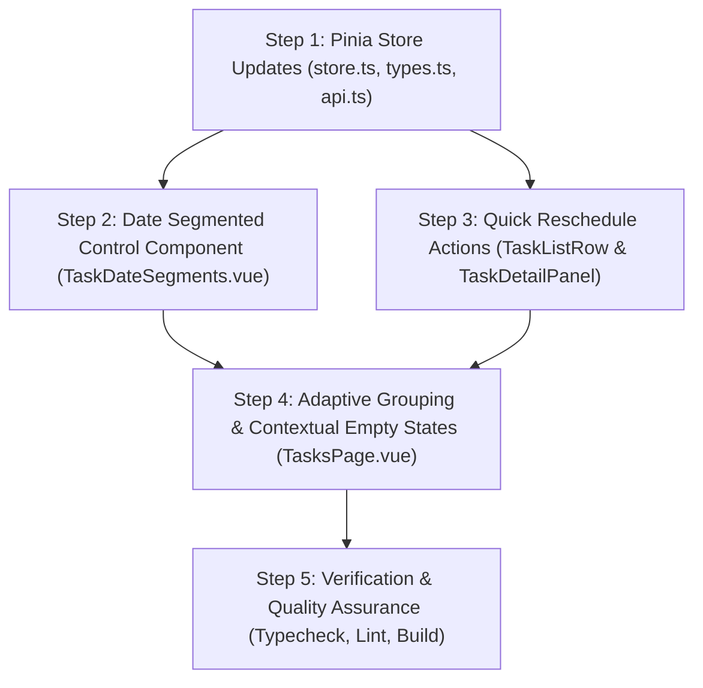

# Plan 015: Tasks Page Date Segments (Today vs. Upcoming vs. Backlog)

## Status

Completed

---

## Specification

### Primary Behavioral Source of Truth

- [docs/specs/ui/tasks-and-inbox-ui.md](file:///Users/metamartin/Documents/RoutMartin/productivity-os/docs/specs/ui/tasks-and-inbox-ui.md) (Amended §7, §7.1–§7.7, §18, §31 AC-UI-010 to AC-UI-017)
- [docs/specs/tasks/task-management.md](file:///Users/metamartin/Documents/RoutMartin/productivity-os/docs/specs/tasks/task-management.md) (Task entity, due dates, full-replace update)
- [docs/specs/planning/daily-planning.md](file:///Users/metamartin/Documents/RoutMartin/productivity-os/docs/specs/planning/daily-planning.md) (Calendar days, today commitments)

### Acceptance Criteria in Scope

- **AC-UI-010:** Top-Level Date Segmented Control with Reactive Count Badges
- **AC-UI-011:** Exact Date Filtering Rules and Overdue Inclusion
- **AC-UI-012:** Multi-Dimensional Coexistence with Status Filters and Search
- **AC-UI-013:** Quick Date Reschedule Actions on Task Row
- **AC-UI-014:** Quick Date Reschedule Actions on Task Detail Panel
- **AC-UI-015:** Contextual Segment-Specific Empty States
- **AC-UI-016:** Adaptive Grouping per Segment (Upcoming by Date, Backlog by Project)
- **AC-UI-017:** URL Query Parameter Synchronization and Navigation State Preservation

### Supporting Architecture & Decisions

- **Domain Architecture:** [docs/architecture/domain.md](file:///Users/metamartin/Documents/RoutMartin/productivity-os/docs/architecture/domain.md) (Task lifecycle, scheduling commitments, backlog triage)
- **System Architecture:** [docs/architecture/system.md](file:///Users/metamartin/Documents/RoutMartin/productivity-os/docs/architecture/system.md)
- **ADR-001: SDD Workflow** (Gating implementation on approved specification and plan)
- **ADR-002: Technology Stack** (Vue 3, Pinia, TypeScript, Vite)
- **ADR-005: API Architecture** (REST `/api/v1/tasks/{id}`, full-replace semantics on `PUT`)
- **ADR-006: Time and Timezone Handling** (IANA user timezone, `toISODateInZone`, ISO-8601 calendar dates `YYYY-MM-DD`)
- **ADR-007: Package and Module Layout** (`apps/web/src/features/tasks`, `apps/web/src/pages/TasksPage.vue`)

---

## Architectural Decisions & Product Choices

### D1: Date Segment Filter State & URL Routing

- **Option A (Recommended):** Store `dateSegment` in `features/tasks/store.ts` as a reactive Pinia ref (`'ALL' | 'TODAY' | 'UPCOMING' | 'BACKLOG'`), bidirectionally synchronized with `route.query.segment` in `TasksPage.vue`.
  - Enables deep links (e.g. `/tasks?segment=backlog` from sidebar, command palette, or bookmarks).
  - Allows `TaskDetailPanel` and global shortcuts to react to the currently active segment.
  - Keeps URL updates lightweight via `router.replace` without triggering reloads or navigation resets.
- **Option B:** Component-local `ref<DateSegment>` purely inside `TasksPage.vue`.
  - Cannot be read or modified by child components without prop drilling / event cascading.
- **Decision:** **Option A**. Follows standard Pinia state pattern used for `statusFilter` and `searchQuery`, while ensuring URL deep-linking and browser navigation integrity.

### D2: Default Segment on Landing (`TODAY` vs. `ALL`)

- **Option A (Recommended):** Default to `TODAY` when arriving at `/tasks` without a `?segment=` query parameter.
  - Aligns directly with the North Star product goal: _"Open the platform -> Know what to do -> Do it with intention and focus."_
  - Immediately presents the user's committed work for today without overwhelming them with backlog volume.
  - If today has no tasks, the contextual empty state prompts them to pull work from the backlog or schedule a task.
- **Option B:** Default to `ALL`.
  - Traditional exhaustive view, but introduces cognitive overload on arrival.
- **Option C:** Adaptive default (select `TODAY` if today count > 0, otherwise `BACKLOG`).
  - Unpredictable landing destination based on dynamic data.
- **Decision:** **Option A**. Flagged as **Pre-Implementation Decision D2** for human confirmation.

### D3: Quick Reschedule UX Pattern

- **Option A (Recommended):** 1-click quick reschedule action chips/controls on hover/focus in `TaskListRow.vue` and dedicated action buttons in `TaskDetailPanel.vue` ("Today", "Tomorrow", "Move to Backlog").
  - "Today" sets `dueDate = todayISO`.
  - "Tomorrow" sets `dueDate = tomorrowISO`.
  - "Move to Backlog" clears `dueDate = null`.
  - No dialog modal required for everyday triaging; fast and tactile.
- **Option B:** Full date-picker dialog only.
  - High friction for the most common operations (delaying to tomorrow or clearing back to backlog).
- **Decision:** **Option A**. Provides frictionless micro-actions essential for calm, intentional daily planning.

### D4: Segment Counts Reactivity and Scope

- **Option A (Recommended):** Global segment counts compute total active tasks belonging to each date segment (`ALL`, `TODAY`, `UPCOMING`, `BACKLOG`), independent of the secondary `statusFilter`.
  - The segmented control tabs act as global compass navigation across temporal buckets.
  - Secondary status filter (`PLANNED`, `IN_PROGRESS`, `COMPLETED`) filters tasks _within_ the selected date bucket.
  - Tab count badges remain stable and predictable while filtering statuses.
- **Option B:** Segment count badges dynamically reflect the active secondary status filter.
  - Confusing behavior: selecting "In Progress" would cause Backlog tab count to drop to only In Progress items, hiding the actual backlog size.
- **Decision:** **Option A**. Matches industry best practices (e.g. Things 3, Todoist) for multi-tier filtering.

---

## Vertical Steps & Implementation Plan



---

### Step 1: Pinia Store Updates (`store.ts`, `types.ts`, `api.ts`)

**Status:** completed

- **Files/modules:**
  - `apps/web/src/features/tasks/types.ts`
  - `apps/web/src/features/tasks/store.ts`
  - `apps/web/src/features/tasks/api.ts`
- **Spec/AC:** `AC-UI-011`, `AC-UI-012`, `AC-UI-013`
- **Behavior:**
  - In `types.ts`:
    - Define `DateSegment` union type:
      ```typescript
      export type DateSegment = "ALL" | "TODAY" | "UPCOMING" | "BACKLOG";
      ```
    - Define human-readable labels:
      ```typescript
      export const DATE_SEGMENT_LABELS: Record<DateSegment, string> = {
        ALL: "All",
        TODAY: "Today",
        UPCOMING: "Upcoming",
        BACKLOG: "Backlog",
      };
      ```
  - In `store.ts`:
    - Add state: `dateSegment = ref<DateSegment>('TODAY')`.
    - Add action: `setDateSegment(segment: DateSegment): void`.
    - Compute `todayISO`:
      ```typescript
      const auth = useAuthStore();
      const todayISO = computed(() =>
        toISODateInZone(new Date(), auth.user?.timezone ?? undefined),
      );
      ```
    - Compute `tomorrowISO`:
      ```typescript
      const tomorrowISO = computed(() => {
        const tomorrow = new Date();
        tomorrow.setDate(tomorrow.getDate() + 1);
        return toISODateInZone(tomorrow, auth.user?.timezone ?? undefined);
      });
      ```
    - Define `matchesDateSegment(task: Task, segment: DateSegment): boolean`:
      - `'TODAY'`: `task.dueDate === todayISO.value || (task.dueDate !== null && task.dueDate < todayISO.value && task.status !== 'COMPLETED' && task.status !== 'CANCELLED')` (captures today commitments plus active overdue tasks per AC-UI-011).
      - `'UPCOMING'`: `task.dueDate !== null && task.dueDate > todayISO.value`.
      - `'BACKLOG'`: `task.dueDate === null`.
      - `'ALL'`: `true`.
    - Add `segmentCounts` computed getter:
      ```typescript
      const segmentCounts = computed<Record<DateSegment, number>>(() => ({
        ALL: tasks.value.filter((t) => t.status !== "CANCELLED").length,
        TODAY: tasks.value.filter(
          (t) => matchesDateSegment(t, "TODAY") && t.status !== "CANCELLED",
        ).length,
        UPCOMING: tasks.value.filter(
          (t) => matchesDateSegment(t, "UPCOMING") && t.status !== "CANCELLED",
        ).length,
        BACKLOG: tasks.value.filter(
          (t) => matchesDateSegment(t, "BACKLOG") && t.status !== "CANCELLED",
        ).length,
      }));
      ```
    - Update `visibleTasks` to enforce conjunction:
      ```typescript
      tasks.value.filter(
        (task) =>
          matchesDateSegment(task, dateSegment.value) &&
          matchesFilter(task) &&
          matchesSearch(task),
      );
      ```
    - Add `setDueDate(taskId: string, dueDate: string | null): Promise<void>` action:
      - Validates task existence.
      - In mock mode: immediately updates `task.dueDate = dueDate`, `task.updatedAt = new Date().toISOString()`.
      - In real API mode: sends `PUT /api/v1/tasks/{id}` with `UpdateTaskRequest` preserving `title`, `description`, `priority`, `energy`, `estimatedDurationMinutes` and applying new `dueDate`. Replaces task in state with backend `TaskResponse`.
      - Handles network errors gracefully and sets `lastError`.
- **Dependencies:** `toISODateInZone` from `@/lib/utils/date`, `useAuthStore` from `@/features/auth/store`, `tasksApi.update` from `./api`.
- **Tests:** `pnpm run typecheck`, Pinia store state unit test or scenario verification.
- **Risks/ambiguities:** Backend `PUT /api/v1/tasks/{id}` has full-replace semantics (overwrites nullable fields). Must pass existing non-null fields so description/priority/energy are not unintentionally cleared.

---

### Step 2: Date Segmented Control Component (`TaskDateSegments.vue`)

**Status:** completed

- **Files/modules:**
  - `apps/web/src/features/tasks/components/TaskDateSegments.vue` (new component)
  - `apps/web/src/pages/TasksPage.vue`
- **Spec/AC:** `AC-UI-010`, `AC-UI-017`
- **Behavior:**
  - Create `TaskDateSegments.vue` wrapping accessible tabs:
    - Renders segmented bar with 4 tabs: "All", "Today", "Upcoming", "Backlog".
    - Displays reactive count badge next to each label: `segmentCounts[key]`.
    - Accessible markup: `role="tablist"`, `role="tab"`, `aria-selected="segment === active"`, keyboard arrow keys (`ArrowLeft`, `ArrowRight`, `Home`, `End`) to navigate.
    - Emits `change(segment: DateSegment)`.
  - In `TasksPage.vue`:
    - Insert `<TaskDateSegments :active="store.dateSegment" :counts="store.segmentCounts" @change="onSegmentChange" />` directly in the page header / top toolbar area.
- **Dependencies:** Step 1 (`DateSegment`, `segmentCounts`).
- **Tests:** `pnpm run typecheck`, `pnpm run lint`.
- **Risks/ambiguities:** Styling must integrate naturally with the "Calm Command Center" design language without visually clashing with the secondary `TaskFilters` row.

---

### Step 3: Quick Reschedule Actions in `TaskListRow.vue` & `TaskDetailPanel.vue`

**Status:** completed

- **Files/modules:**
  - `apps/web/src/features/tasks/components/TaskListRow.vue`
  - `apps/web/src/features/tasks/components/TaskDetailPanel.vue`
- **Spec/AC:** `AC-UI-013`, `AC-UI-014`
- **Behavior:**
  - In `TaskListRow.vue`:
    - Surface quick reschedule controls on the row (or beside the due date badge):
      - Quick actions: "Today" (`todayISO`), "Tomorrow" (`tomorrowISO`), "Backlog" (`null`).
      - Clicking a reschedule action invokes `store.setDueDate(props.task.id, targetDate)` with `.stop` modifier so the row is not selected.
    - If task is overdue (`task.dueDate < todayISO` and active), display a prominent warning tone on the due date chip (`tone="warning"`).
  - In `TaskDetailPanel.vue`:
    - In the metadata list below the Due Date entry, render a clean horizontal button strip:
      - Quick button: `Today` (Calendar icon)
      - Quick button: `Tomorrow` (CalendarPlus icon)
      - Quick button: `Move to Backlog` (FolderInput or Archive icon)
    - Clicking dispatches `store.setDueDate(task.id, targetDate)`.
    - Updates panel state immediately without closing the panel.
- **Dependencies:** Step 1 (`setDueDate`, `todayISO`, `tomorrowISO`).
- **Tests:** `pnpm run typecheck`, `pnpm run lint`.
- **Risks/ambiguities:** Clicking quick actions on `TaskListRow` must strictly stop propagation to prevent toggling the detail panel.

---

### Step 4: Adaptive Grouping & Contextual Empty States in `TasksPage.vue`

**Status:** completed

- **Files/modules:**
  - `apps/web/src/pages/TasksPage.vue`
- **Spec/AC:** `AC-UI-015`, `AC-UI-016`, `AC-UI-017`
- **Behavior:**
  - **Adaptive Grouping:**
    - Maintain a boolean `userOverrodeGrouping = ref(false)`.
    - When `store.dateSegment` switches:
      - If `!userOverrodeGrouping.value`:
        - When `dateSegment === 'UPCOMING'`: auto-set `groupMode = 'date'` (chronological days).
        - When `dateSegment === 'BACKLOG'`: auto-set `groupMode = 'project'` (since due date is null).
        - When `dateSegment === 'TODAY'`: auto-set `groupMode = 'project'` or priority.
        - When `dateSegment === 'ALL'`: auto-set `groupMode = 'project'`.
    - If user explicitly clicks the Date or Project grouping toggle button, set `userOverrodeGrouping.value = true` so their preference is preserved.
  - **Contextual Empty States:**
    - Refactor `emptyCopy` and icon selection:
      - If search active: Title "No tasks found.", Description "Nothing matches '<query>'. Try a different search.", CTA "Clear search".
      - If status filter active: Title "Nothing here.", Description "No tasks with this status right now.", CTA "Clear filter".
      - If `dateSegment === 'TODAY'`: Title "All caught up for today.", Description "No tasks scheduled for today. Pull tasks from your backlog or enjoy the calm.", CTA "+ Schedule for Today" (opens create dialog prefilled with `dueDate = todayISO`).
      - If `dateSegment === 'UPCOMING'`: Title "No upcoming tasks.", Description "Your future schedule is clear. Plan ahead by scheduling dates on your tasks.", CTA "+ Plan a Task".
      - If `dateSegment === 'BACKLOG'`: Title "Backlog is clear.", Description "All your tasks are scheduled on the calendar. Capture new ideas anytime.", CTA "+ Capture Task" (opens create dialog with `dueDate = null`).
      - If `dateSegment === 'ALL'`: Title "No tasks yet.", Description "Capture something you're thinking about.", CTA "+ New Task".
  - **URL Query Synchronization:**
    - On mount: inspect `route.query.segment`. If valid (`all | today | upcoming | backlog`), initialize `store.setDateSegment(segment.toUpperCase())`.
    - Watch `store.dateSegment`: update `route.query.segment` via `router.replace({ query: { ...route.query, segment: store.dateSegment.toLowerCase() } })`.
    - Watch `route.query.segment`: if query changes (e.g. browser back/forward), update `store.dateSegment` accordingly.
- **Dependencies:** Steps 1, 2, 3.
- **Tests:** `pnpm run typecheck`, `pnpm run lint`.
- **Risks/ambiguities:** Ensuring `router.replace` does not cause infinite watch loops with `store.dateSegment`.

---

### Step 5: Verification & Quality Assurance

**Status:** completed

- **Files/modules:**
  - All modified files across `apps/web`.
- **Spec/AC:** All (`AC-UI-010` to `AC-UI-017`)
- **Verification Plan:**
  - Run typecheck: `pnpm --filter @productivity-os/web typecheck` (must pass 0 errors).
  - Run linter: `pnpm --filter @productivity-os/web lint` (must pass 0 errors).
  - Run build: `pnpm --filter @productivity-os/web build` (must pass without warnings).
  - Execute end-to-end manual verification matrix:
    1. Verify segment tab bar displays All, Today, Upcoming, Backlog with accurate reactive count badges.
    2. Click each segment tab and confirm tasks filter accurately.
    3. Test overdue tasks: verify that a past-due active task appears under Today with warning badge.
    4. Select Backlog, then toggle status filter to "In Progress": verify only in-progress unscheduled tasks appear.
    5. On a task row in Backlog, click "Today": verify task moves instantly to Today and tab count badges update.
    6. In TaskDetailPanel, click "Move to Backlog": verify task due date is cleared and moves to Backlog.
    7. Empty states: force empty state on Today and Backlog; verify customized copy, icons, and CTA actions.
    8. URL routing: navigate to `/tasks?segment=backlog`; confirm Backlog tab is active. Click browser back; verify previous tab activates.
- **Risks/ambiguities:** None identified.

---

## Traceability Matrix

| Acceptance Criteria                              | Spec Reference                         | Implementation Step | Verification Suite / Scenarios                    |
| ------------------------------------------------ | -------------------------------------- | ------------------- | ------------------------------------------------- |
| **AC-UI-010** (Segmented control & count badges) | `tasks-and-inbox-ui.md` §7.2, §31      | Step 2, Step 4      | `TaskDateSegments.vue`, `typecheck`, Visual check |
| **AC-UI-011** (Date filtering rules & overdue)   | `tasks-and-inbox-ui.md` §7.1, §31      | Step 1, Step 4      | `store.ts` (`matchesDateSegment`), `typecheck`    |
| **AC-UI-012** (Coexistence with status & search) | `tasks-and-inbox-ui.md` §7.3, §31      | Step 1, Step 4      | `store.ts` (`visibleTasks`), `typecheck`          |
| **AC-UI-013** (Quick reschedule on task row)     | `tasks-and-inbox-ui.md` §7.4, §31      | Step 1, Step 3      | `TaskListRow.vue`, `setDueDate`, `typecheck`      |
| **AC-UI-014** (Quick reschedule in detail panel) | `tasks-and-inbox-ui.md` §7.4, §31      | Step 1, Step 3      | `TaskDetailPanel.vue`, `setDueDate`, `typecheck`  |
| **AC-UI-015** (Segment contextual empty states)  | `tasks-and-inbox-ui.md` §7.6, §18, §31 | Step 4              | `TasksPage.vue` (`emptyCopy`), Visual check       |
| **AC-UI-016** (Adaptive grouping per segment)    | `tasks-and-inbox-ui.md` §7.5, §31      | Step 4              | `TasksPage.vue` (`groupMode`), Visual check       |
| **AC-UI-017** (URL query param preservation)     | `tasks-and-inbox-ui.md` §7.7, §31      | Step 4              | `TasksPage.vue` (vue-router watcher), URL check   |

---

## Pre-Implementation Decisions (Must Be Resolved First)

- **D1: Date Segment State Storage & URL Synchronization:**

  - **Status:** **PROPOSED (Option A: Pinia store + router.replace)**.
  - Store `dateSegment` in `features/tasks/store.ts` and sync bidirectionally with `route.query.segment`.

- **D2: Default Segment on Landing (`/tasks`):**

  - **Status:** **PROPOSED (Option A: `TODAY`)**.
  - Defaulting to `TODAY` directly fulfills the North Star user goal: _"Open the platform -> Know what to do -> Do it with intention and focus."_ Backlog and All remain 1 click away.

- **D3: Quick Reschedule UX Pattern:**

  - **Status:** **PROPOSED (Option A: 1-click chips on row + button strip in detail panel)**.
  - "Today", "Tomorrow", and "Move to Backlog" exposed directly for instant triage.

- **D4: Segment Count Badges Reactivity:**
  - **Status:** **PROPOSED (Option A: Total active tasks per date bucket)**.
  - Count badges provide an unwavering global compass of task volume regardless of secondary status filters.

---

## Out of Scope for This Plan

1. **Recurring Task Generation Engine:** Automated generation of recurrent task instances across future calendar dates (covered under separate recurrence engine specification).
2. **Natural Language Date Parsing:** NLP parser for strings like "due next Friday at 3pm" (covered under quick capture / AI triage).
3. **Multi-Day Drag and Drop Kanban Board:** Moving tasks across days via drag-and-drop gestures.
4. **Time Blocking Calendar Grid:** Scheduling tasks into specific hourly blocks on the Daily Schedule (covered by Schedule workspace).
5. **Backend Database Migrations:** No schema or Flyway changes required; existing `due_date` column and `PUT /api/v1/tasks/{id}` endpoint are fully leveraged.

---

## Change History

- **2026-11-12:** Initial Draft created for Plan 015 ("Tasks Page Date Segments: Today vs. Upcoming vs. Backlog"). Establishes 5-step implementation slice, Pre-Implementation Decisions D1–D4, and full traceability matrix against Acceptance Criteria `AC-UI-010` through `AC-UI-017`.
