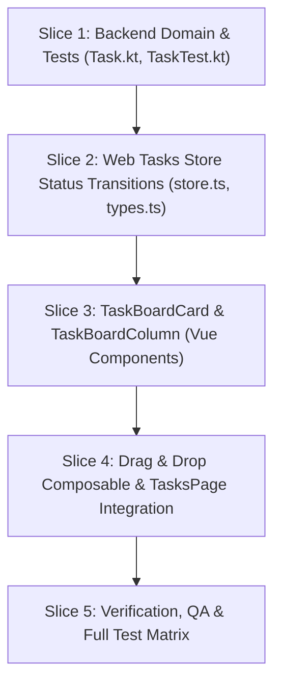

# Plan 019: Tasks Page 3-Column Kanban Board Layout & Drag-and-Drop Interactions

## Status

Completed

---

## Specification

### Primary Behavioral Source of Truth

- [docs/specs/ui/tasks-and-inbox-ui.md](file:///Users/metamartin/Documents/RoutMartin/productivity-os/docs/specs/ui/tasks-and-inbox-ui.md) (Amended §8.1 "Board View (3-Column Kanban Layout)", §8.2 "Drag-and-Drop Lifecycle State Transitions & Interaction Model", §18.6 "Board Column Empty States", §31 AC-UI-018 to AC-UI-023)
- [docs/specs/tasks/task-management.md](file:///Users/metamartin/Documents/RoutMartin/productivity-os/docs/specs/tasks/task-management.md) (Allowed transitions, Rule 20 status demotion, AC-010, AC-011, AC-017, AC-019, AC-031, AC-036)

### Acceptance Criteria in Scope

- **AC-UI-018:** 3-Column Kanban Board Layout (To Do, In Progress, Done)
- **AC-UI-019:** Drag-and-Drop Lifecycle State Transitions
- **AC-UI-020:** Disambiguating Click (Open Details) from Drag
- **AC-UI-021:** Visual Drag Feedback and Drop Target Indicators
- **AC-UI-022:** Keyboard Reordering & Status Transition (Grab-Move-Drop)
- **AC-UI-023:** Column-Specific Empty States & Quick Creation

### Supporting Architecture & Decisions

- **Domain Architecture:** [docs/architecture/domain.md](file:///Users/metamartin/Documents/RoutMartin/productivity-os/docs/architecture/domain.md) (Task lifecycle states, transitions, owner isolation)
- **System Architecture:** [docs/architecture/system.md](file:///Users/metamartin/Documents/RoutMartin/productivity-os/docs/architecture/system.md)
- **ADR-001: SDD Workflow** (Specification before implementation; mandatory Phase 2 approval gate)
- **ADR-002: Technology Stack** (Spring Boot 3 + Kotlin; Vue 3, Pinia, TypeScript, Vite; zero external drag-and-drop dependencies)
- **ADR-004: Authentication and User Isolation** (Tokens, user-scoped queries, no cross-user mutations)
- **ADR-005: API Architecture** (REST endpoints `/api/v1/tasks/{id}/*`, structured error responses)
- **ADR-006: Time and Timezone Handling** (IANA timezone, ISO-8601 calendar dates `YYYY-MM-DD`)
- **ADR-007: Package and Module Layout** (`apps/web/src/features/tasks`, `apps/api/src/main/kotlin/com/productivityos/task`)

---

## Architectural Decisions & Product Choices

### D1: Board View Mode Placement vs. List View

- **Context:** `TasksPage.vue` currently supports a view mode toggle between "List" (`viewMode = 'list'`) and a secondary date-grouped "Grid" (`viewMode = 'grid'`). The date-grouped grid provides little tactical utility and duplicates the list view with heavier cards.
- **Option A (Recommended):** Replace "Grid" with "Board" (`viewMode = 'board'`).
  - In the toolbar view control, the layout toggle switches between List (icon: `List`) and Board (icon: `Columns3` / `Kanban`).
  - When `viewMode = 'board'`, the workspace renders 3 workflow columns: "To Do", "In Progress", and "Done".
  - The secondary grouping toggle (`Date` vs `Project`) is active in List mode; in Board mode, tasks are grouped inherently by lifecycle workflow state, so the grouping toggle is hidden or disabled to avoid cognitive clash.
  - The view preference (`list` vs `board`) is stored in local component state and synchronized with URL query parameter `?view=board|list` (or `localStorage`).
- **Option B:** Add Board as a third toggle option (List, Grid, Board).
  - Clutters the toolbar and preserves the redundant date-grid.
- **Decision:** **Option A**. Replaces the date-grid completely with the modern 3-column Kanban board, matching Linear, Jira, and Notion paradigms.

### D2: Drag-and-Drop Implementation Strategy (Zero New Dependencies)

- **Context:** Adding third-party drag-and-drop libraries (e.g. `sortablejs`, `vue-draggable-plus`, `vuedraggable`) increases bundle weight, risks hydration/SSR conflicts, complicates custom styling (glassmorphism/accents), and often degrades accessibility.
- **Option A (Recommended):** Native Pointer Events & Composable (`useTaskDragAndDrop.ts`).
  - Uses native Pointer Events (`pointerdown`, `pointermove`, `pointerup`, `pointercancel`) with `setPointerCapture`.
  - Implements a strict **4px movement threshold** to disambiguate instantaneous clicks (which open the contextual `TaskDetailPanel`) from intentional card dragging.
  - Uses Vue `<TransitionGroup>` with FLIP animation for smooth 60fps card movement.
  - Renders an elevated preview (`scale(1.025)`, shadow, accent border) and drop insertion indicator line.
  - Full keyboard accessibility: <kbd>Space</kbd>/<kbd>Enter</kbd> to grab, arrow keys to move/reorder, <kbd>Space</kbd>/<kbd>Enter</kbd> to drop, <kbd>Escape</kbd> to cancel, with `aria-live` announcements.
- **Option B:** HTML5 Drag & Drop API (`draggable="true"`, `dragstart`, `dragover`, `drop`).
  - Clunky default ghost preview, poor mobile touch support, and inconsistent styling across Chromium/WebKit/Firefox.
- **Option C:** External npm package (`vue-draggable-plus`).
  - Adds ~15KB minified dependency and restricts custom insertion line / preview styling.
- **Decision:** **Option A**. Zero external dependencies (per ADR-002), pixel-perfect styling alignment with the Calm Command Center design system, and full keyboard accessibility.

### D3: Backend Alignment for In Progress -> Planned Demotion

- **Context:** Task Management specification line 64 and Rule 20 explicitly authorize:
  *"In Progress → Planned (status demotion / pause)"*.
  However, in `apps/api/src/main/kotlin/com/productivityos/task/domain/Task.kt`:
  ```kotlin
  fun plan(): Task {
      require(status == TaskStatus.INBOX || status == TaskStatus.PLANNED) {
          "Cannot transition from $status to PLANNED"
      }
      require(deletedAt == null) { "Cannot transition a deleted task" }
      return copy(status = TaskStatus.PLANNED)
  }
  ```
  `plan()` currently throws an `IllegalArgumentException` (HTTP 400/409) if the task is in `IN_PROGRESS`.
- **Option A (Recommended):** Update `Task.kt`'s `fun plan()` to permit `status == TaskStatus.IN_PROGRESS`.
  - Aligns the domain entity with the approved Task Management spec (line 64 & Rule 20).
  - Existing `POST /api/v1/tasks/{id}/plan` in `TaskController.kt` immediately functions for moving a task from "In Progress" back to "To Do".
  - Requires zero database schema changes and zero controller changes.
  - Add unit test in `TaskTest.kt` verifying `IN_PROGRESS -> PLANNED` succeeds.
- **Option B:** Introduce a brand new endpoint `POST /api/v1/tasks/{id}/demote`.
  - Unnecessary endpoint proliferation when `POST /api/v1/tasks/{id}/plan` already semantics-wise means "move task to Planned state".
- **Decision:** **Option A**. Adjust `Task.kt` in Slice 1 to permit `status == TaskStatus.IN_PROGRESS` in `plan()`.

### D4: Coexistence with Date Segments

- **Context:** The Tasks workspace uses 4 Date Segments: "All", "Today", "Upcoming", and "Backlog" (Plan 015, AC-UI-010 to AC-UI-017).
- **Option A (Recommended):** Date Segments filter the task dataset *prior* to partitioning into the 3 Kanban columns.
  - Selecting "Today" shows Today's "To Do", Today's "In Progress", and Today's "Done".
  - Selecting "Backlog" shows unscheduled ideas across To Do, In Progress, and Done.
  - Dragging a card between columns transitions only the task's lifecycle `status`, leaving its `dueDate` intact.
  - The secondary toolbar `TaskFilters.vue` (which filters by status) is redundant in Board view because the columns *are* the statuses. When switching to Board view, `statusFilter` defaults to `'ALL'` so all 3 columns are populated.
- **Decision:** **Option A**. Delivers an exceptionally clear mental model: temporal segmentation on top, workflow execution on the board.

---

## Agent Delegation Matrix

| Agent Role | Target Slice | Owned Files & Scope | Verification Command | Dispatch Brief |
| :--- | :--- | :--- | :--- | :--- |
| **`backend`** | Slice 1 | `apps/api/.../Task.kt`<br>`apps/api/.../TaskTest.kt`<br>`apps/api/.../TaskServiceTest.kt` | `./gradlew :apps:api:test --tests "com.productivityos.task.*"` | Relax `plan()` validation to permit `IN_PROGRESS -> PLANNED` status demotion (Rule 20 / AC-019). Verify with unit tests. |
| **`frontend`** | Slices 2, 3, 4 | `apps/web/.../store.ts`<br>`apps/web/.../TaskBoardCard.vue`<br>`apps/web/.../TaskBoardColumn.vue`<br>`apps/web/.../useTaskDragAndDrop.ts`<br>`apps/web/src/pages/TasksPage.vue` | `pnpm --filter @productivity-os/web typecheck && pnpm --filter @productivity-os/web lint && pnpm --filter @productivity-os/web test:unit` | Implement 3-column Kanban board, native pointer drag-and-drop, accessible keyboard grab-move-drop, optimistic undo transitions, and TasksPage integration. |
| **`code-reviewer`** | Slice 5 | Entire `git diff` across `apps/api` and `apps/web` | Independent Audit | Audit all changes against approved specifications, AC-UI-018 through AC-UI-023, ADR-004 (security), and ADR-007 (architecture). |

---

## Concurrent Implementation Slices



---

### Slice 1: Backend Domain Alignment & Unit Tests

**Target:** `apps/api` (Backend Specialist)  
**Status:** pending

- **Files/modules:**
  - `apps/api/src/main/kotlin/com/productivityos/task/domain/Task.kt`
  - `apps/api/src/test/kotlin/com/productivityos/task/TaskTest.kt`
- **Spec/AC:** `Task Management §4 Line 64`, `Rule 20`, `AC-019`, `AC-UI-019`
- **Behavior:**
  - In `Task.kt`:
    - Amend `fun plan(): Task` validation to allow `status == TaskStatus.IN_PROGRESS`:
      ```kotlin
      fun plan(): Task {
          require(status == TaskStatus.INBOX || status == TaskStatus.PLANNED || status == TaskStatus.IN_PROGRESS) {
              "Cannot transition from $status to PLANNED"
          }
          require(deletedAt == null) { "Cannot transition a deleted task" }
          return copy(status = TaskStatus.PLANNED)
      }
      ```
  - In `TaskTest.kt`:
    - Add unit test:
      ```kotlin
      @Test
      fun `plan task from IN_PROGRESS transitions to PLANNED (status demotion / pause)`() {
          val task = Task(id = taskId, ownerId = userId, title = "Test Task", status = TaskStatus.IN_PROGRESS)
          val planned = task.plan()
          assertEquals(TaskStatus.PLANNED, planned.status)
      }
      ```
- **Dependencies:** None.
- **Tests:** `./gradlew :apps:api:test --tests "com.productivityos.task.TaskTest"`
- **Risks/ambiguities:** None. Does not break existing tests because `INBOX` and `PLANNED` continue to pass.

---

### Slice 2: Web Tasks Store Status Transition Helpers

**Target:** `apps/web` (Frontend Specialist)  
**Status:** pending

- **Files/modules:**
  - `apps/web/src/features/tasks/types.ts`
  - `apps/web/src/features/tasks/store.ts`
  - `apps/web/src/features/tasks/api.ts`
- **Spec/AC:** `AC-UI-019`, `AC-UI-022`
- **Behavior:**
  - In `types.ts`:
    - Export `BoardColumnId`:
      ```typescript
      export type BoardColumnId = 'TODO' | 'IN_PROGRESS' | 'DONE';
      ```
  - In `store.ts`:
    - Add consolidated action `transitionTaskStatus(taskId: string, targetStatus: TaskStatus): Promise<void>`:
      - Validates task existence. If `task.status === targetStatus`, no-op.
      - Captures `previousTask = { ...task }` for rollback and Undo toast.
      - In **Mock Mode (`USE_MOCK`)**:
        - Optimistically updates `task.status = targetStatus`.
        - If `targetStatus === 'COMPLETED'`, sets `task.completedAt = new Date().toISOString()`; otherwise clears `task.completedAt = null`.
        - Triggers `showToast({ kind: ..., title: task.title })`.
      - In **Real API Mode**:
        - Selects the exact API call:
          - Target `PLANNED`: If previous was `COMPLETED`, calls `tasksApi.uncomplete(taskId, 'PLANNED')`; otherwise calls `tasksApi.plan(taskId)`.
          - Target `IN_PROGRESS`: If previous was `COMPLETED`, calls `tasksApi.uncomplete(taskId, 'IN_PROGRESS')`; otherwise calls `tasksApi.start(taskId)`.
          - Target `COMPLETED`: Calls `tasksApi.complete(taskId)`.
        - On success: updates local task with returned `TaskResponse` and shows Undo Toast.
        - On failure: reverts task to `previousTask` and sets `lastError = errorMessage(error)`.
- **Dependencies:** Slice 1 (Backend `plan()` endpoint demotion support).
- **Tests:** `pnpm --filter @productivity-os/web typecheck`.
- **Risks/ambiguities:** Ensuring chained or uncomplete calls maintain consistent completedAt nulling across all states.

---

### Slice 3: TaskBoardCard & TaskBoardColumn Components

**Target:** `apps/web` (Frontend Specialist)  
**Status:** pending

- **Files/modules:**
  - `apps/web/src/features/tasks/components/TaskBoardCard.vue` (new component)
  - `apps/web/src/features/tasks/components/TaskBoardColumn.vue` (new component)
- **Spec/AC:** `AC-UI-018`, `AC-UI-020`, `AC-UI-021`, `AC-UI-023`
- **Behavior:**
  - **`TaskBoardCard.vue`**:
    - **Props:** `task: Task`, `active: boolean`, `isDragging: boolean`, `isGrabbed: boolean`.
    - **Emits:** `select(taskId: string)`, `toggleComplete(taskId: string)`, `dragStart(event: PointerEvent, taskId: string)`, `keydown(event: KeyboardEvent, taskId: string)`.
    - **Markup & Styling:**
      - Surface card with calm borders (`var(--surface-1)`, `border: 1px solid var(--border-subtle)`).
      - Interactive completion checkbox (`.check`) with checkmark animation on click.
      - Bold task title (struck through and muted if `COMPLETED`).
      - Project pill with project dot indicator (`color: project.color`).
      - Metadata chips: scheduled time (`Clock`), estimated duration (`formatMinutes`), recurrence (`Repeat`), due date (`CalendarDays` with overdue warning tone if past due).
      - Priority segmented indicator (`TaskPrioritySegments`).
      - Dragging states: `.dragging` applies `opacity: 0.4`, `.grabbed` applies keyboard focus ring (`outline: 2px solid var(--accent-strong)`).
      - Pointer listeners: `@pointerdown="onPointerDown"`.
  - **`TaskBoardColumn.vue`**:
    - **Props:**
      - `columnId: BoardColumnId` (`'TODO' | 'IN_PROGRESS' | 'DONE'`)
      - `title: string`
      - `tasks: Task[]`
      - `isDropTarget: boolean`
      - `draggedTaskId: string | null`
      - `dropIndex: number | null`
    - **Emits:** `createTask(columnId: BoardColumnId)`, `cardSelect(taskId: string)`, `cardComplete(taskId: string)`.
    - **Markup & Styling:**
      - Column header: Title ("To Do", "In Progress", "Done"), reactive task count badge (`.badge.tnum`), and quick `+` button (`UiButton` icon-only) to capture a task directly into this status.
      - Card list container with `<TransitionGroup name="board-card">`.
      - Drop insertion marker: horizontal line rendered between cards when `isDropTarget && dropIndex === index`.
      - Empty state (AC-UI-023): When `tasks.length === 0`, renders calm column placeholder copy and CTA.
      - Drop highlight: `.drop-target` applies subtle accent surface tint and illuminated border.
- **Dependencies:** Slice 2 (`types.ts`, `BoardColumnId`).
- **Tests:** `pnpm --filter @productivity-os/web typecheck`, `pnpm --filter @productivity-os/web lint`.
- **Risks/ambiguities:** Ensuring card layout remains compact without overflowing on small viewports.

---

### Slice 4: TasksPage.vue Integration & Drag-and-Drop Composable

**Target:** `apps/web` (Frontend Specialist)  
**Status:** pending

- **Files/modules:**
  - `apps/web/src/features/tasks/composables/useTaskDragAndDrop.ts` (new composable)
  - `apps/web/src/pages/TasksPage.vue`
- **Spec/AC:** `AC-UI-018`, `AC-UI-019`, `AC-UI-020`, `AC-UI-021`, `AC-UI-022`
- **Behavior:**
  - **`useTaskDragAndDrop.ts`**:
    - Reactive state:
      - `draggedTaskId: Ref<string | null>`
      - `sourceColumn: Ref<BoardColumnId | null>`
      - `hoveredColumn: Ref<BoardColumnId | null>`
      - `dropIndex: Ref<number | null>`
      - `pointerPosition: Ref<{ x: number; y: number }>`
      - `grabbedTaskId: Ref<string | null>` (Keyboard grab mode)
    - Pointer mechanics:
      - `startPointerDrag(event: PointerEvent, task: Task, column: BoardColumnId, onSelect: () => void)`:
        - Stores start coordinates `(startX, startY)`.
        - Listens to window `pointermove` and `pointerup`.
        - Calculates Euclidean distance: $\Delta = \sqrt{(x - startX)^2 + (y - startY)^2}$.
        - If pointer releases with $\Delta \le 4\text{px}$, executes `onSelect()` (opens `TaskDetailPanel`) and terminates drag.
        - If $\Delta > 4\text{px}$, establishes `draggedTaskId = task.id`, creates floating elevated card preview, and tracks drop target column/index.
        - On `pointerup`: if over a different column, dispatches `store.transitionTaskStatus(taskId, targetStatus)`. Clears drag state.
    - Keyboard grab mechanics:
      - `onCardKeyDown(event: KeyboardEvent, task: Task, column: BoardColumnId)`:
        - <kbd>Space</kbd> / <kbd>Enter</kbd>: toggles grab mode (`grabbedTaskId.value = task.id`).
        - <kbd>ArrowLeft</kbd> / <kbd>ArrowRight</kbd>: moves grabbed card to preceding/succeeding column, announcing move via live region.
        - <kbd>ArrowUp</kbd> / <kbd>ArrowDown</kbd>: reorders within column.
        - <kbd>Space</kbd> / <kbd>Enter</kbd> (while grabbed): commits drop, calls `store.transitionTaskStatus`, exits grab mode.
        - <kbd>Escape</kbd>: cancels grab mode, reverts card position without network call.
  - **`TasksPage.vue`**:
    - Change `type ViewMode = 'list' | 'board'`.
    - In toolbar: replace Grid button with Board button:
      ```html
      <button
        type="button"
        class="seg-btn icon-only"
        :class="{ active: viewMode === 'board' }"
        title="Board"
        aria-label="Board layout"
        @click="viewMode = 'board'"
      >
        <Columns3 :size="15" :stroke-width="1.75" />
      </button>
      ```
    - Compute column task arrays from `store.visibleTasks`:
      - `todoTasks = computed(() => store.visibleTasks.filter(t => t.status === 'PLANNED' || t.status === 'INBOX'))`
      - `inProgressTasks = computed(() => store.visibleTasks.filter(t => t.status === 'IN_PROGRESS'))`
      - `doneTasks = computed(() => store.visibleTasks.filter(t => t.status === 'COMPLETED'))`
    - When `viewMode === 'board'`:
      - Render `.kanban-board` grid container holding 3 `<TaskBoardColumn>`s.
      - Add responsive CSS: on `<= 1024px`, `.kanban-board` has `overflow-x: auto`, `scroll-snap-type: x mandatory`, and each column has `min-width: 320px`, `scroll-snap-align: start`.
    - Floating Drag Preview: When `draggedTaskId` is active, render teleported or absolute-positioned preview card tracking cursor position (`transform: translate3d(x, y, 0) scale(1.025)` with `pointer-events: none`).
- **Dependencies:** Slices 2 & 3 (`store.transitionTaskStatus`, `TaskBoardCard`, `TaskBoardColumn`).
- **Tests:** `pnpm --filter @productivity-os/web typecheck`, `pnpm --filter @productivity-os/web lint`.
- **Risks/ambiguities:** Ensuring window pointer listeners are safely unregistered on component unmount or pointer cancel.

---

### Slice 5: Verification, QA & Full Test Matrix

**Target:** Backend & Frontend (Full-Stack Engineer)  
**Status:** pending

- **Files/modules:** All modified files across `apps/api` and `apps/web`.
- **Spec/AC:** `AC-UI-018` through `AC-UI-023`, `Task Management Rule 20`.
- **Verification Plan:**
  - **Backend Automated Tests:**
    - Run `./gradlew :apps:api:test --tests "com.productivityos.task.*"` (0 failures).
  - **Frontend Automated Verification:**
    - Run `pnpm --filter @productivity-os/web typecheck` (0 errors).
    - Run `pnpm --filter @productivity-os/web lint` (0 errors).
    - Run `pnpm --filter @productivity-os/web build` (build succeeds cleanly).
  - **End-to-End Manual Verification Matrix:**
    1. **Board Layout:** Switch toolbar layout toggle to "Board". Confirm 3 columns appear: "To Do", "In Progress", "Done".
    2. **Click Disambiguation (AC-UI-020):** Click a card without dragging; confirm `TaskDetailPanel` opens instantly.
    3. **Drag to In Progress (AC-UI-019):** Drag a card from "To Do" to "In Progress". Confirm:
       - Drop indicator line shows preview position.
       - Dropping immediately moves card to "In Progress".
       - In real API mode: `POST /api/v1/tasks/{id}/start` succeeds with HTTP 200.
       - Undo Toast appears anchored at bottom-center.
    4. **Drag to Done (AC-UI-019):** Drag a card from "In Progress" or "To Do" to "Done". Confirm card is completed, title is struck through, and `POST /api/v1/tasks/{id}/completion` is sent.
    5. **Status Demotion (AC-UI-019, Slice 1):** Drag a card from "In Progress" back to "To Do". Confirm `POST /api/v1/tasks/{id}/plan` succeeds without 409 conflict and card stays in "To Do".
    6. **Uncompletion from Done (AC-UI-019):** Drag a card from "Done" to "In Progress". Confirm `POST /api/v1/tasks/{id}/uncompletion` (`targetStatus: "IN_PROGRESS"`) succeeds and completion timestamp is cleared.
    7. **Keyboard Reordering (AC-UI-022):** Focus a card using <kbd>Tab</kbd>. Press <kbd>Space</kbd> (enters grabbed mode). Press <kbd>ArrowRight</kbd> to move column. Press <kbd>Enter</kbd> to drop. Confirm API transition fires and focus is maintained.
    8. **Date Segments Integration:** Switch between "Today", "Upcoming", and "Backlog" date segments. Confirm the Kanban board reactively updates to show the cards belonging to that date segment.
    9. **Empty States & Quick Creation (AC-UI-023):** On a column with zero tasks, confirm column empty state copy renders. Click "+" button on column header; confirm create dialog opens pre-configured with the corresponding column status.
    10. **Responsive Horizontal Scroll:** Resize browser viewport below 1024px; confirm horizontal scrolling engages smoothly with scroll snapping.
- **Risks/ambiguities:** None.

---

## Traceability Matrix

| Acceptance Criteria | Spec Reference | Implementation Step | Verification Suite / Scenarios |
| :--- | :--- | :--- | :--- |
| **AC-UI-018** (3-Column Kanban Board Layout) | `tasks-and-inbox-ui.md` §8.1, §31 | Slice 3, Slice 4 | `TaskBoardColumn.vue`, `TasksPage.vue`, Visual layout check |
| **AC-UI-019** (Drag-and-Drop Lifecycle Transitions) | `tasks-and-inbox-ui.md` §8.2.3, §31 | Slice 1, Slice 2, Slice 4 | `TaskTest.kt`, `store.transitionTaskStatus`, E2E drag-and-drop test |
| **AC-UI-020** (Click vs Drag Disambiguation 4px) | `tasks-and-inbox-ui.md` §8.2.1, §31 | Slice 4 | `useTaskDragAndDrop.ts` (threshold check), Manual click vs drag test |
| **AC-UI-021** (Visual Drag Feedback & Indicators) | `tasks-and-inbox-ui.md` §8.2.2, §31 | Slice 3, Slice 4 | Preview card styling, drop insertion marker check |
| **AC-UI-022** (Keyboard Grab-Move-Drop Reordering) | `tasks-and-inbox-ui.md` §8.2.4, §31 | Slice 4 | `useTaskDragAndDrop.ts` (key handlers), Keyboard accessibility test |
| **AC-UI-023** (Column Empty States & Quick Add) | `tasks-and-inbox-ui.md` §8.1, §18.6, §31 | Slice 3, Slice 4 | Empty column check, Quick "+" CTA dialog pre-fill check |

---

## Pre-Implementation Decisions (Must Be Resolved at Phase 2 Gate)

- **D1: View Mode Toggle (Board replacing Grid):**
  - **Status:** **PROPOSED (Option A: Board replaces Grid in toolbar)**.
  - Toolbar layout toggle switches between List and Board. Grouping toggle (Date vs. Project) applies to List; Board is inherently grouped by lifecycle status.
- **D2: Drag-and-Drop Strategy (Zero New Dependencies):**
  - **Status:** **PROPOSED (Option A: Native Pointer Events + Composable)**.
  - Custom composable `useTaskDragAndDrop.ts` with 4px click threshold, FLIP animations, and accessible keyboard grab-move-drop. No external npm packages.
- **D3: Backend Alignment for In Progress -> Planned Demotion:**
  - **Status:** **PROPOSED (Option A: Relax `Task.kt` `plan()` check)**.
  - Allow `status == TaskStatus.IN_PROGRESS` in `Task.kt` `plan()`, conforming directly to Task Management spec line 64 and Rule 20.
- **D4: Coexistence with Date Segments:**
  - **Status:** **PROPOSED (Option A: Date Segments filter before column distribution)**.
  - Top-level date segments ("Today", "Upcoming", "Backlog", "All") partition tasks temporally before distributing into the 3 board columns.

---

## Out of Scope for This Plan

1. **Multi-Column Custom Status Workflows:** User-defined custom lifecycle columns (e.g. "Review", "QA", "Blocked") — the system strictly follows the core domain lifecycle (`PLANNED`, `IN_PROGRESS`, `COMPLETED`).
2. **Multi-Task Drag Selection:** Dragging multiple cards simultaneously.
3. **Cross-Project Swimlanes:** Grouping board columns by project horizontal swimlanes simultaneously.
4. **Third-Party Drag-and-Drop Libraries:** No introduction of external npm dependencies (e.g., `sortablejs`).
5. **Database Schema Migrations:** No Flyway migrations; existing task entity attributes and endpoints are utilized.

---

## Change History

- **2026-11-13:** Initial Draft created for Plan 019 ("Tasks Page 3-Column Kanban Board Layout & Drag-and-Drop Interactions"). Defines 5 concurrent implementation slices, Pre-Implementation Decisions D1–D4, and comprehensive Traceability Matrix mapping against `AC-UI-018` through `AC-UI-023`.
