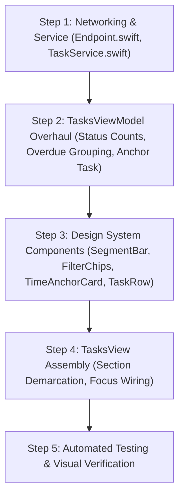

# Plan 022: iOS Tasks Filter & Time-Sticky UI

## Status
Completed

---

## 1. Specification Reference

### Primary Behavioral Source of Truth
- [docs/specs/ui/ios-tasks-time-and-filter-ui.md](file:///Users/metamartin/Documents/RoutMartin/productivity-os/docs/specs/ui/ios-tasks-time-and-filter-ui.md) (Proposed)
- [docs/specs/ui/tasks-and-inbox-ui.md](file:///Users/metamartin/Documents/RoutMartin/productivity-os/docs/specs/ui/tasks-and-inbox-ui.md) (Approved)

### Acceptance Criteria in Scope
- **AC-001:** Fluid Date Segment Bar Rendering & Zero Truncation
- **AC-002:** Status Filter Chips with Reactive Counts
- **AC-003:** Overdue vs. Today Visual Separation
- **AC-004:** Time-Sticky "Up Next" Anchor Card Display & Action
- **AC-005:** Time-Sticky "Happening Now" State
- **AC-006:** TaskRow Duration & Urgency Metadata
- **AC-007:** Completed Tasks Data Loading & Display
- **AC-008:** Quick Reschedule Actions Preservation

---

## 2. Architectural Decisions & Product Choices

### D1: Custom Fluid Pill Segment Bar vs Native `UISegmentedControl`
- **Context:**
  Native `UISegmentedControl` (`Picker(...).pickerStyle(.segmented)`) forces equal 25% width for all 4 segments. On standard iPhone screen widths (375pt to 402pt), `"Upcoming (0)"` truncates to `"Upcoming (..."` as seen in user screenshot `/Users/metamartin/Desktop/Simulator Screenshot - iPhone 17 Pro - 2026-11-14 at 15.41.39.png`.
- **Options Evaluated:**
  - *Option A (Recommended):* Implement a custom SwiftUI fluid pill segment component (`TaskDateSegmentBar`). Segments calculate intrinsic text width with padding. Active segment renders with a smooth sliding capsule background (`AppMotion.spring`), with horizontal scroll support on narrow screens if necessary.
  - *Option B:* Abbreviate segment titles (e.g., "Upcom (0)"). Degrades UX and visual polish.
- **Decision:** **Option A**. Eliminates truncation permanently, matches modern iOS design standards, and maintains full readability across all iPhone form factors.

### D2: Overdue vs. Today Visual Grouping Architecture
- **Context:**
  Currently, `TasksView.swift` bundles both overdue tasks (e.g. from Nov 6 and Sep 2) and today's tasks under a single `"TODAY"` section header, causing cognitive distortion and confusion.
- **Options Evaluated:**
  - *Option A (Recommended):* In the `Today` segment, compute two distinct arrays: `overdueTasks` (`dueDate < todayISO`) and `todayTasks` (`dueDate == todayISO`).
    - If `overdueTasks` is non-empty, render an `"OVERDUE"` section header with warning coral accent (`Color(hex: "FF6B4A")`), count badge, and relative overdue days (`8d overdue`).
    - Render `"TODAY"` section with primary purple accent for tasks scheduled for today.
  - *Option B:* Hide overdue tasks from Today segment entirely and move them to Backlog. Violates spec AC-UI-011 and domain rules.
- **Decision:** **Option A**. Preserves North Star principle that overdue tasks remain active commitments needing attention today, while making the lapse visually explicit and honest.

### D3: Time-Sticky "Now & Next" Anchor Architecture & Cross-System Model
- **Context:**
  The user is fundamentally "sticky with time" (*"I always need to know what time I need to this thing or what I should do at this time... I check the phone then know what to do at what time"*).
- **Architecture:**
  - Introduce `TimeAnchorCardView` at the top of the Today tasks view.
  - State engine:
    1. **Active Focus State:** If `focusViewModel.sessionState.state == .running || .paused`, display "Happening Now", active task title, elapsed/remaining timer, and "Resume Focus" button.
    2. **Up Next State:** If no focus is running, pick the primary today task (top priority, earliest slot). Display current clock time, task title, explicit duration pill (`⏱️ 45m`), suggested window (`15:45 – 16:30`), and 1-tap `"Start Focus (45m)"` action.
    3. **Clear State:** If all today tasks completed, display celebratory completion card.
- **Cross-System Impact:**
  Establishes the "Time-Sticky" mental model for Productivity OS: every surface presenting tasks must anchor to clock time, duration, and the immediate next action.

### D4: TaskRow Duration & Time Metadata Hierarchy
- **Context:**
  The user had to write `"45 Minutes to focus on learning AI knowlage"` in the task title because `TaskRowView` omitted duration!
- **Architecture:**
  - Update `TaskRowView` to accept `estimatedDurationMinutes: Int?`.
  - Layout:
    - Upper row: Title (clean text, no manual duration needed).
    - Lower metadata row: Project dot & name (omitted if nil, no dangling `• — •`) + Time Pill (`Today • 45m` or `8d overdue • 45m`).
    - Trailing column: Priority Badge + Duration Pill.
  - Helper `formattedOverdue(dueDate, todayISO)` returns e.g. `"8d overdue"`.

### D5: Complete & Status Filter Data Source
- **Context:**
  Status chips had no counts, and tapping "Completed" returned empty because only `taskService.listActiveTasks()` was queried.
- **Backend Verification:**
  - Verified backend `TaskController.kt` lines 55-60:
    ```kotlin
    @GetMapping("/completed")
    fun listCompleted(
        @RequestParam(defaultValue = "0") page: Int,
        @RequestParam(defaultValue = "50") size: Int
    ): List<TaskResponse>
    ```
- **Architecture:**
  - Add `case listCompletedTasks(page: Int, size: Int)` to `apps/ios/ProductivityOS/Core/Networking/Endpoint.swift`.
  - Add `listCompletedTasks()` to `TaskService.swift`.
  - In `TasksViewModel`:
    - Manage `completedTasks: [TaskItem]` loaded from `/api/v1/tasks/completed`.
    - Provide reactive `statusCounts: [TaskStatusFilter: Int]` for the filter chips within the active date segment.
    - When `statusFilter == .completed`, display tasks from `completedTasks`.

---

## 3. Agent Delegation Matrix

| Agent | Target Slice | Owned Files / Scope | Verification Command | Dispatch Brief |
| :--- | :--- | :--- | :--- | :--- |
| `@ios-engineer` | Slice 1: Networking & Service | `apps/ios/.../Networking/Endpoint.swift`<br>`apps/ios/.../Services/TaskService.swift` | `swift test --package-path apps/ios --filter TaskServiceTests` | Add `/api/v1/tasks/completed` endpoint and service method |
| `@ios-engineer` | Slice 2: ViewModel & Grouping | `apps/ios/.../Features/Tasks/TasksViewModel.swift` | `swift test --package-path apps/ios --filter TasksViewModelTests` | Implement status counts, overdue splitting, completed tasks loading, and anchor task selection |
| `@ios-engineer` | Slice 3: Design System Components | `apps/ios/.../Components/TaskDateSegmentBar.swift`<br>`apps/ios/.../Components/StatusFilterChipsView.swift`<br>`apps/ios/.../Components/TimeAnchorCardView.swift`<br>`apps/ios/.../Components/TaskRowView.swift` | `swift test --package-path apps/ios` | Build custom fluid pill bar, scrollable chips with counts, time anchor card, and duration-aware task row |
| `@ios-engineer` | Slice 4: View Integration | `apps/ios/.../Features/Tasks/TasksView.swift` | Simulator verification & `swift test` | Integrate components into TasksView, replacing native picker, adding sections, and wiring focus launch |
| `@code-reviewer` | Slice 5: Quality Audit | Full PR Git Diff | `./scripts/agent-review.sh` | Independent audit against specs, ADR-006, and visual standards |

---

## 4. Vertical Implementation Steps



### Step 1: Networking & Service Layer
- **Target Files:**
  - `apps/ios/ProductivityOS/Core/Networking/Endpoint.swift`
  - `apps/ios/ProductivityOS/Core/Services/TaskService.swift`
- **Actions:**
  1. Add `case listCompletedTasks(page: Int = 0, size: Int = 50)` to `AppEndpoint`.
  2. Implement path `"/api/v1/tasks/completed"` and query items `[page, size]` in `Endpoint.swift`.
  3. Add `public func listCompletedTasks(page: Int = 0, size: Int = 50) async throws -> [TaskItem]` to `TaskService`.
  4. Invalidate cache on mutations via `await cache.evict(prefix: "/api/v1/tasks")`.
- **Verification:** Unit test `TaskServiceTests.testListCompletedTasksHitsCorrectEndpoint`.

### Step 2: TasksViewModel Enhancements
- **Target Files:**
  - `apps/ios/ProductivityOS/Features/Tasks/TasksViewModel.swift`
- **Actions:**
  1. Add `completedTasks: [TaskItem]` storage.
  2. In `loadTasks()`, concurrently fetch `listActiveTasks()` and `listCompletedTasks()`.
  3. Compute reactive `statusCounts: [TaskStatusFilter: Int]` based on tasks in the active `dateSegment`:
     - `All`: total active + completed in segment.
     - `Active`: active non-completed in segment.
     - `Completed`: completed in segment.
     - `Cancelled`: cancelled in segment.
  4. Add grouping computed properties:
     - `overdueTasks: [TaskItem]`: active tasks where `dueDate < todayISO`.
     - `todayScheduledTasks: [TaskItem]`: active tasks where `dueDate == todayISO`.
     - `upNextTask: TaskItem?`: highest priority active task for today, or first overdue task.
  5. Add relative date formatting helper `relativeDueDateDescription(for task: TaskItem) -> (text: String, isOverdue: Bool)`.
- **Verification:** Unit test `TasksViewModelTests.testOverdueAndTodayGroupingAndStatusCounts`.

### Step 3: Design System Components
- **Target Files:**
  - `apps/ios/ProductivityOS/Core/DesignSystem/Components/TaskDateSegmentBar.swift` (New)
  - `apps/ios/ProductivityOS/Core/DesignSystem/Components/StatusFilterChipsView.swift` (New)
  - `apps/ios/ProductivityOS/Core/DesignSystem/Components/TimeAnchorCardView.swift` (New)
  - `apps/ios/ProductivityOS/Core/DesignSystem/Components/TaskRowView.swift` (Update)
- **Actions:**
  1. Create `TaskDateSegmentBar`: Custom fluid pill tab bar with count badges and animated selection capsule. No label truncation on any device.
  2. Create `StatusFilterChipsView`: Horizontal scrolling chip container showing `filter.title` and `(count)`.
  3. Create `TimeAnchorCardView`:
     - Live clock display (`15:45`).
     - "Happening Now" (if focus active) or "Up Next" (with task title, duration pill `⏱️ 45m`, suggested window).
     - 1-tap `"Start Focus (45m)"` button.
  4. Update `TaskRowView`:
     - Accept `estimatedDurationMinutes: Int?`.
     - Display duration pill (`45m`).
     - Display relative overdue string (`8d overdue`) with warning color.
     - Remove dangling `• — •` when project name is nil or empty.
- **Verification:** Preview checks and XCTest component render tests.

### Step 4: TasksView Assembly & Interaction Wiring
- **Target Files:**
  - `apps/ios/ProductivityOS/Features/Tasks/TasksView.swift`
- **Actions:**
  1. Replace native `Picker.pickerStyle(.segmented)` with `TaskDateSegmentBar`.
  2. Replace static `HStack` chips with `StatusFilterChipsView`.
  3. When `dateSegment == .today`, render `TimeAnchorCardView` at top, wired to `onSelectTask` for focus session launch.
  4. In `dateSegment == .today` list rendering:
     - If `viewModel.overdueTasks.count > 0`, render `SectionHeaderView(title: "OVERDUE (\(viewModel.overdueTasks.count))")` followed by overdue rows.
     - Render `SectionHeaderView(title: "TODAY (\(viewModel.todayScheduledTasks.count))")` followed by today rows.
  5. Wire completed tasks list when `statusFilter == .completed`.
  6. Pass duration and relative overdue strings to `TaskRowView`.
- **Verification:** Interactive smoke test on iPhone simulator.

### Step 5: Automated Testing & Verification
- **Target Files:**
  - `apps/ios/ProductivityOSTests/TasksViewModelTests.swift`
  - `apps/ios/ProductivityOSTests/TaskServiceTests.swift`
- **Actions:**
  1. Test status filter counts reactivity.
  2. Test overdue tasks isolation from today tasks.
  3. Test completed tasks decoding and list rendering.
  4. Test upNext task selection logic.
  5. Run full test suite: `swift test --package-path apps/ios`.

---

## 5. Traceability Matrix

| Acceptance Criteria | Target Components & Files | Unit / Integration Test Suites |
| :--- | :--- | :--- |
| **AC-001** (Fluid Segment Bar) | `TaskDateSegmentBar.swift`, `TasksView.swift` | `TasksViewModelTests.testDateSegmentFilterProperties` |
| **AC-002** (Filter Chips with Counts) | `StatusFilterChipsView.swift`, `TasksViewModel.swift` | `TasksViewModelTests.testStatusCountsWithinDateSegment` |
| **AC-003** (Overdue vs Today Grouping) | `TasksView.swift`, `TasksViewModel.swift` | `TasksViewModelTests.testOverdueAndTodaySeparation` |
| **AC-004** (Time-Sticky "Up Next" Card) | `TimeAnchorCardView.swift`, `TasksView.swift` | `TasksViewModelTests.testUpNextTaskSelection` |
| **AC-005** (Time-Sticky "Happening Now") | `TimeAnchorCardView.swift`, `TasksView.swift` | `TasksViewModelTests.testTimeAnchorSessionState` |
| **AC-006** (TaskRow Duration & Urgency) | `TaskRowView.swift`, `TaskItem.swift` | `TaskRowViewTests.swift`, `TasksViewModelTests.testFormattedDuration` |
| **AC-007** (Completed Tasks Loading) | `Endpoint.swift`, `TaskService.swift`, `TasksViewModel.swift` | `TaskServiceTests.testListCompletedTasks`, `TasksViewModelTests.testCompletedTasks` |
| **AC-008** (Quick Reschedule Actions) | `TaskRowView.swift`, `TasksViewModel.swift` | `TasksViewModelTests.testRescheduleTaskUpdatesDateAndLocalState` |

---

## 6. Pre-Implementation Review Checklist

- [x] Backend endpoint contracts verified against Kotlin controllers (`TaskController.kt`, `ScheduleController.kt`).
- [x] Specification authored with Given/When/Then ACs (`docs/specs/ui/ios-tasks-time-and-filter-ui.md`).
- [x] Five architectural decisions documented (D1, D2, D3, D4, D5).
- [x] No application source code modified during planning phase.
- [ ] Human Approval Gate: Stop and wait for user confirmation before launching implementation.
