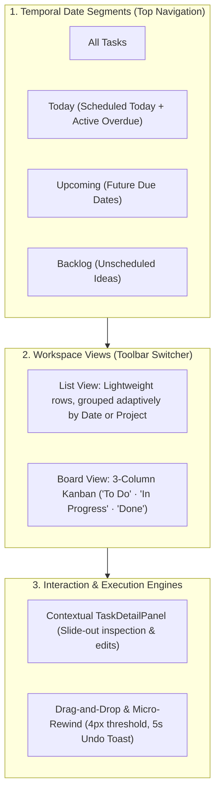

# Tasks & Inbox UI Specification

**Status:** Approved

## 1. Problem

Productivity OS needs a dedicated workspace for capturing, organizing, and
managing tasks.

The Tasks workspace should support both deliberate task management and fast
capture through the Inbox while maintaining the calm, premium visual
language established by the Today workspace.

## 2. Goal

Create a desktop-first task workspace that allows users to:

- Quickly capture tasks.
- Browse tasks.
- Search and filter tasks.
- Distinguish Inbox tasks from organized tasks.
- Understand task status at a glance.
- Open task details without leaving the workspace.
- Perform common task actions quickly.
- Move naturally between Inbox and organized task views.

The UI should feel lightweight and fast rather than like a traditional
project-management table.

## Executive Summary & Mental Model



| Component | Responsibility | Key Invariant |
| :--- | :--- | :--- |
| **Date Segments** | High-level temporal filtering (`ALL`, `TODAY`, `UPCOMING`, `BACKLOG`) | Overdue tasks remain active in `TODAY`; counts reactively update across tabs. |
| **List View** | Dense scannable task rows | Grouped adaptively (Upcoming by Date; Backlog by Project). |
| **Board View** | 3-Column Kanban workflow ("To Do", "In Progress", "Done") | Fluid drag-and-drop with 4px click/drag disambiguation and optimistic undo. |
| **Context Panel** | Zero-navigation task inspection and modification | Opened on card click; updates server via full-replace `PUT /api/v1/tasks/{id}`. |

## 3. Design Direction

Follow the existing Productivity OS visual direction:

**Calm Command Center**

The screen should feel:

- Premium
- Focused
- Calm
- Fast
- Information-dense without being cluttered

Reuse the visual language from the Today screen.

Do not introduce a separate visual design system.

## 4. Layout

The Tasks workspace uses:

```
┌────────────┬───────────────────────────────────────────┐
    │            │                                           │
    │ Navigation │ Task Workspace                            │
    │            │                                           │
    │            │ Header                                    │
    │            │                                           │
    │            │ Filters / Search                          │
    │            │                                           │
    │            │ Task List                                 │
    │            │                                           │
    │            │                                           │
    └────────────┴───────────────────────────────────────────┘
```

When a task is selected:

```
┌────────────┬──────────────────────────────┬─────────────┐
    │ Navigation │ Task List                    │ Task Detail │
    └────────────┴──────────────────────────────┴─────────────┘
```

The detail panel is contextual and should not require a page navigation.

## 5. Navigation

The application sidebar provides direct access to primary workspaces:
Today, Schedule, Tasks, Projects, Goals, and Settings.

The previous standalone `/inbox` route is retired; navigating to `/inbox` redirects to `/tasks`.
Tasks is visually highlighted whenever the user is in `/tasks`.

## 6. Tasks Header

The Tasks workspace header contains:

- Page title.
- Short contextual description.
- Search.
- Primary "New Task" action (with `<kbd>c</kbd>` shortcut badge).

Example:

```
Tasks
Everything you're working on.
[ Search tasks... ] [ + New Task c ]
```

## 7. Unified Task Date Segments (Today vs. Upcoming vs. Backlog)

Instead of a separate Inbox limbo state, all tasks are created directly in Planned status.
The Tasks workspace cleanly separates immediate actionable commitments from unscheduled backlog ideas using `dueDate`.
This directly serves the North Star user goal: **"Open the platform -> Know what to do -> Do it with intention and focus."**

### 7.1 Core Date Segments & Filtering Boundaries

The workspace establishes four first-class date segments:

1. **All (`ALL`):** Displays all active and planned tasks regardless of scheduling date, giving users a holistic panoramic view of their commitments.
2. **Today (`TODAY`):** Focuses strictly on immediate commitments for the current day.
   - Evaluated as `task.dueDate === todayISO` in the user's configured IANA timezone (ADR-006).
   - Also captures active overdue tasks (`task.dueDate < todayISO` where status is active, i.e. `PLANNED` or `IN_PROGRESS`) with a distinct overdue indicator, guaranteeing that past-due commitments are neither lost nor buried.
3. **Upcoming (`UPCOMING`):** Forward-looking schedule containing all tasks where `task.dueDate > todayISO`.
   - Organizes future commitments chronologically to assist in forward planning and calendar load balancing.
4. **Backlog (`BACKLOG`):** Unscheduled tasks where `task.dueDate === null`.
   - Stores queued ideas, aspirational work, and non-time-sensitive tasks safely without creating temporal stress or calendar clutter.

### 7.2 Top-Level Segmented Control & Reactive Badges

The date segments are rendered as a prominent segmented tab bar anchored directly below the page header and above secondary filters:

```
[ All (42) ] [ Today (5) ] [ Upcoming (12) ] [ Backlog (25) ]
```

- Each tab renders a reactive count badge reflecting the number of tasks in that segment.
- Selecting a segment smoothly filters the list without layout jank.
- Tab selection is keyboard-accessible with standard arrow-key navigation (`role="tablist"` / `role="tab"`).

### 7.3 Multi-Dimensional Filter Composition

The workspace composes filters in three clear, non-conflicting tiers:

1. **Primary Tier — Date Segment (`dateSegment`):** Filters tasks temporally (`ALL`, `TODAY`, `UPCOMING`, `BACKLOG`).
2. **Secondary Tier — Lifecycle Status (`statusFilter`):** Filters tasks by workflow state (`ALL`, `PLANNED`, `IN_PROGRESS`, `COMPLETED`).
3. **Tertiary Tier — Search Query (`searchQuery`):** Matches case-insensitive title tokens within the active temporal and lifecycle slice.

The active visible task set is the logical conjunction:

```typescript
visibleTasks = tasks.filter(
  (task) =>
    matchesDateSegment(task) &&
    matchesStatusFilter(task) &&
    matchesSearch(task),
);
```

The date segment counts reflect the total volume in each date bucket, providing an unwavering mental map of task distribution even when narrowing the view by status.

### 7.4 Quick Date Reschedule Actions

Users can re-anchor tasks in time with 1-click frictionless operations without opening the edit dialog:

- **"Today" Shortcut:** Sets `dueDate` to today's date (`todayISO`). Immediately pulls the task into Today's actionable commitments.
- **"Tomorrow" Shortcut:** Sets `dueDate` to tomorrow's date (`tomorrowISO`). Defers the task to tomorrow without dropping it into the backlog.
- **"Move to Backlog / Clear Date" Shortcut:** Clears `dueDate` to `null`. Parks the task in Backlog without cancelling or completing it.

These actions are surfaced in two key locations:

1. **Task List Row (`TaskListRow`):** Quick-action chip or dropdown button directly accessible on hover/focus.
2. **Task Detail Panel (`TaskDetailPanel`):** Dedicated quick reschedule button strip positioned immediately below the Due Date metadata field.

Each reschedule action persists the date change via backend `PUT /api/v1/tasks/{id}` (or store update in mock mode) and triggers immediate reactive repositioning across segments.

### 7.5 Adaptive Grouping per Segment

The workspace intelligently adapts its grouping strategy based on the active date segment to maximize cognitive clarity:

- **When viewing Upcoming:** The workspace automatically defaults to chronological **Date Grouping** (`groupMode = 'date'`), grouping tasks by calendar day ("Tomorrow", weekday, "Nov 15") so users can scan upcoming workloads day-by-day.
- **When viewing Backlog:** Because unscheduled tasks have no due date, date grouping is nonsensical. The workspace automatically adapts to **Project Grouping** (`groupMode = 'project'`), organizing backlog items by domain and context.
- **When viewing Today:** The list displays tasks in a single focused flow grouped by priority or status.
- **When viewing All:** The workspace defaults to Project Grouping while allowing users to toggle freely between Date and Project modes.

If a user explicitly toggles the view grouping button in the toolbar, their manual override is respected for the duration of the session.

### 7.6 Contextual Segment-Specific Empty States

When a selected segment contains no tasks, the workspace provides concise, encouraging empty states with relevant call-to-action buttons (see Section 18).

### 7.7 URL & Navigation State Preservation

The active date segment is synchronized bidirectionally with the URL query parameter `?segment=all|today|upcoming|backlog`:

- Navigating directly to `/tasks?segment=backlog` automatically activates the Backlog segment.
- Switching tabs updates the browser URL via `router.replace({ query: { ...route.query, segment } })` without triggering full page reloads.
- Browser forward and back buttons navigate seamlessly across previously visited segments.
- Landing on `/tasks` without a segment parameter activates the default segment (see Pre-Implementation Decision D2; recommended: `TODAY`).

## 8. Task List

Tasks are displayed primarily as lightweight rows (never heavy cards).

A task row may contain:

- Completion/status indicator.
- Task title.
- Project.
- Goal relationship where relevant.
- Status.
- Priority.
- Due information.
- Estimated duration.
- Overflow actions.

Example:

```
○ Finish authentication             IN PROGRESS
      Productivity OS                   Today · 1h 30m
```

Rows should have enough spacing to remain easy to scan.

### 8.1 Board View (3-Column Kanban Layout)

In addition to the primary List view, the Tasks workspace provides a 3-column Kanban Board layout ("To Do", "In Progress", "Done"), replacing the legacy date-grouped grid layout.

The Board view aligns with modern task management paradigms (Linear, Jira, Trello, Notion) while preserving the Calm Command Center design ethos:

```
┌────────────────────────┬────────────────────────┬────────────────────────┐
│ To Do (5)          [+] │ In Progress (2)    [+] │ Done (12)          [+] │
├────────────────────────┼────────────────────────┼────────────────────────┤
│ ┌────────────────────┐ │ ┌────────────────────┐ │ ┌────────────────────┐ │
│ │ Task Card          │ │ │ Task Card          │ │ │ Completed Card     │ │
│ │                    │ │ │                    │ │ │ (muted, struck)    │ │
│ └────────────────────┘ │ └────────────────────┘ │ └────────────────────┘ │
│ ┌────────────────────┐ │                        │                        │
│ │ Task Card          │ │                        │                        │
│ └────────────────────┘ │                        │                        │
└────────────────────────┴────────────────────────┴────────────────────────┘
```

#### 8.1.1 Column Mapping & Lifecycle States

The 3 columns represent the fundamental active workflow lifecycle states:

1. **"To Do" Column (`PLANNED`, `INBOX`):**
   - Contains all planned tasks awaiting execution, as well as any captured inbox items.
   - Represents the active queue of actionable commitments.
2. **"In Progress" Column (`IN_PROGRESS`):**
   - Contains tasks currently being actively worked on or in an active focus session.
   - Highlights immediate focus to avoid multitasking and work-in-progress overload.
3. **"Done" Column (`COMPLETED`):**
   - Displays completed tasks for the active date segment with muted styling, checked indicators, and strike-through titles.
   - Provides visible momentum and daily accomplishment records.

Cancelled tasks (`CANCELLED`) and soft-deleted tasks are excluded from the active board view.

#### 8.1.2 Integration with Date Segments

The 3-column Kanban board operates seamlessly within the active Date Segment (`ALL`, `TODAY`, `UPCOMING`, `BACKLOG`):

- **"Today's Kanban":** Displays commitments for today across To Do, In Progress, and Done.
- **"Backlog Kanban":** Displays unscheduled ideas and queued backlog items across To Do, In Progress, and Done.
- **"Upcoming Kanban":** Displays scheduled future tasks across the 3 workflow columns.
- **"All Kanban":** Provides a comprehensive panoramic board across all scheduled and unscheduled commitments.

Moving a task between columns transitions its lifecycle status without modifying its `dueDate`.

#### 8.1.3 Responsive Behavior & Layout Structure

- **Desktop (>= 1024px):** Three equal-width columns (`grid-template-columns: repeat(3, minmax(0, 1fr))`) stretching across the full content width, sharing screen space harmoniously.
- **Compact Viewports (< 1024px):** Board gracefully shifts into a horizontal scroll container (`overflow-x: auto`) with snap alignment (`scroll-snap-type: x mandatory`), ensuring each column maintains a comfortable minimum readable width (min 320px) without cramped text or clipping.
- **Toolbar View Toggle:** The view toggle in the page toolbar allows switching instantly between **List** (`viewMode = 'list'`) and **Board** (`viewMode = 'board'`). The secondary grouping toggle (Date vs. Project) is active in List mode; in Board mode, tasks are naturally and decisively partitioned by workflow state.

#### 8.1.4 Task Board Card Anatomy (`TaskBoardCard`)

Each card within a column provides immediate scannability without visual clutter:

- **Completion Checkbox:** Interactive circular checkbox allowing 1-click completion toggle.
- **Title:** Bold, high-contrast task title (struck through and muted in the Done column).
- **Project Pill:** Subtly tinted chip indicating project association with project dot color.
- **Metadata Chips:** Compact icons and labels for due date/overdue badge, scheduled time (`formatClockTime`), duration estimate (`formatMinutes`), and recurrence.
- **Priority Indicator:** Segmented priority indicator (`TaskPrioritySegments`) on the right.
- **Card Surface & Interactions:** Surface elevated with subtle borders; hover highlights border; clicking (without drag) opens the contextual `TaskDetailPanel`.

### 8.2 Drag-and-Drop Lifecycle State Transitions & Interaction Model

The Kanban board features smooth, tactile drag-and-drop interactions built with zero heavy external dependencies, utilizing native pointer events and accessible keyboard reordering.

#### 8.2.1 Pointer Distance Threshold (Click vs. Drag Disambiguation)

To prevent accidental drags when a user intends to select a card to open the `TaskDetailPanel`:

- A **4-pixel movement threshold** is enforced on pointer down.
- If the pointer releases within a 4-pixel radius of the initial down position, the interaction is treated strictly as a **Card Click**, opening or closing the contextual detail panel.
- Once pointer movement exceeds 4 pixels, **Drag Mode** is engaged: pointer capture is established, detail panel opening is suppressed, and visual drag feedback activates.

#### 8.2.2 Visual Drag Feedback & Target Indicators

During an active drag:

- **Elevated Preview:** The dragged card elevates with an enhanced shadow (`box-shadow: var(--shadow-panel)`), a subtle scale magnification (`scale(1.025)`), an accent border highlight (`border-color: var(--accent-border)`), and a tilt angle for physical tactile feel.
- **Source Placeholder:** The original card slot remains visible with reduced opacity (40%) and dashed outline, keeping the column geometry stable.
- **Drop Target Column:** The column container hovered over reflects an active drop-target state with a subtle accent background wash and border illumination.
- **Drop Insertion Marker:** A horizontal drop indicator line (`var(--accent-strong)`) appears at the exact insertion point between cards, showing where the card will land if dropped.
- **Motion:** Reordering cards within or across columns utilizes a FLIP (First, Last, Invert, Play) transition or Vue `<TransitionGroup>` for buttery 60fps animations.

#### 8.2.3 Backend Lifecycle Transitions on Drop

When a card is dropped into a target column, the application initiates the sanctioned backend API transition matching the column state:

| Source Column | Target Column | Backend API Endpoint Dispatched | Lifecycle Transition |
| :--- | :--- | :--- | :--- |
| **To Do** | **In Progress** | `POST /api/v1/tasks/{id}/start` | `PLANNED -> IN_PROGRESS` |
| **To Do** | **Done** | `POST /api/v1/tasks/{id}/completion` | `PLANNED -> COMPLETED` |
| **In Progress** | **To Do** | `POST /api/v1/tasks/{id}/plan` *(status demotion)* | `IN_PROGRESS -> PLANNED` |
| **In Progress** | **Done** | `POST /api/v1/tasks/{id}/completion` | `IN_PROGRESS -> COMPLETED` |
| **Done** | **In Progress** | `POST /api/v1/tasks/{id}/uncompletion` (`targetStatus: "IN_PROGRESS"`) | `COMPLETED -> IN_PROGRESS` |
| **Done** | **To Do** | `POST /api/v1/tasks/{id}/uncompletion` (`targetStatus: "PLANNED"`) | `COMPLETED -> PLANNED` |

- **Optimistic State & Undo:** The UI immediately moves the card to the target column and displays the global **Undo Toast** (Section 15.5) with a 5-second countdown.
- **Error Recovery:** If the backend rejects the transition (e.g. 409 Conflict or network loss), the card snaps back to its original column, and an error message is displayed.

#### 8.2.4 Keyboard Reordering & Accessible Grab-Move-Drop

Full accessibility compliance without pointer device dependency:

- **Grab:** Focusing a card and pressing <kbd>Space</kbd> or <kbd>Enter</kbd> activates "Grabbed" mode.
- **Move Columns:** Pressing <kbd>ArrowLeft</kbd> or <kbd>ArrowRight</kbd> shifts the grabbed card to the adjacent column ("To Do" ↔ "In Progress" ↔ "Done").
- **Move Position:** Pressing <kbd>ArrowUp</kbd> or <kbd>ArrowDown</kbd> reorders the card within the column.
- **Drop / Commit:** Pressing <kbd>Space</kbd> or <kbd>Enter</kbd> commits the move, triggering the status transition API call and releasing the card.
- **Cancel:** Pressing <kbd>Escape</kbd> cancels the move, restoring the card to its original position without network requests.
- **Screen Reader Announcements:** An `aria-live="assertive"` region announces grab state, current column position, and final drop confirmation.

## 9. Task Status

Status should be visually clear but restrained.

Supported lifecycle states from Task Management:

- INBOX
- PLANNED
- IN_PROGRESS
- COMPLETED
- CANCELLED

The frontend must not redefine lifecycle rules.

The backend remains the source of truth for valid transitions.

## 10. Filters

The workspace should provide lightweight filtering.

Initial filter concepts:

- All
- Inbox
- Planned
- In Progress
- Completed

Additional filters may include:

- Project
- Goal
- Priority
- Due date

Filters should not dominate the interface.

## 11. Search

Search should be visually accessible from the task workspace.

Search should support finding tasks by title.

The UI should provide:

- Search input.
- Clear action.
- Empty result state.
- Loading state where applicable.

Keyboard shortcuts may be added later.

## 12. Task Creation

The primary "New Task" action should make task capture extremely fast.

Preferred interaction:

```
+ New Task
```

opens a lightweight creation interface.

The creation interface should initially contain:

- Title.
- Optional description.
- Optional project.
- Optional goal.
- Optional priority.
- Optional due date.
- Optional duration.
- Destination: Inbox, Plan for today, or Start now (see 12.1).

The first visual milestone may use mock submission.

The interface should be designed so the real Task API can be connected later.

### 12.1 Initial State & Optional Scheduling

All tasks are created directly in the Planned state. The previous Inbox
destination is retired.

Scheduling options during creation:

- **No date (Default):** Creates an unscheduled Planned task in Backlog.
- **Plan for today:** Sets `dueDate` to today's date.
- **Start now:** Creates the task and immediately transitions `PLANNED → IN_PROGRESS`.

Due date is completely optional on all tasks. If a chained transition fails,
the task remains visible in its actual lifecycle state.

## 13. Global Quick Capture

Users can quickly capture ideas and tasks from anywhere in the application
by pressing <kbd>c</kbd>, opening the lightweight task creation dialog.

The interaction minimizes unnecessary fields so the user can capture the thought
instantly and stay in flow without context switching.

## 14. Task Detail Panel

Selecting a task opens the contextual detail panel.

The panel may contain:

- Title.
- Description.
- Lifecycle status.
- Project.
- Goal.
- Priority.
- Due date.
- Estimated duration.
- Created time.
- Completion time where applicable.
- Focus action.
- Task actions.

Example:

```
Finish authentication
```

```
IN PROGRESS
```

```
Build JWT authentication and refresh-token
    handling.
```

```
Project
    Productivity OS
```

```
Priority
    High
```

```
Duration
    1h 30m
```

```
──────────────────────────
```

```
[ Start Focus ]
```

```
[ Complete ]
```

```
...
```

The panel should remain visually consistent with the Today contextual
panel.

## 15. Task Actions

Common actions should be accessible without navigating away.

Potential actions:

- Plan.
- Start.
- Complete.
- Cancel.
- Reopen.
- Delete.
- Restore.
- Move to project.
- Change priority.
- Edit task.

### 15.3 Cancel and Reopen (amended)

A task in any active state — Inbox, Planned, or In Progress — can be
cancelled from the UI. Cancelling is a deliberate action and must use a
confirmation step, but it must not require deleting the task: "stop working
on this" and "delete this" are distinct operations.

The backend `cancellation` endpoint is the only path to Cancelled; the UI
requests it and renders the result. A Cancelled task remains visible with
reduced emphasis (consistent with Completed treatment) and exposes a
**Reopen** action, which requests the backend `reopening` transition
(Cancelled → Planned).

Restore of deleted tasks stays out of scope for this milestone
(Section 17).

### 15.1 One-click Start (amended)

Starting work on a task must be a single, obvious action available wherever
the task appears: the task row/card action menu and the task detail panel.

A single **Start** action means "I am working on this now":

- On a Planned task, Start requests the backend `start` transition
  (Planned → In Progress).
- On an Inbox task, Start is still one click for the user. The UI requests
  the sanctioned backend transitions in sequence (`plan`, then `start`) as
  one user-initiated operation. The intermediate Planned state is never
  shown as a separate required step.
- The Start action must not be buried so that the primary path to working
  on a task requires opening a context menu twice.

The task detail panel's primary action follows the same rule:

- If the task is active but not In Progress (Inbox or Planned), pressing
  **Start focus session** first moves the task to In Progress using the
  chaining above, then proceeds to focus. It must not dead-end with only a
  message telling the user to start the task elsewhere.
- Only Completed or Cancelled tasks are ineligible, and the panel should
  communicate why.

### 15.2 Backend authority

The UI must not implement lifecycle transitions independently.

It should request the operation and respond to the backend result. Chained
operations use only existing backend transition endpoints; no client-side
state invention.

### 15.4 Task Uncompletion and Status Demotion (amended)

Tasks are no longer trapped in terminal states:

- **Uncompletion:** Completed tasks display an active checkmark that can be
  toggled. Clicking an already-completed checkbox or selecting "Uncomplete" in
  the action menu / detail panel requests `POST /api/v1/tasks/{id}/uncompletion`.
  By default, the task returns to `IN_PROGRESS` (or `PLANNED` if preferred)
  with its completion timestamp cleared.
- **Status Demotion / Reorganization:**
  - Tasks in `IN_PROGRESS` expose a "Demote to Planned" / "Pause" action in the
    overflow menu and detail panel, requesting `POST /api/v1/tasks/{id}/demote`.
  - Tasks in `PLANNED` expose a "Return to Inbox" action in the overflow menu
    and detail panel, requesting `POST /api/v1/tasks/{id}/demote`.
  - Demotion allows users to reorganize tasks non-destructively without
    cancelling or deleting them.

### 15.5 Production Micro-Rewind & Undo Toast (amended)

The client-side undo functionality is promoted from mock-only to full production
API support:

- When a task is completed, cancelled, planned, or demoted in real API mode, the
  store captures a snapshot in `lastUndoable`.
- An **Undo Toast** appears anchored at the bottom-center of the screen with a
  **5-second countdown timer**.
- The toast displays:
  - An icon indicating the action (e.g. checkmark for completion, arrow for
    demotion/reopening).
  - Clear descriptive text: e.g. "Task completed: Buy groceries".
  - A visual progress bar or countdown chip that shrinks smoothly over
    5 seconds.
  - A prominent "Undo" action button.
- Clicking "Undo" before the timer expires immediately executes the inverse
  API transition:
  - Undoing completion calls `POST /api/v1/tasks/{id}/uncompletion`.
  - Undoing cancellation calls `POST /api/v1/tasks/{id}/reopening`.
  - Undoing planning/demotion calls the respective forward or backward endpoint.
- If the countdown reaches zero or the user triggers another destructive
  mutation, the toast quietly fades out and the undo snapshot is discarded.

## 16. Completed Tasks

Completed tasks should remain visually distinguishable:

- Reduced visual emphasis.
- Completion indicator (interactive checkbox allowing 1-click uncompletion).
- Completed status badge.
- Optional completion timestamp.

Completed tasks must not be treated as unchangeable dead ends. Clicking the
checked completion indicator triggers task uncompletion with an accompanying
undo toast.

## 17. Deleted Tasks

Deleted tasks are soft-deleted according to Task Management.

Normal active task views should not display deleted tasks.

If a future deleted-task view is provided, deleted tasks may expose a Restore
action.

The first UI milestone does not need a dedicated deleted-task workspace.

## 18. Empty States

Empty states should remain concise, calm, and actionable. They adapt directly to the active date segment and filter context:

### 18.1 Today Segment Empty

```
All caught up for today.
```

```
No tasks scheduled for today. Pull tasks from your backlog or enjoy the calm.
```

```
[ + Schedule for Today ]
```

### 18.2 Upcoming Segment Empty

```
No upcoming tasks.
```

```
Your future schedule is clear. Plan ahead by scheduling dates on your tasks.
```

```
[ + Plan a Task ]
```

### 18.3 Backlog Segment Empty

```
Backlog is clear.
```

```
All your tasks are scheduled on the calendar. Capture new ideas anytime.
```

```
[ + Capture Task ]
```

### 18.4 All Tasks Empty

```
No tasks yet.
```

```
Capture something you're thinking about.
```

```
[ + New Task ]
```

### 18.5 Filter & Search Empty

```
No tasks found.
```

```
Nothing matches your active filter or search query.
```

```
[ Clear search / filters ]
```

### 18.6 Board Column Empty States

When viewed in Board mode, individual columns that contain zero tasks display calm, encouraging placeholders reflecting the column's role:

- **"To Do" Column Empty:**
  - Message: *"Queue is clear. Capture or schedule work to plan ahead."*
  - Action: `[ + Add to To Do ]` (opens creation dialog configured for `PLANNED`).
- **"In Progress" Column Empty:**
  - Message: *"Nothing in progress. Drag tasks here when you start focusing."*
  - Action: `[ + Start a Task ]` (opens creation dialog configured for `IN_PROGRESS`).
- **"Done" Column Empty:**
  - Message: *"No completed tasks yet. Finish a task to see your momentum here."*

## 19. Loading States

Use localized loading states.

Examples:

- Task list skeleton.
- Search loading indicator.
- Task detail loading.
- Creation submission state.
- Action-level loading.

Avoid replacing the entire workspace with a full-screen spinner.

## 20. Error States

Errors should be:

- Clear.
- Concise.
- Recoverable where possible.

Examples:

- Unable to load tasks.
- Task could not be created.
- Task could not be updated.
- Task is no longer available.

Do not expose raw backend exceptions.

## 21. Responsive Behavior

Desktop is the primary experience.

At smaller desktop widths:

- Detail panel may collapse.
- Filters may condense.
- Sidebar may reduce.

The task list remains the primary workspace.

Full mobile optimization is not part of this milestone.

## 22. Visual Hierarchy

The hierarchy should be:

```
Page
      ↓
    Search + New Task
      ↓
    Filters
      ↓
    Task List
      ↓
    Task Metadata
```

Avoid giving every metadata field equal visual weight.

Task titles should remain the strongest element within each row.

## 23. Motion

Use subtle motion for:

- Opening detail panel.
- Closing detail panel.
- Task creation.
- Task completion.
- Filtering.
- Reordering where applicable.

Avoid decorative animation.

## 24. Reusable Components

Where appropriate, create reusable components such as:

- TaskRow
- TaskList
- TaskBoardColumn
- TaskBoardCard
- TaskStatus
- TaskPriority
- TaskDetailPanel
- TaskActionMenu
- TaskSearch
- TaskFilters
- NewTaskDialog
- QuickCapture
- EmptyState
- LoadingState

Do not over-abstract simple UI elements.

## 28. Dependencies

- Frontend UI Specification
- Task Management Specification
- User Management Specification
- ADR-002 — Technology Stack
- ADR-005 — API Architecture
- ADR-006 — Time and Timezone

## 29. Open Questions

1. Should task creation use a modal, side panel, or inline composer?
2. Should Inbox and Tasks share the same list component?
3. Should filtering use URL query parameters?
4. Should task search eventually support keyboard shortcuts?
5. Should completed tasks appear in the default Tasks view?
6. Should the task detail panel remain open when navigating between tasks?
7. *(Resolved in Plan 019)* Should users be able to drag tasks between lifecycle/group sections? Yes, resolved via 3-column Kanban board ("To Do", "In Progress", "Done") with drag-and-drop and keyboard transitions.

These should be resolved through visual iteration rather than extensive
upfront architecture decisions.

## 30. Change History

- **2026-11-13 (Plan 019 — 3-Column Kanban Board Layout & Drag-and-Drop):**
  Amended Section 8 with Section 8.1 "Board View (3-Column Kanban Layout)" (replacing
  date-grid with 3 columns: To Do, In Progress, Done; responsive horizontal scroll under 1024px;
  date segments integration; board card anatomy) and Section 8.2 "Drag-and-Drop Lifecycle
  State Transitions & Interaction Model" (4px pointer threshold disambiguating clicks from drags,
  elevated preview, column drop target indicators, FLIP transitions, API transition mapping,
  and keyboard grab-move-drop reordering); added Section 18.6 defining column empty states;
  resolved Open Question 7; added reusable components `TaskBoardColumn` and `TaskBoardCard`;
  added Acceptance Criteria `AC-UI-018` through `AC-UI-023`.

- **2026-11-12 (Actionable 2 — Date Segments: Today vs. Upcoming vs. Backlog):**
  Amended Section 7 into unified date segments ("All", "Today", "Upcoming", "Backlog");
  added Sections 7.1–7.7 defining temporal filtering boundaries, reactive count badges,
  multi-dimensional coexistence with status filters, quick date rescheduling actions on
  both row and detail panel, adaptive grouping, and URL query preservation (`?segment=...`);
  updated Section 18 with segment-specific contextual empty states; added formal
  Acceptance Criteria section with `AC-UI-001`–`AC-UI-005` (from Plan 014) and
  `AC-UI-010`–`AC-UI-017` (Date Segments).

- Amended per Option 2 (Two-Tier Rewind Engine & Rituals): added Section 15.4
  "Task Uncompletion and Status Demotion" (enabling interactive checkbox toggle
  for completed tasks and demotion actions), added Section 15.5 "Production
  Micro-Rewind & Undo Toast" (promoting undo from mock-only to full production
  API with a 5-second countdown timer), and updated Section 16 to specify
  interactive uncompletion on completed tasks.

- Initial Draft created for the Tasks and Inbox frontend experience.
- Amended per human request to simplify starting work: added Section 15.1
  "One-click Start" — a single Start action on Inbox/Planned tasks (UI chains
  the sanctioned plan → start transitions), and the detail panel's
  "Start focus session" starts the task instead of dead-ending with a message.
- Amended per human request to allow creating tasks directly into Planned or
  In Progress: added Section 12.1 "Creation destination" — New Task dialog
  gains an Inbox / Plan for today / Start now choice; UI chains sanctioned
  transitions after create; backend create contract unchanged.
- Amended to wire up Cancel and Reopen: added Section 15.3 — Cancel available
  on Inbox/Planned/In Progress tasks with confirmation (uses the backend
  cancellation endpoint), Cancelled tasks expose Reopen (backend reopening
  endpoint). Previously these endpoints had no UI path at all.

## 31. Acceptance Criteria

### AC-UI-001 — Interactive Uncompletion on Completed Task Rows

Given a task in `COMPLETED` status displayed in the task list
When the user clicks the checked completion indicator or selects "Uncomplete"
Then the task transitions back to active status (`IN_PROGRESS` or `PLANNED`)
And the completed timestamp is cleared
And an Undo Toast is displayed.

### AC-UI-002 — Backend Uncompletion API Call

Given the user triggers uncompletion on a completed task in real API mode
When the action is processed
Then `POST /api/v1/tasks/{id}/uncompletion` is dispatched with `targetStatus`
And upon server confirmation, the task is updated in the local store.

### AC-UI-003 — Global Reactive Undo Toast

Given a task mutation occurs (completion, cancellation, planning, or demotion)
When the mutation succeeds
Then an Undo Toast appears anchored at the bottom-center of the screen
And the toast identifies the action and task title
And the toast exposes a clickable "Undo" button.

### AC-UI-004 — Undo Toast 5-Second Countdown

Given an Undo Toast is displayed
When 5 seconds elapse without user interaction
Then the toast smoothly fades out and the undo snapshot is discarded.

### AC-UI-005 — Reverting Mutation via Undo

Given an active Undo Toast with remaining time on its countdown
When the user clicks the "Undo" button
Then the corresponding inverse API transition is dispatched immediately
And the task is restored to its previous state in the store.

### AC-UI-010 — Top-Level Date Segmented Control with Reactive Count Badges

Given a user viewing the Tasks workspace (`/tasks`)
When the page is rendered
Then four primary date segment tabs are displayed prominently above the task list: "All", "Today", "Upcoming", and "Backlog"
And each tab displays a reactive count badge indicating the total number of tasks belonging to that segment
And the currently active segment is visually highlighted with active tab styling
And keyboard navigation allows cycling through tabs using arrow keys.

### AC-UI-011 — Exact Date Filtering Rules and Overdue Inclusion

Given the user selects a date segment
When the segment filter is evaluated:

- If "Today" is active, visible tasks include all tasks where `task.dueDate === todayISO`, plus active tasks (`status !== 'COMPLETED' && status !== 'CANCELLED'`) where `task.dueDate < todayISO` (overdue tasks)
- If "Upcoming" is active, visible tasks include all tasks where `task.dueDate > todayISO`
- If "Backlog" is active, visible tasks include all tasks where `task.dueDate === null`
- If "All" is active, all tasks are included regardless of due date
  Then tasks not matching the selected temporal criteria are excluded from the view.

### AC-UI-012 — Multi-Dimensional Coexistence with Status Filters and Search

Given an active date segment (e.g. "Backlog")
When the user selects a lifecycle status filter (e.g. "Planned") or enters a search query
Then visible tasks are filtered by the logical conjunction: `matchesDateSegment(task) && matchesStatusFilter(task) && matchesSearch(task)`
And date segment tabs remain accessible and switchable without losing the active search query or status filter.

### AC-UI-013 — Quick Date Reschedule Actions on Task Row

Given a task row in the task list
When the user triggers the quick reschedule controls on the row
Then 1-click shortcuts are available:

- "Today" (sets `dueDate = todayISO`)
- "Tomorrow" (sets `dueDate = tomorrowISO`)
- "Move to Backlog" / "Clear Date" (sets `dueDate = null`)
  And selecting an option immediately invokes `tasksStore.setDueDate(taskId, newDate)`, updates the task's due date, adjusts segment count badges reactively, and persists the update via `PUT /api/v1/tasks/{id}`.

### AC-UI-014 — Quick Date Reschedule Actions on Task Detail Panel

Given a task is open in the contextual `TaskDetailPanel`
When viewing the due date section of the panel
Then quick reschedule action buttons ("Today", "Tomorrow", "Move to Backlog") are displayed alongside the custom date selector
And clicking any quick reschedule button immediately updates the task's `dueDate`, reflects the updated due date in the panel, and updates the task's position and segment badge counts.

### AC-UI-015 — Contextual Segment-Specific Empty States

Given a date segment is selected and contains zero matching tasks
When the task list renders the empty state
Then the empty state displays segment-specific title, description, and primary CTA:

- For "Today": Title "All caught up for today.", Description "No tasks scheduled for today. Pull tasks from your backlog or enjoy the calm.", CTA "+ Schedule for Today"
- For "Upcoming": Title "No upcoming tasks.", Description "Your future schedule is clear. Plan ahead by scheduling dates on your tasks.", CTA "+ Plan a Task"
- For "Backlog": Title "Backlog is clear.", Description "All your tasks are scheduled on the calendar. Capture new ideas anytime.", CTA "+ Capture Task"
- For "All": Title "No tasks yet.", Description "Capture something you're thinking about.", CTA "+ New Task".

### AC-UI-016 — Adaptive Grouping per Segment

Given the user navigates between date segments
When switching to the "Upcoming" segment, the workspace automatically defaults to chronological Date grouping (`groupMode = 'date'`)
And when switching to the "Backlog" segment, the workspace automatically adapts to Project grouping (`groupMode = 'project'`) since unscheduled tasks have no date
And if the user manually changes the grouping toggle (`Date` vs `Project`), their explicit manual choice is preserved for the remainder of their session.

### AC-UI-017 — URL Query Parameter Synchronization and Navigation State Preservation

Given the user is on the Tasks page
When a date segment is selected (e.g. "Upcoming")
Then the URL query parameter updates to `?segment=upcoming` via `router.replace` without full page reload
And when arriving at `/tasks?segment=backlog` from a direct link, bookmark, or browser reload, the "Backlog" segment is activated on load
And clicking browser Back/Forward transitions between the previously visited segments reactively.

### AC-UI-018 — 3-Column Kanban Board Layout (To Do, In Progress, Done)

Given a user viewing the Tasks workspace (`/tasks`)
When the user toggles the view layout to "Board" in the toolbar
Then the date-grid layout is replaced by a 3-column Kanban board displaying:
- "To Do" column containing active `PLANNED` and `INBOX` tasks
- "In Progress" column containing `IN_PROGRESS` tasks
- "Done" column containing `COMPLETED` tasks
And each column displays a header with column title, reactive task count badge, and quick "+ New Task" creation trigger
And on viewports under 1024px width, the board enables smooth horizontal scrolling with scroll-snap without layout clipping or text overlap
And the board respects the active top Date Segment ("All", "Today", "Upcoming", "Backlog") and search query.

### AC-UI-019 — Drag-and-Drop Lifecycle State Transitions

Given a task card displayed in any Kanban column
When the user drags the task card from its source column and drops it onto a different target column
Then the task transitions to the lifecycle state of the target column:
- Dropping into "To Do" sets status to `PLANNED` via `POST /api/v1/tasks/{id}/plan` (from In Progress) or `POST /api/v1/tasks/{id}/uncompletion` with target `PLANNED` (from Done)
- Dropping into "In Progress" sets status to `IN_PROGRESS` via `POST /api/v1/tasks/{id}/start` (from To Do) or `POST /api/v1/tasks/{id}/uncompletion` with target `IN_PROGRESS` (from Done)
- Dropping into "Done" sets status to `COMPLETED` via `POST /api/v1/tasks/{id}/completion`
And the task card immediately moves to the target column
And an Undo Toast is displayed allowing the user to revert the transition within 5 seconds
And if the backend rejects the transition, the card reverts to its source column with an error notification.

### AC-UI-020 — Disambiguating Click (Open Details) from Drag

Given a task card in the Kanban board
When the user clicks or taps on the card without moving the pointer more than 4 pixels
Then the contextual `TaskDetailPanel` opens for that task
And no drag interaction or reordering is initiated
When the user presses down and moves the pointer beyond the 4-pixel distance threshold
Then drag mode is initiated and clicking/toggling the detail panel is suppressed upon pointer release.

### AC-UI-021 — Visual Drag Feedback and Drop Target Indicators

Given an active drag-and-drop interaction on a task card
When the card is being dragged:
- The dragged preview card renders with elevated shadow (`box-shadow: var(--shadow-panel)`), slight scaling (`scale(1.025)`), and accent border (`border-color: var(--accent-border)`)
- The source placeholder card renders with reduced opacity (40%) and dashed border
- When hovering over a target column, the column container highlights with subtle surface tint and accent border
- An insertion marker (horizontal accent line or indicator slot) clearly indicates the target drop zone within the column
And when dropped, the cards reorder with a smooth FLIP transition.

### AC-UI-022 — Keyboard Reordering & Status Transition (Grab-Move-Drop)

Given a focused task card in the Kanban board
When the user presses <kbd>Space</kbd> or <kbd>Enter</kbd>
Then the card enters "Grabbed" state, announced via `aria-live`
And pressing <kbd>ArrowLeft</kbd> or <kbd>ArrowRight</kbd> moves the grabbed card across columns ("To Do" ↔ "In Progress" ↔ "Done"), with tasks within each column ordered deterministically (pinned tasks top, followed by alphabetical title ordering)
And pressing <kbd>Space</kbd> or <kbd>Enter</kbd> commits the drop, triggering the corresponding status transition API call and exiting grab mode
And pressing <kbd>Escape</kbd> cancels the grab operation and returns the card to its original position without state changes.

### AC-UI-023 — Column-Specific Empty States & Quick Creation

Given a Kanban column with zero matching tasks within the active date segment
When the column renders
Then a calm, column-specific empty placeholder is displayed:
- For "To Do": "Queue is clear. Capture or schedule work to plan ahead."
- For "In Progress": "Nothing in progress. Drag tasks here when you start focusing."
- For "Done": "No completed tasks yet. Finish a task to see your momentum here."
And clicking the column header "+ New Task" button opens the task creation dialog pre-configured with the corresponding column destination (`PLANNED` for To Do, `IN_PROGRESS` for In Progress) and current date segment `dueDate`.
